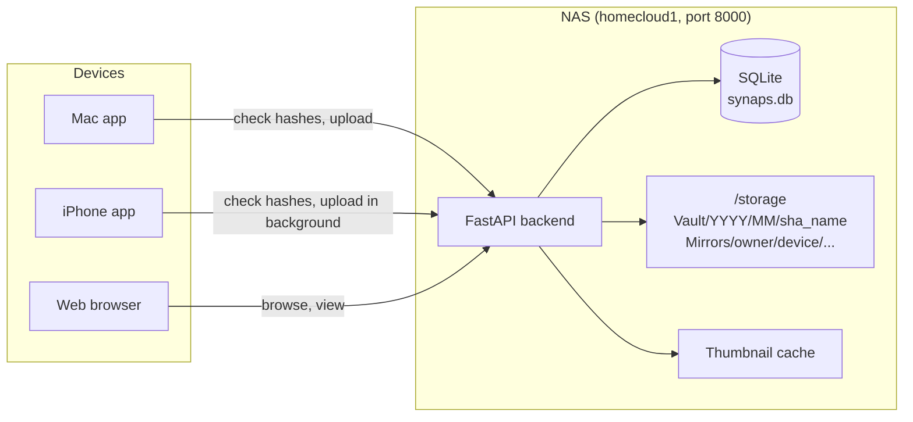
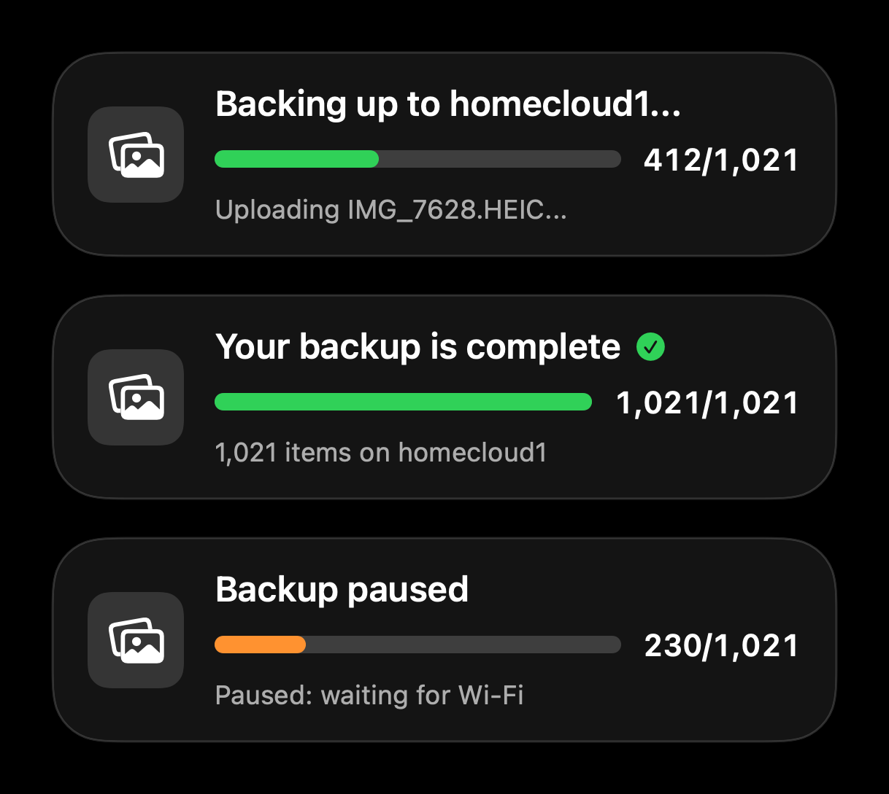

<div align="center">

# Synaps

**A self-hosted photo and file cloud for a home NAS, with native Mac and iPhone apps.**

Back up your iPhone and Mac to a computer you own, browse everything from either device, and see at a glance what is already safe on the NAS. No subscriptions, nothing leaves your network.

[](https://github.com/harshoutoftokens/synaps/actions/workflows/ci.yml)
[](docs/project/versioning.md)
[](backend/)
[](clients/mac/SynapsMac/)
[](clients/ios/SynapsiOS/)
[](frontend/)

[How it works](#how-it-works) · [Features](#features) · [Getting started](#getting-started) · [Deployment](#deployment) · [Documentation](#documentation)

</div>

---

## What it is

Synaps turns an old PC into a personal cloud. The one it was built for is a 15-year-old Core 2 Duo with 2 GB of RAM running Ubuntu Server. It has four parts:

| Part | What it does | Code |
|---|---|---|
| **NAS backend** | FastAPI + SQLite server. Stores every file once (named by its SHA-256), deduplicates across devices, generates thumbnails, and serves the API and the web app on port 8000. | [`backend/`](backend/) |
| **Mac app** | A Finder-style app. Shows your Mac folders with a green tick on every file that is already on the NAS, syncs the rest, browses the NAS ("Home Cloud"), and imports from an iPhone over USB. | [`clients/mac/SynapsMac/`](clients/mac/SynapsMac/) |
| **iPhone app** | An Apple Photos–style app. Backs up the photo library automatically on home Wi-Fi, even in the background, and shows progress on the Lock Screen. | [`clients/ios/SynapsiOS/`](clients/ios/SynapsiOS/) |
| **Web dashboard** | Browser access to the NAS: timeline, folder browser, search, trash and settings. | [`frontend/`](frontend/) |

## How it works



1. **Hash first, upload second.** An app computes each file's SHA-256 and asks the NAS which ones it already has (`/api/v2/ingest/check`). Anything the NAS already holds, from any device, is linked instantly with zero bytes sent.
2. **Stream the rest.** New files are streamed to the NAS (`PUT /api/v2/ingest/stream`), verified against the hash, and stored once in the vault. A hardlink mirror under `Mirrors/` recreates each device's folder structure without using extra space.
3. **Show the state.** Each app keeps a local database of what is committed, so the green ticks appear instantly. Photos that reached the NAS another way, such as through the Mac, are matched by name and size (`/api/v2/ingest/match`).

The full picture is in the [overview](docs/01-overview.md) and the [storage and ingest](docs/03-storage-and-ingest.md) guide.

## Features

**iPhone app**
- Timeline of the whole photo library with a green tick (on the NAS) or red cross (not yet) on every item
- Automatic backup on home Wi-Fi only, with an optional charging-only mode; uploads continue while the app is in the background
- Live Photos, videos and edited versions backed up as separate files
- Lock Screen progress while backing up:

  

- Browse the NAS vault from the phone

**Mac app**
- Finder-like icon and list views, selection, sorting, kind grouping and Quick Look
- Green ticks for files already on the NAS, and one-click sync for the rest
- "Home Cloud": browse the NAS with thumbnails
- Import photos from an iPhone connected over USB

**NAS backend**
- Content-addressed storage: one copy of each file however many devices upload it
- Fast thumbnails (WebP) for photos, HEIC and video, generated in a bounded background queue
- Downloads with HTTP Range support (video seeking) and caching
- Optional API token; uploads confined to the storage folder; SQLite in WAL mode

**Web dashboard**
- Timeline, folder browser, search, trash and settings; served by the backend as static files, so the NAS doesn't run Node.js

## Repository layout

```
synaps                  one command for install, dev, test, update, deploy (run ./synaps help)
backend/                FastAPI server: main.py, routers/, scanner, thumbnails, storage engine
  ├─ migrations/        one-off database migrations
  ├─ scripts/           maintenance scripts (thumbnail preheat, cleanup, audits)
  └─ tests/             pytest suite
frontend/               Next.js web dashboard (exported as static files in production)
clients/mac/SynapsMac/  macOS app (SwiftUI, Swift Package)
clients/ios/SynapsiOS/  iPhone app (SwiftUI, Xcode project + Live Activity widget)
deploy/                 systemd units, sudoers rule, Bonjour advertisement used by ./synaps install
docs/                   guides; start at docs/README.md
.github/workflows/      CI
```

## Getting started

**Requirements:** Python 3.10+, Node 18+, ffmpeg. On a Mac: Xcode or the Command Line Tools.

### Run it locally

```bash
git clone https://github.com/harshoutoftokens/synaps.git
cd synaps
./synaps dev        # backend on :8000 + web app on :3000 (Ctrl+C stops both)
./synaps test       # backend tests, web lint + build, Mac app tests
```

Without a `backend/.env`, the backend stores everything in `mock_storage/`. That folder is git-ignored and starts empty, so add a few photos to it (or fill it with [`copy_sample_media.py`](backend/scripts/copy_sample_media.py)) to see something in the web app. Settings such as the storage path, API token and owner name are listed in [`backend/.env.example`](backend/.env.example).

### Build the apps

```bash
./synaps mac        # builds SynapsMac.app and opens it
./synaps ios        # opens the iPhone project in Xcode: pick your iPhone, set your Team, Run
```

> **Mac app look:** build the Mac app with your Mac's default toolchain (Command Line Tools). Xcode 27's default Swift build system marks the app as built with the macOS 14 SDK, and macOS 26 then shows it without the Liquid Glass design. Check a build with `vtool -show-build clients/mac/SynapsMac/SynapsMac.app/Contents/MacOS/SynapsMac`; it should report `sdk 26.x` or newer. Details in the [Mac app guide](docs/08-mac-app.md).

## Deployment

On the NAS (Ubuntu), one command sets everything up: packages, the Python environment, the web app, systemd services, mDNS so the NAS answers as `<hostname>.local`, and a timer that keeps the NAS up to date.

```bash
git clone https://github.com/harshoutoftokens/synaps.git ~/nas_dashboard
cd ~/nas_dashboard
./synaps install --storage /storage
./synaps doctor     # every check should say ok
```

After that, deploying is merging to `main`:

1. Every push and pull request runs [CI](.github/workflows/ci.yml): backend tests, web build, Mac tests and the iPhone build.
2. Every 5 minutes the NAS checks `main`. It deploys a new commit only after CI has passed, rebuilds only what changed, backs up the database, restarts, and health-checks.
3. If anything fails, the NAS rolls back automatically and skips that commit until a newer one lands.

`./synaps status`, `./synaps logs` and `./synaps rollback` cover day-to-day operation. See [deployment](docs/11-deployment.md) and [operations](docs/12-operations.md).

## Documentation

Start with the [documentation index](docs/README.md). The guides:

| Guide | Covers |
|---|---|
| [Overview](docs/01-overview.md) | How the pieces fit together, glossary |
| [Backend](docs/02-backend.md) | Server structure, settings, auth, background jobs |
| [Storage and ingest](docs/03-storage-and-ingest.md) | Vault layout, dedup, the upload pipeline |
| [Database](docs/04-database.md) | Tables, indexes, migrations, backups |
| [Scanner and timeline](docs/05-scanner-and-timeline.md) | How the web timeline is built |
| [Thumbnails and media](docs/06-thumbnails-and-media.md) | Thumbnails, previews, downloads |
| [Web dashboard](docs/07-web-dashboard.md) | The Next.js app |
| [Mac app](docs/08-mac-app.md) | SynapsMac internals |
| [iPhone app](docs/09-iphone-app.md) | SynapsiOS internals, background sync, Lock Screen progress |
| [API reference](docs/10-api-reference.md) | Every endpoint |
| [Deployment](docs/11-deployment.md) | `./synaps`, systemd, CI/CD |
| [Operations](docs/12-operations.md) | Health checks, backups, maintenance scripts, troubleshooting |
| [Code walkthroughs](docs/13-code-walkthroughs.md) | End-to-end traces through the code |

Project notes: [changelog](CHANGELOG.md) · [roadmap and known issues](docs/project/roadmap.md) · [history](docs/project/history.md) · [versioning](docs/project/versioning.md)

## License

No license file has been added yet, so all rights are reserved by default. To let others use the code, add a `LICENSE` file (for example MIT).
