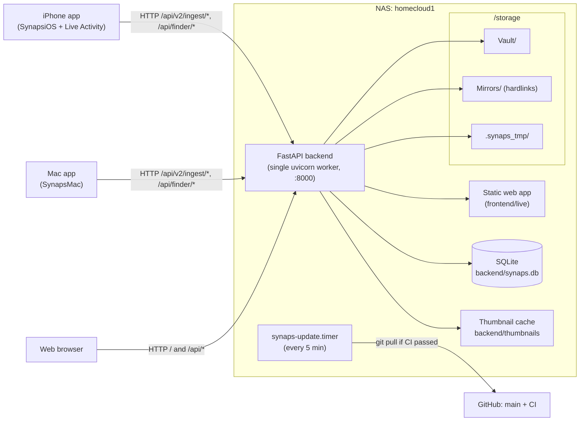

# Overview

Synaps is a self-hosted photo and file cloud that runs on an old PC acting as a NAS (network-attached storage). A Python backend on the NAS stores files on a big disk, keeps a SQLite catalog of them, and serves an API plus a web dashboard. A native macOS app syncs Mac folders to it and a native iPhone app backs up the photo library. This page explains the pieces, how data moves between them, and where each part lives in the repository.

## The hardware and why it shapes everything

The NAS is a Core 2 Duo with 2 GB of RAM running Ubuntu Server 22.04, host name `homecloud1`. Two slow cores and little memory explain most design choices you will see in the code:

- **One backend process.** The API runs as a single uvicorn worker, so in-process locks are enough to serialize writes (see [02-backend.md](02-backend.md)).
- **SQLite instead of a database server.** No extra daemon, one file to back up (see [04-database.md](04-database.md)).
- **No Node.js server in production.** The web dashboard is exported to static files and served by the backend itself.
- **Work is done once and cached.** Clients hash files before uploading, so the NAS can skip content it already has; thumbnails are generated by a single background worker and cached on disk.

## Components

| Component | Where | What it does |
|---|---|---|
| NAS backend | [`backend/`](../backend/) | FastAPI app with SQLAlchemy over SQLite. Receives uploads, stores them on disk, browses the storage folder, builds thumbnails, serves the web app. |
| Storage root | `/storage` on the NAS (`SYNAPS_STORAGE_PATH`) | The disk with all files: `Vault/`, `Mirrors/`, `Imports/`, and hidden work folders. |
| Web dashboard | [`frontend/`](../frontend/) | Next.js app (timeline, Finder-style browser, search, sync/upload, trash, settings), statically exported and served at `/` by the backend. |
| Mac app | [`clients/mac/SynapsMac`](../clients/mac/SynapsMac) | SwiftUI app built with SwiftPM. Syncs chosen Mac folders to the NAS and browses the NAS. |
| iPhone app | [`clients/ios/SynapsiOS`](../clients/ios/SynapsiOS) | SwiftUI app (Xcode project) that backs up the photo library. A widget extension in `Widgets/` shows backup progress as a Live Activity on the Lock Screen. |
| Deploy pipeline | [`synaps`](../synaps), [`deploy/`](../deploy/), [`.github/workflows/ci.yml`](../.github/workflows/ci.yml) | One script for install/update/rollback/doctor/dev/test/deploy, systemd units, mDNS advertisement, CI. |

### Storage layout

Everything the user owns lives under the storage root. The backend never stores user files anywhere else, apart from its thumbnail cache and trash folder.

| Path (relative to storage root) | Contents |
|---|---|
| `Vault/YYYY/MM/<sha16>_<name>` | Canonical copies of every file uploaded by the Mac and iPhone apps. `<sha16>` is the first 16 hex characters of the file's SHA-256, so two different files with the same name never collide. Year and month come from the capture date. |
| `Vault/<Owner>/Iphone/YYYY/MM/...` | Files uploaded from the web dashboard's Sync page and files moved in by the Import Manager (older photos go to `Old_Photos/`). |
| `Vault/<Owner>/...`, `Vault/Windows_laptop-HP/...` | Older per-device folders from before the content-addressed vault. Still indexed by the scanner. |
| `Mirrors/<Owner>/Mac/...`, `Mirrors/<Owner>/Iphone/...` | Hardlinks that recreate each device's original folder structure, pointing at the canonical vault files. |
| `Imports/<owner>/Iphone/` | Drop folder for the manual Import Manager. |
| `.synaps_tmp/` | Staging area for uploads in progress. |
| `.synaps_trash/` | Trash fallback used when the configured trash folder is on another disk. |

`<Owner>` is `SYNAPS_OWNER_NAME` (default `Harsh`). See [03-storage-and-ingest.md](03-storage-and-ingest.md) for the full details.

## Architecture

The NAS runs avahi, so it answers on the local network as `homecloud1.local`, and [`deploy/avahi/synaps.service`](../deploy/avahi/synaps.service) also advertises a `_synaps._tcp` Bonjour service. The apps reach the NAS by its address or that `.local` name: the Mac app tries `192.168.0.105`, `192.168.0.101` and `homecloud1.local`, and neither app browses for the Bonjour service yet.

## Main data flows

### iPhone photo to NAS

The iPhone app reads assets from the photo library and computes each file's SHA-256 on the phone. It sends batches of hashes and original paths to `POST /api/v2/ingest/check`. For each hash the NAS already has, the backend just records that this device also owns the file ("dedup linked") and creates a mirror hardlink; nothing is transferred. For the rest, the app uploads the bytes with `PUT /api/v2/ingest/stream`.

The backend streams the body into `.synaps_tmp/`, hashing as it writes, and rejects the upload if the hash does not match the one the client sent. It then reads the capture date (EXIF, video metadata or file name), renames the file into `Vault/YYYY/MM/<sha16>_<name>`, writes the database rows, creates the mirror under `Mirrors/<Owner>/Iphone/` (the folder is picked from the device's name and platform by `get_mirror_base_for_source()`), and queues a thumbnail. Album memberships are sent separately to `POST /api/v2/ingest/albums`. The app also calls `POST /api/v2/ingest/match` with file names and sizes to mark photos as backed up when they already reached the NAS another way (for example through the Mac).

### Mac folder to NAS

The Mac app follows the same protocol: hash locally, `ingest/check` in batches, upload only what is missing via `ingest/stream`. Its mirrors land in `Mirrors/<Owner>/Mac/`, where the original path is shortened by dropping `/Users/<name>/` (so `~/Downloads/a.pdf` mirrors to `Mirrors/<Owner>/Mac/Downloads/a.pdf`). Unlike the timeline, the Mac sync is not limited to photos and videos: any file type is stored.

### Browsing the NAS

The web dashboard's Finder page and the native apps' browsers call `/api/finder/browse`, `/api/finder/thumbnail` and `/api/finder/download`. These read the real directory tree under the storage root, so `Mirrors/` shows each device's original folder structure. Every path a client sends is checked so it cannot escape the storage root. Thumbnails of mirror files reuse the canonical vault file's thumbnail.

### Web timeline

The Timeline page calls `GET /api/media` (alias `/api/media/timeline`), which reads only the v1 `media_files` table, sorted by `date_taken`, grouped by month. Photos taken before 2024 (`ARCHIVE_CUTOFF_YEAR`) are grouped into an "Archive" bucket. Thumbnails and full files come from `/api/media/thumbnail/{id}` and `/api/media/file/{id}`; HEIC photos are converted to JPEG previews for browsers. See [05-scanner-and-timeline.md](05-scanner-and-timeline.md) and [06-thumbnails-and-media.md](06-thumbnails-and-media.md).

## Two catalogs: v1 and v2

The database holds two models of the same files.

**v1 (`media_files`)** is the original catalog: one row per media file path on disk, with date, type and hash. It is filled by the filesystem scanner (`POST /api/scan`), by the web Sync upload, and by the Import Manager. The web timeline, search, favorites and trash all read it. It only contains photos and videos.

**v2** is the content-addressed model introduced for the native apps. It separates *what the bytes are* from *where they came from*: one `physical_objects` row per unique SHA-256, any number of `logical_items` rows recording which device had that content at which path, a per-device folder tree in `filesystem_nodes`, plus `sources`, `albums` and `media_metadata`.

Both exist because the web features were built on v1 and still query it, while v2 is what makes dedup across devices and provenance tracking possible. They are bridged in one direction: when an upload creates a new physical object that is a photo or video, `upsert_v1_media_file()` in [`backend/routers/ingest_v2.py`](../backend/routers/ingest_v2.py) also writes a `media_files` row, so uploads from the apps appear in the web timeline immediately. The automatic scan at startup is disabled; scans are started manually. See [04-database.md](04-database.md).

## Glossary

| Term | Meaning |
|---|---|
| Storage root | The folder holding all user files (`SYNAPS_STORAGE_PATH`, `/storage` on the NAS). |
| Vault | `Vault/` under the storage root. For v2, the single canonical copy of each file at `Vault/YYYY/MM/<sha16>_<name>`. |
| Mirror | A hardlink under `Mirrors/` that shows a device's original folder layout. A hardlink is a second directory entry for the same file on disk, so it takes no extra space. If hardlinking fails, a relative symlink is used instead. |
| Source | A registered device (row in `sources`), identified by an id the client chooses, with a platform such as `macOS` or `iOS`. |
| Physical object | One unique piece of content, keyed by SHA-256, stored once in the vault (`physical_objects`). |
| Logical item | One device's record of a file: source, original path, original name, timestamps (`logical_items`). Many logical items can point at one physical object. |
| Staging | Writing an upload to `.synaps_tmp/` first and moving it into the vault only after it is complete and its hash verified. Stale staging files are swept away after 6 hours. |
| Commit / committed | Server side: the database transaction that makes an upload permanent, done after the file is safely in the vault. In the apps, "committed" is the state shown for an item the NAS confirmed it holds. |
| Dedup | Deduplication: not storing or transferring content the NAS already has. v2 dedups by full SHA-256 before upload; the web Sync upload dedups by SHA-256 after receiving the file. |

## Repository map

| Path | Contents |
|---|---|
| [`backend/`](../backend/) | FastAPI app: `main.py`, `config.py`, `database.py`, `models.py` (v1), `models_v2.py` (v2), `storage_engine.py` (staging, vault placement, mirrors), `node_manager.py` (folder tree), `scanner.py`, `thumbnails.py`, `import_manager.py`. |
| [`backend/routers/`](../backend/routers/) | API endpoints, one module per area (media, finder, sync, search, trash, settings, imports, ingest_v2). |
| [`backend/migrations/`](../backend/migrations/) | One-off schema/data migration scripts. |
| [`backend/scripts/`](../backend/scripts/) | One-off maintenance scripts (duplicate audit, stale record cleanup, thumbnail preheating, mirror restructuring, ...). See [12-operations.md](12-operations.md). |
| [`backend/tests/`](../backend/tests/) | pytest suite run by `./synaps test` and CI. |
| [`frontend/`](../frontend/) | Next.js web dashboard (`src/app` pages, `src/components`, `src/lib` API client and stores). |
| [`clients/mac/SynapsMac/`](../clients/mac/SynapsMac/) | macOS app (SwiftPM package, `bundle_app.sh` builds the `.app`). |
| [`clients/ios/SynapsiOS/`](../clients/ios/SynapsiOS/) | iPhone app (Xcode project, `Sources/`, `Widgets/` Live Activity extension). |
| [`deploy/`](../deploy/) | systemd units (backend, update service and timer, optional Node frontend), Avahi mDNS service, sudoers rule. |
| [`synaps`](../synaps) | The single command-line tool for install, update, rollback, status, logs, doctor, dev, test, deploy. |
| [`.github/workflows/`](../.github/workflows/) | CI: backend tests, web lint and static build, deploy tooling checks, Mac and iPhone builds. |
| [`docs/`](.) | This documentation; project history, roadmap and versioning under `docs/project/`. |
| `mock_storage/` | Git-ignored local storage root used in development (the default `SYNAPS_STORAGE_PATH`). |

## Deployment in one paragraph

`./synaps install` sets up the NAS once: Python venv, static web build, systemd units, the update timer, and mDNS. After that, `synaps-update.timer` runs `./synaps update` about every 5 minutes. It fetches `origin/main`, deploys only if every GitHub check for the new commit passed, backs up the database when backend code changed, rebuilds what changed, restarts, health-checks, and rolls back automatically on failure. See [11-deployment.md](11-deployment.md).

## Where to go next

- [README.md](README.md): index of all docs.
- [02-backend.md](02-backend.md): how the FastAPI app is put together.
- [03-storage-and-ingest.md](03-storage-and-ingest.md): vault, staging, mirrors and the upload pipeline.
- [04-database.md](04-database.md): every table, indexes, migrations, backups.
- [05-scanner-and-timeline.md](05-scanner-and-timeline.md): the filesystem scanner and the web timeline.
- [06-thumbnails-and-media.md](06-thumbnails-and-media.md): thumbnails, HEIC previews, streaming.
- [07-web-dashboard.md](07-web-dashboard.md), [08-mac-app.md](08-mac-app.md), [09-iphone-app.md](09-iphone-app.md): the three clients.
- [10-api-reference.md](10-api-reference.md): every endpoint.
- [11-deployment.md](11-deployment.md), [12-operations.md](12-operations.md): running and maintaining the NAS.
- [13-code-walkthroughs.md](13-code-walkthroughs.md): step-by-step traces through the code.
- [project/roadmap.md](project/roadmap.md), [project/history.md](project/history.md), [project/versioning.md](project/versioning.md).
