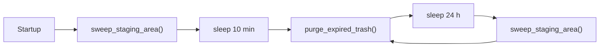

# Backend

The backend is a single FastAPI application in [`backend/`](../backend/) that runs as one uvicorn process on the NAS. It owns the SQLite database, every file under the storage root, the thumbnail cache, and it also serves the static web dashboard. This page walks through how the app starts, how requests are authenticated, how configuration works, what each router does, and how work is spread across threads on a two-core machine.

## Process and entry point

Production runs `backend/venv/bin/python main.py` from the `backend/` folder (see [`deploy/systemd/synaps-backend.service`](../deploy/systemd/synaps-backend.service)). The bottom of [`backend/main.py`](../backend/main.py) calls `uvicorn.run("main:app", host=HOST, port=PORT, reload=False)`, which means one worker process. That is deliberate: on a Core 2 Duo a second worker would mostly compete for the same two cores, and a single process lets plain `threading.Lock`s serialize database writes and scans.

The unit loads `backend/.env` as an `EnvironmentFile`, waits for the storage mount (`RequiresMountsFor`), restarts on failure, and runs at `Nice=-2` so the API stays responsive while builds run at low priority. `./synaps dev` runs the same `main.py` on a Mac next to the Next.js dev server.

## Application setup in `main.py`

`main.py` builds the app in this order:

1. Configure logging and attach `_RedactTokenFilter` to `uvicorn.access`, which replaces `?token=...` in access-log lines with `***`.
2. Create `FastAPI(title="Synaps", version="1.0.0", lifespan=lifespan)`.
3. Add `APITokenMiddleware`, then `CORSMiddleware` (added last, so it wraps the token check).
4. Include the eight routers.
5. Register `/api/health`, `/health` and `POST /api/scan`.
6. If `SYNAPS_FRONTEND_DIST` is set, mount the static web app at `/` via `mount_frontend()`.

### Lifespan (startup)

`lifespan()` runs once at startup:

- `init_db()` creates missing tables, adds missing nullable columns and creates extra indexes (see [04-database.md](04-database.md)).
- Creates the thumbnail, trash and import-source folders if missing.
- Starts the `synaps-housekeeping` daemon thread.
- Logs whether token auth is on.

There is no automatic scan at startup. The comment in the code explains why: in v2 the scanner's garbage collection must not run unattended against the canonical vault. Scans are started with `POST /api/scan`.

### Background housekeeping

`_housekeeping_loop()` runs in one daemon thread:



- **Staging sweep:** `sweep_stale_staging()` in [`backend/storage_engine.py`](../backend/storage_engine.py) deletes files in `.synaps_tmp/` older than 6 hours (`STAGING_MAX_AGE_SECONDS`), left by aborted uploads or crashes.
- **Trash purge:** `cleanup_expired()` from [`backend/routers/trash.py`](../backend/routers/trash.py) deletes trash items past their 30-day retention. The first run waits 10 minutes (`TRASH_PURGE_START_DELAY_SECONDS`) so thumbnail traffic after a restart settles first.

Both functions catch and log their own errors, so the loop never dies.

### Scan single-flight

`POST /api/scan` tries `_scan_lock.acquire(blocking=False)`. If a scan is already running it returns `{"status": "scan_already_running"}`; otherwise it starts `scan_directory()` in a daemon thread and returns `{"status": "scan_started"}`. The lock is released when the scan finishes, whatever the outcome. See [05-scanner-and-timeline.md](05-scanner-and-timeline.md).

### API token middleware

`APITokenMiddleware` is written as pure ASGI (a class with `__call__(scope, receive, send)`) rather than Starlette's `BaseHTTPMiddleware`. Pure ASGI does not wrap the response body, so large streamed uploads and file downloads pass through untouched.

Rules:

- If `config.API_TOKEN` is empty, everything is open. The value is read on every request, so tests can change it at runtime.
- Only paths starting with `/api/` are protected. `/health` and the web app are always open.
- Exempt: any `OPTIONS` request (CORS preflight) and `GET`/`HEAD` on `/api/health`.
- The token is accepted in any of three places, compared with `hmac.compare_digest` (constant time):
  - `Authorization: Bearer <token>` (native apps),
  - cookie `synaps_token=<token>` (web app; surrounding double quotes are stripped),
  - query parameter `?token=<token>` (for ``/`<video>` URLs that cannot send headers).
- Otherwise the response is `401 {"detail": "unauthorized"}` with `WWW-Authenticate: Bearer`.

### CORS

The web app normally talks to the API from the same origin (served by the backend, or proxied by Next's rewrites in dev), and native apps ignore CORS. The one cross-origin case is direct uploads from the `next start` dashboard on port 3000 to port 8000. So CORS is narrow by default:

- **Default:** credentialed requests allowed only from origins matching `DEFAULT_CORS_ORIGIN_REGEX`: port 3000 on localhost, `127.x`, `10.x`, `172.16-31.x`, `192.168.x`, Tailscale `100.64/10`, and `*.local` names.
- **`SYNAPS_CORS_ORIGINS`** (comma-separated exact origins) replaces that default regex.
- **`*` in `SYNAPS_CORS_ORIGINS`** allows any origin but turns credentials off.
- **`SYNAPS_CORS_ORIGIN_REGEX`** sets the pattern explicitly (empty means none).

Because CORS wraps the token middleware, preflights are answered before auth and even a 401 carries CORS headers, so the browser can read the error.

### Serving the web app

When `SYNAPS_FRONTEND_DIST` points at a directory (the install script sets it to `frontend/live`), `mount_frontend()` appends a `FrontendMount` at `/` serving `FrontendStaticFiles`. Two details matter:

- `FrontendStaticFiles` never answers `api` paths with a page, so an unknown API path keeps its JSON 404. It also falls back from `/x` to `x.html` for exports built without trailing slashes.
- `FrontendMount.matches()` refuses `/api` and `/api/*`. A mount at `/` would otherwise "fully match" every path, and Starlette prefers that over a route that only matched the path but not the method. Without this, `GET` on a PUT-only route would return the web app's 404 instead of 405. The Mac app relies on the 405 to detect support for `PUT /api/v2/ingest/stream`.

The mount is added after all API routes so it is matched last. If the directory is missing, a warning is logged and the API still works.

### Health endpoint

`GET`/`HEAD` on `/api/health` and `/health` return:

```json
{"status": "ok", "app": "Synaps", "version": "1.0.0", "name": "homecloud1"}
```

`name` is `socket.gethostname()` up to the first dot. The apps display it instead of the NAS's IP address. `./synaps update` and `./synaps status` use this endpoint to check that a restarted backend is healthy.

## Configuration

[`backend/config.py`](../backend/config.py) calls `load_dotenv()`, so values come from real environment variables first and `backend/.env` second. [`backend/.env.example`](../backend/.env.example) lists them with comments. Defaults reproduce a single-user development setup.

| Setting | Default | Meaning |
|---|---|---|
| `SYNAPS_STORAGE_PATH` | `<repo>/mock_storage` | Storage root holding `Vault/`, `Mirrors/`, `Imports/`, `.synaps_tmp/`. `/storage` on the NAS (set by `./synaps install`). |
| `SYNAPS_DB_URL` | `sqlite:///<backend>/synaps.db` | SQLAlchemy database URL. |
| `SYNAPS_SQLITE_BUSY_TIMEOUT_MS` | `30000` | How long a writer waits for another writer before "database is locked". |
| `SYNAPS_THUMBNAIL_DIR` | `<backend>/thumbnails` | Thumbnail cache (HEIC previews go in its `previews/` subfolder). |
| `SYNAPS_TRASH_DIR` | `<backend>/trash` | Trash folder. If it is on a different filesystem than a file, `.synaps_trash/` on the storage disk is used instead. |
| `SYNAPS_HOST` / `SYNAPS_PORT` | `0.0.0.0` / `8000` | Listen address. |
| `SYNAPS_OWNER_NAME` | `Harsh` | Owner folder name in `Vault/<Owner>/...`, `Imports/<owner>/...`, `Mirrors/<Owner>/...`. |
| `SYNAPS_MIRROR_OWNER` | owner name | Top-level folder for mirrors. |
| `SYNAPS_SYNC_TARGET_DIR` | `<storage>/Vault/<Owner>/Iphone` | Where web Sync uploads go (in `YYYY/MM` subfolders). |
| `SYNAPS_IMPORT_SOURCE_DIR` | `<storage>/Imports/<owner>/Iphone` | Import Manager input folder. |
| `SYNAPS_IMPORT_DEST_DIR` | `<storage>/Vault/<Owner>/Iphone` | Import Manager destination. |
| `SYNAPS_EXCLUDED_PATHS` | empty | Extra comma-separated folders (relative to storage root) the scanner skips. Always skipped anyway: `Mirrors`, `.synaps_tmp`, `.synaps_trash`, `Vault/Windows_laptop-HP`, `Vault/<Owner>/Mac/Private`. |
| `SYNAPS_API_TOKEN` | empty (auth off) | Shared secret for `/api/*`. |
| `SYNAPS_CORS_ORIGINS` | empty | Exact origins allowed with credentials; replaces the LAN default. `*` = any origin, no credentials. |
| `SYNAPS_CORS_ORIGIN_REGEX` | LAN `:3000` pattern (empty if `SYNAPS_CORS_ORIGINS` is set) | Origin pattern for credentialed CORS. |
| `SYNAPS_FRONTEND_DIST` | empty | Static web export to serve at `/`. |
| `SYNAPS_MIN_FREE_BYTES` | `536870912` (512 MiB) | Uploads that would leave less free space are refused with 507. |
| `SYNAPS_THUMBNAIL_WORKERS` | `1` | Background thumbnail threads (read in [`backend/thumbnails.py`](../backend/thumbnails.py)). |
| `SYNAPS_THUMBNAIL_QUEUE_MAX` | `2000` | Max queued thumbnail jobs; oldest dropped beyond this. |
| `SYNAPS_PREVIEW_CACHE_MB` | `1024` | Disk budget for HEIC-to-JPEG previews. |

Some values are constants in `config.py`, not environment settings: `TRASH_RETENTION_DAYS = 30`, `ARCHIVE_CUTOFF_YEAR = 2024` (timeline "Archive"), `IMPORT_OLD_PHOTOS_CUTOFF = 2024`, `THUMBNAIL_SIZE = (320, 320)`, the media extension sets (`.jpg .jpeg .png .heic` and `.mp4 .mov`), and `SOURCE_MAPPING`, which maps folder names (`Iphone`, `Mac`, `Windows_laptop-HP`) to timeline source keys (`iphone`, `mac`, `windows`).

The deploy script has its own settings (`SYNAPS_BRANCH`, `SYNAPS_REQUIRE_CI`, `SYNAPS_WEB_MODE`, ...) in `.synaps.local`; see [11-deployment.md](11-deployment.md).

## Routers

All routers live in [`backend/routers/`](../backend/routers/). The full endpoint list with parameters is in [10-api-reference.md](10-api-reference.md).

| Router | Prefix | Purpose |
|---|---|---|
| [`media.py`](../backend/routers/media.py) | `/api/media` | Web timeline and gallery from `media_files` (offset paging, month grouping, source/type/date filters), item details, thumbnails, full files with HEIC-to-JPEG preview, video streaming with Range, favorites, library stats. Also provides `cached_file_response()` (ETag/Last-Modified/304) used by finder and trash. |
| [`finder.py`](../backend/routers/finder.py) | `/api/finder` | Browses the real folder tree under the storage root: paginated listings, directory tree, download (Range, HEAD, 304), thumbnails for any file. All paths go through `resolve_storage_path()`, which rejects `..` and NUL (400), hides dot-folders (404) and refuses anything whose real path leaves the storage root (403). Thumbnails still being generated return 202 with `Retry-After`. |
| [`ingest_v2.py`](../backend/routers/ingest_v2.py) | `/api/v2` | The native apps' upload protocol: `ingest/check` (dedup pre-check by SHA-256), `ingest/match` (name+size lookup), `ingest/stream` (raw streamed upload), `ingest/upload` (older multipart upload), `ingest/albums`; plus read APIs for sources, a source's virtual folder tree and albums. See [03-storage-and-ingest.md](03-storage-and-ingest.md). |
| [`sync.py`](../backend/routers/sync.py) | `/api/sync` | The web dashboard's upload path: single and batch uploads into `SYNAPS_SYNC_TARGET_DIR/YYYY/MM`, dedup by SHA-256 against `sync_records`, `media_files` and `physical_objects`, never overwriting a file; upload history and a duplicate check. |
| [`search.py`](../backend/routers/search.py) | `/api/search` | `LIKE` search over `media_files` (wildcards in the query are escaped) and suggestions. |
| [`trash.py`](../backend/routers/trash.py) | `/api/trash` | Move a `media_files` item to trash, list, restore (never overwriting), delete permanently, purge expired. Refuses (409) to trash v2 vault files, hardlinked files, symlinks and anything under `Mirrors/`. |
| [`settings.py`](../backend/routers/settings.py) | `/api/settings` | Reads settings (only `theme` is writable; server paths are reported read-only) and storage usage, with folder sizes computed in the background and cached for 10 minutes. |
| [`imports.py`](../backend/routers/imports.py) | `/api/import` | Import Manager: scan the import folder, preview, run an import job in the background, poll progress. Logic in [`backend/import_manager.py`](../backend/import_manager.py). |

## Threading model

Everything runs in one process, so concurrency comes from threads:

- **Request handlers.** Almost every endpoint is a plain `def`. FastAPI runs those in its worker thread pool, so a slow disk read does not block the event loop. The one `async def` endpoint is `PUT /api/v2/ingest/stream`: it reads the request body on the event loop and hands each ~1 MB batch to a worker thread (`run_in_threadpool` / `run_in_executor`) for writing and hashing, overlapping network receive with disk work on the second core. Hash checking, date extraction and the database commit also run via `run_in_threadpool`.
- **`_INGEST_LOCK`** in `ingest_v2.py` serializes the database and vault part of every v2 ingest (uploads, pre-checks, album sync). Without it, two concurrent uploads of the same content could both see "not found" and then collide on unique indexes. Slow steps (receiving, hashing, EXIF/ffprobe) happen outside the lock. Commits that still hit an `IntegrityError` are retried up to 3 times.
- **`_SYNC_LOCK`** in `sync.py` does the same for web uploads: dedup check, placement and record happen atomically.
- **`_scan_lock`** keeps at most one scan running.
- **Thumbnail workers** (`SYNAPS_THUMBNAIL_WORKERS`, default 1) render thumbnails from a bounded queue, separate from request threads. See [06-thumbnails-and-media.md](06-thumbnails-and-media.md).
- **Housekeeping** is the one daemon thread described above.

SQLite in WAL mode lets readers proceed while a writer commits, and `busy_timeout` makes a second writer wait instead of failing (see [04-database.md](04-database.md)).

## Error conventions

Errors are FastAPI `HTTPException`s, returned as JSON `{"detail": "..."}`.

| Status | When |
|---|---|
| 400 | Invalid input: bad path (`..`, NUL), not a file/folder, bad `client_sha256`, SHA-256 mismatch after upload, incomplete or too-long body, unsupported file type, unknown or read-only setting. |
| 401 | Missing or wrong API token (`{"detail": "unauthorized"}`). |
| 403 | Path resolves outside the storage root, or permission denied reading a folder. |
| 404 | Unknown id, file missing on disk, hidden path, thumbnail could not be generated. |
| 409 | Trash refuses: file is in the v2 vault, hardlinked, a symlink, under `Mirrors/`, or outside the storage root; no free name to restore to. |
| 411 | `PUT /api/v2/ingest/stream` without `Content-Length`. |
| 413 | `POST /api/v2/ingest/match` with more than 2000 files. |
| 500 | Unexpected failures (move/delete failed, stream error). |
| 503 | HEIC preview converter busy; comes with `Retry-After: 5`. |
| 507 | Not enough disk space: an upload would leave less than `SYNAPS_MIN_FREE_BYTES` free, or the disk filled up while writing (`ENOSPC`). |

Two non-error statuses are part of the contract too: 202 `{"status": "queued"}` with `Retry-After: 2` when a finder thumbnail is still being generated, and 304 when a cached file is still valid.

## Logs

The backend logs to stderr through Python `logging` (`%(asctime)s [%(name)s] %(levelname)s: %(message)s`, level INFO). Logger names follow the module, for example `synaps`, `synaps.ingest_v2`, `synaps.finder`, `synaps.database`. Under systemd, stderr goes to the journal: `./synaps logs [N]` shows the last N lines (default 100) of the backend, update and frontend units, or use `journalctl -u synaps-backend -f`. In `./synaps dev` the logs appear in the terminal.

Query-string tokens are redacted from uvicorn access logs by `_RedactTokenFilter`.

## Maintenance scripts

One-off maintenance scripts live in [`backend/scripts/`](../backend/scripts/) (duplicate audit, stale record cleanup, hash migration, thumbnail preheating, mirror restructuring and others). Schema and data migrations are in [`backend/migrations/`](../backend/migrations/). How and when to run them is covered in [12-operations.md](12-operations.md) and [04-database.md](04-database.md).

## Gotchas and limits

- **Single worker is assumed.** The ingest, sync and scan locks are per process. With more uvicorn workers, the unique indexes plus the `IntegrityError` retry still prevent duplicate rows, but scans and web uploads would no longer be serialized.
- **Token auth is all or nothing.** There are no users or permissions; anyone with the token has full access. Without a token, anyone on the network does.
- **`/health` and the web app's static files are never protected.** The web app checks auth through the API.
- **Startup scan is off.** Files copied straight onto the disk (outside the apps, Sync page and Import Manager) only appear in the timeline after `POST /api/scan`.
- **Housekeeping timing is relative to process start.** A backend that restarts often (for example on every deploy) runs the staging sweep often but may delay the trash purge, since the purge waits 10 minutes after each start.
