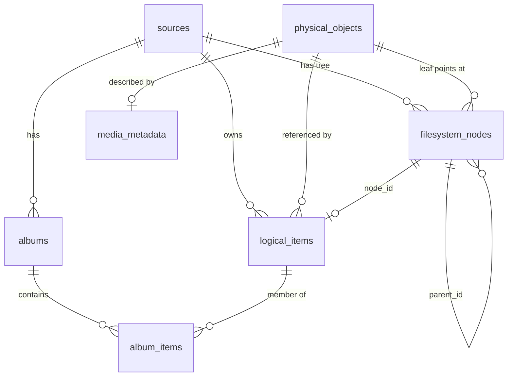
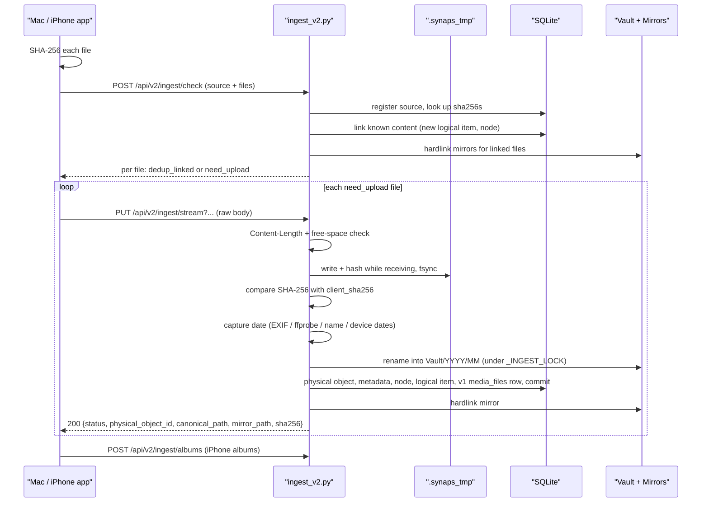

# Storage and Ingest

This is how files get onto the NAS and how they sit on disk once they are there. The Mac and iPhone apps upload through the "v2" ingest API in [`backend/routers/ingest_v2.py`](../backend/routers/ingest_v2.py): every file is stored once, under a name derived from its SHA-256 hash, and each device's view of its own folders is rebuilt from database rows and hardlinks. The older "v1" catalog (`media_files`) is kept in step so the web timeline shows app uploads too.

Related docs: [04-database.md](04-database.md) for the full schema, [05-scanner-and-timeline.md](05-scanner-and-timeline.md) for the v1 catalog, [06-thumbnails-and-media.md](06-thumbnails-and-media.md) for what happens after a file lands, [10-api-reference.md](10-api-reference.md) for every endpoint's parameters.

## The storage root

Everything lives under one directory, the storage root: `SYNAPS_STORAGE_PATH` in [`backend/config.py`](../backend/config.py) (`/storage` on the NAS, `mock_storage/` in a dev checkout).

```text
/storage
├── Vault/
│   ├── 2025/07/3f9a1c0d2b4e5f60_IMG_1234.HEIC   canonical v2 objects
│   ├── 2025/08/...
│   ├── Harsh/Iphone/2024/03/IMG_0042.JPG        older v1 layout (web Sync page, Import Manager)
│   └── Windows_laptop-HP/...                     older v1 layout (excluded from the scanner)
├── Mirrors/
│   ├── Harsh/Mac/Downloads/AWS/doc.pdf           hardlink to a Vault object
│   ├── Harsh/Iphone/Camera Roll/IMG_1234.HEIC
│   └── windows-pc/E/Himachal/2025/IMG001.jpg
├── Imports/harsh/Iphone/                         drop folder for the Import Manager
├── .synaps_tmp/                                  staging for uploads in progress
└── .synaps_trash/                                trash fallback on the storage disk
```

| Folder | What it holds | Who writes it |
|---|---|---|
| `Vault/YYYY/MM/<sha16>_<name>` | One canonical copy of every file uploaded by the apps. `<sha16>` is the first 16 hex characters of the SHA-256; `<name>` is the original file name passed through `sanitize_filename()`. | `place_in_vault()` in [`backend/storage_engine.py`](../backend/storage_engine.py) |
| `Vault/<Owner>/...` | Files from the v1 era: the web Sync page (`SYNAPS_SYNC_TARGET_DIR`, default `Vault/<Owner>/Iphone`) and the Import Manager (`SYNAPS_IMPORT_DEST_DIR`, same default). Named by their original file name, not by hash. | [`backend/routers/sync.py`](../backend/routers/sync.py), [`backend/import_manager.py`](../backend/import_manager.py) |
| `Mirrors/...` | Each device's original folder tree, made of hardlinks to Vault objects. Lets Finder or Explorer browse "my Mac's Downloads folder" over Samba. | `create_hardlink_mirror()` |
| `Imports/<owner>/Iphone` | Files you drop in by hand and then import from the web Import page. | You |
| `.synaps_tmp/` | Partial uploads named `<uuid>.upload<.ext>`. | `StagedUpload` |
| `.synaps_trash/` | Trashed files when `SYNAPS_TRASH_DIR` is on another filesystem than the file. | [`backend/routers/trash.py`](../backend/routers/trash.py) |

The Vault date folder comes from the file's capture date (EXIF, video metadata, file name, then the device's creation/modification time), so `Vault/2025/07/` means "taken in July 2025", not "uploaded in July 2025". The scanner skips `Mirrors`, `.synaps_tmp` and `.synaps_trash` (`EXCLUDED_PATHS` in config), because mirror entries are the same inodes as Vault files and would otherwise appear twice in the timeline. The Finder API hides every dot-folder.

### Mirror folder names

`get_mirror_base_for_source()` picks the top-level mirror folder from the source's friendly name and platform. `<Owner>` is `SYNAPS_MIRROR_OWNER` (defaults to `SYNAPS_OWNER_NAME`, default `Harsh`).

| Rule (checked in order) | Mirror base |
|---|---|
| "mac" in the friendly name, or platform contains "mac"/"darwin" | `<Owner>/Mac` |
| "iphone" or "ios" in the friendly name | `<Owner>/Iphone` |
| "gdrive" or "google" in the friendly name | `<Owner>/GoogleDrive` |
| "laptop" or "hp" in the friendly name | `Windows_laptop-HP` |
| "pc" or "win" in the friendly name | `windows-pc` |
| anything else | the sanitized friendly name |

Below the base, `normalize_source_path_for_mirror()` rewrites the device path: a Mac path loses its `/Users/<name>/` prefix, a Windows path `E:\A\b.jpg` becomes `E/A/b.jpg`, and an iPhone path such as `Camera Roll/IMG_1234.HEIC` is used as is.

## Why content addressing

Content addressing means the file's location is derived from a hash of its bytes. Synaps uses it for three reasons:

- **One copy on disk.** The same photo arriving from the iPhone, from a Mac folder it was AirDropped into, and again after a reinstall is stored once. Every later arrival only adds database rows and a hardlink.
- **Zero-transfer dedup.** A client can hash a file locally and ask the NAS whether it already has it before sending any bytes. On a slow NAS and Wi-Fi this skips most of a re-sync.
- **Provenance is kept separately.** Because the physical file has no device-specific name, the database can record every place a file came from (several devices, several paths) without copying it.

The cost is that `Vault/` itself is not pleasant to browse by hand, which is why `Mirrors/` exists.

## The v2 data model

The v2 tables are defined in [`backend/models_v2.py`](../backend/models_v2.py). The key idea is the split between a *logical item* (where a file came from) and a *physical object* (the bytes on disk).



| Table | One row per | Key columns |
|---|---|---|
| `sources` | device (Mac, iPhone, PC) | `id` (client-chosen string), `friendly_name`, `platform` (`macOS`, `iOS`, `Windows`), `volume_identifier`, `last_seen_at` |
| `physical_objects` | unique file content | `sha256` (unique), `file_size`, `physical_path` (relative to the storage root, unique), `mime_type`, `reference_count` |
| `logical_items` | file at a path on a device | `source_id`, `physical_object_id`, `node_id`, `original_path`, `original_filename`, `source_location`, `source_created_at`, `source_modified_at`, `imported_at`, `is_deleted_on_source` |
| `filesystem_nodes` | folder or file in a device's tree | `source_id`, `parent_id` (NULL = top level), `name`, `is_directory`, `physical_object_id` (files only); unique on `(source_id, parent_id, name)` |
| `media_metadata` | physical object | `capture_date`, `media_type`, `is_screenshot`, `is_screen_recording`, `is_favorite`, plus camera/size/GPS columns that ingest does not fill today |
| `albums`, `album_items` | album per source, membership link | `albums.name` + `source_id`; `album_items` unique on `(album_id, logical_item_id)` |

`reference_count` is "how many logical items point at this object". It is changed with SQL-side increments (`_apply_ref_deltas()`), so two writers cannot lose an update, and clamped at 0. Nothing reads it to delete files yet.

`filesystem_nodes` is an adjacency tree (each row points at its parent). It lets `GET /api/v2/sources/{id}/tree` list a folder with one indexed query instead of walking the disk. [`backend/node_manager.py`](../backend/node_manager.py) builds it: `split_original_path()` splits the device path (dropping `Users/<name>` on macOS), and `get_or_create_node_path()` walks or creates each component and points the leaf at the current physical object.

## Ingest end to end

The apps never write to disk paths directly. They hash locally, ask what is missing, and upload only that.



### 1. Pre-check: `POST /api/v2/ingest/check`

`check_ingest_batch()` takes a source registration and a batch of files, each with `original_path`, `original_filename`, `file_size`, `source_location`, `client_sha256`, optional `source_modified_at` and `is_favorite`. The apps send at most 200 files per request (iPhone `maxPartsPerWindow`; the Mac's `maxCheckBatchSize`), though the server sets no limit.

`_check_batch()` upserts the source (updating `friendly_name` and `last_seen_at`), then looks up all hashes and paths with a few chunked `IN` queries rather than several queries per file. For each file:

- **Hash unknown:** `need_upload`. Nothing is written for it.
- **Hash known:** `dedup_linked`. If this source has no logical item at that path, one is created and the object's reference count goes up. If it has one pointing at different content, it is re-pointed (see "Changed content" below). Either way the node tree is updated, a favorite flag is applied, and a mirror hardlink is queued.

The batch is committed, then the mirrors are created while still holding the ingest lock. The response carries `need_upload` and `dedup_linked` counts plus a per-file `results` list.

### 2. Upload: `PUT /api/v2/ingest/stream`

`upload_stream_v2()` takes the file as the raw request body and the metadata (`source_id`, `original_path`, `original_filename`, `source_location`, `client_sha256`, optional dates and `is_favorite`) in the query string. Raw body instead of multipart means no form parsing and each byte is written to disk exactly once.

The checks, in order:

1. `Content-Length` missing: **411**. Not an integer or negative: **400**.
2. `client_sha256` not 64 hex characters: **400**, before any body is read.
3. `ensure_free_space()`: if free space minus `Content-Length` would drop below `SYNAPS_MIN_FREE_BYTES` (default 512 MiB), **507**. A disk-full error (`ENOSPC`) while writing is also mapped to 507.
4. The body is streamed into a `StagedUpload` in `.synaps_tmp`. Chunks are batched (about 1 MB) and handed to a worker thread that writes and hashes them while the next batch is received, so both Core 2 Duo cores are used. A body longer or shorter than `Content-Length` is **400**; a client disconnect is **400** too.
5. `StagedUpload.finish()` flushes, fsyncs and returns the SHA-256 (plus an MD5 of the first 64 KB, the v1 `file_hash`). If it differs from `client_sha256`: **400** `SHA-256 mismatch`.

The staging file keeps the upload's extension, because the EXIF and ffprobe date readers pick their parser by extension. Whatever happens, the `finally` block calls `staged.discard()`, which is a no-op once the file has been renamed into the Vault.

### Fallback: `POST /api/v2/ingest/upload`

`upload_file_v2()` is the older multipart endpoint, with the same fields as form fields and the file as the `file` part. It copies Starlette's spooled temp file into a `StagedUpload` and from there shares the exact same pipeline and response. Both apps prefer the stream endpoint and fall back:

- The Mac app ([`NASClient.swift`](../clients/mac/SynapsMac/Sources/Services/NASClient.swift)) probes once per server with a `GET` on the PUT-only route: 405 means the route exists, 404 means it does not. A 404 or 405 on the PUT itself also switches it to multipart for the session.
- The iPhone app ([`SyncManager.swift`](../clients/ios/SynapsiOS/Sources/Services/SyncManager.swift)) falls back on 404, 405 or 411 from the PUT.

The probe works because of `FrontendMount` in [`backend/main.py`](../backend/main.py): the web app's static mount refuses every `/api/*` path, so a wrong method on an API route gets FastAPI's 405 instead of the web app's 404.

### 3. Commit: `ingest_staged_upload()` and `_commit_ingest()`

`ingest_staged_upload()` runs in a worker thread. It first checks, without the lock, whether the hash is already known; if not, it resolves the capture date now, because EXIF parsing and ffprobe are slow and should not run while other uploads wait.

It then takes `_INGEST_LOCK` and calls `_commit_ingest()`, which does this in one transaction:

1. **Source.** `_get_or_register_source()` finds the source or, if the client skipped the pre-check, creates one guessing the platform from the id.
2. **Physical object.** If no object has this SHA-256, `get_canonical_relative_path()` builds `Vault/YYYY/MM/<sha16>_<name>` and `place_in_vault()` renames the staging file there. If a file already exists at that path (an earlier attempt, or a file whose row was lost), it is reused only if its size and SHA-256 match; otherwise it is replaced ("verify or replace"). The rename is atomic because `.synaps_tmp` is on the same filesystem; the directory is fsynced so the rename survives a power cut. A `PhysicalObject` and a `MediaMetadata` row (capture date, `classify_media()` type and screenshot flags, favorite) are added.
3. **Already known content.** The staging file is left for the caller to delete. If an earlier retry of this same request had already moved it into the Vault under a different name, that copy is queued for deletion as an orphan. A favorite flag is applied with `_mark_favorite()`, which also updates the v1 row.
4. **Node.** `get_or_create_node_path()` places the file in the device's tree.
5. **Logical item.** Looked up by `(source_id, original_path)`. New: created, reference +1. Existing: re-pointed if needed, `is_deleted_on_source` reset, `source_modified_at` updated.
6. **v1 row.** For newly created objects only, `upsert_v1_media_file()` inserts a `media_files` row keyed by the Vault file's absolute path, so the web timeline, thumbnails and media endpoints see it. Non-media extensions (anything outside `.jpg .jpeg .png .heic .mp4 .mov`) get no row. `v1_source_key()` maps the platform to the timeline's `iphone`/`mac`/`windows` filter values.
7. Flush, apply reference deltas.

After the commit, still under the lock, `_make_mirror()` creates the hardlink; mirror failures are logged and the response carries `mirror_path: null` rather than failing an upload that is already durable. Outside the lock, orphans are deleted and a thumbnail is queued for image, video and PDF extensions.

Times are normalised on the way in: device timestamps (`source_created_at`, `source_modified_at`) are stored as naive UTC, while capture dates are naive local wall-clock time like EXIF. `_parse_iso()` accepts the trailing `Z` that Swift's date formatter emits.

### The ingest lock and retries

`_INGEST_LOCK` is a process-wide `threading.Lock` around the database and Vault part of uploads, pre-checks and album syncs. Without it, two uploads of the same content or path race between "SELECT found nothing" and INSERT, causing unique-index errors and duplicate rows. A unique index alone does not prevent duplicate top-level folders, because `parent_id` is NULL there and SQLite never treats two NULLs as equal.

Receiving, hashing and date extraction happen outside the lock, so it only serializes the short commit step. If more than one uvicorn worker process ran, the lock would not span them; for that case the commit loop retries up to 3 times (`_COMMIT_ATTEMPTS`) on `IntegrityError`, re-reading state each time. `StagedUpload.placed` remembers that the file was already moved so a retry does not move it twice.

### Mirrors and path confinement

`original_path` comes from the client, so it is treated as hostile when it touches the disk:

- The Vault file name goes through `sanitize_filename()`: base name only, control characters and `\ / : " * ? < > |` replaced with `_`.
- `_safe_path_parts()` drops empty, `.` and `..` components from the mirror path.
- `create_hardlink_mirror()` resolves the deepest existing ancestor of the target folder and refuses if it leads outside `Mirrors/`, so a symlink planted inside `Mirrors/` cannot redirect it. It checks again after `makedirs`.
- The link is created under a hidden temporary name and renamed over the target, so an existing mirror is replaced in one step. If the target is already the same inode, nothing happens. If hardlinking fails, it falls back to a relative symlink.

Tests for these cases live in [`backend/tests/test_ingest.py`](../backend/tests/test_ingest.py) (`test_mirror_never_escapes_mirrors_root`, `test_upload_with_traversal_path_stays_inside` and neighbours).

## Changed content and re-uploads

| Situation | What happens |
|---|---|
| Same file, same path, uploaded again | Pre-check says `dedup_linked`; the logical item already points at the object, so nothing changes. |
| Same content at a new path or from another device | New logical item and node pointing at the existing object; new mirror link. No bytes transferred. |
| File at an existing path changed to new content | Pre-check says `need_upload`; the upload creates a new physical object and `_repoint_logical()` moves the logical item to it (old object -1, new +1). The node leaf is re-pointed too. |
| File at an existing path changed to content already on the NAS | Same re-pointing, done by the pre-check alone. |

The old physical object stays in the Vault even when its reference count reaches 0. There is no garbage collection yet.

## Matching by name and size: `POST /api/v2/ingest/match`

`match_existing_files()` is read-only. It takes up to 2000 `{filename, size}` pairs (413 above that) and returns the pairs the NAS already holds, each with a SHA-256. `_match_files()` searches `logical_items.original_filename` joined to `physical_objects.file_size` from any source, and also v1 `media_files` rows that have a `content_hash`.

Both apps use it to mark items as already backed up: the iPhone app's `NASReconciler` (at most every 6 hours, or on demand from Settings) and the Mac app's iPhone browser (`markItemsAlreadyOnNAS` in `iPhoneManager.swift`).

Why name and size instead of hash: to hash a photo, the iPhone app must export its full bytes from the photo library, possibly downloading it from iCloud first. File name and size come from the photo library's resource index without reading any photo data, so the app can check thousands of items in seconds. This catches photos that reached the NAS another way (AirDropped to the Mac and synced from a folder, an older install, the web uploader). The trade-off is that name plus size is a strong hint, not proof; a later real sync still verifies by hash.

## Albums

`POST /api/v2/ingest/albums` (`sync_albums()`) takes `source_id`, `album_name` and a list of `original_paths`. It finds or creates the album for that source, looks up the source's logical items for those paths, and adds the missing `album_items`. It only adds: a photo removed from an album on the phone stays in the NAS album. Paths with no logical item yet are skipped silently, so albums should be synced after the uploads. An unknown source is 404.

`/api/v2/ingest/sync-albums` is a hidden alias of the same handler, kept for older Mac app builds; the current Mac app calls `/ingest/albums`.

## Housekeeping

### Stale staging files

If the server dies mid-upload, the partial file stays in `.synaps_tmp`. `sweep_stale_staging()` deletes `*.upload` and `*.upload.<ext>` files directly in that folder that nobody has written to for 6 hours (`STAGING_MAX_AGE_SECONDS`). [`backend/main.py`](../backend/main.py) starts a housekeeping thread at startup that sweeps immediately, then every 24 hours (alongside the 30-day trash purge, which first waits 10 minutes).

### Trash and v2 files

The trash API works on v1 `media_files` rows. `move_to_trash()` asks `vault_protection_reason()` in [`backend/scanner.py`](../backend/scanner.py) and refuses with **409** anything that belongs to the v2 vault: a canonical object (`Vault/YYYY/MM/<sha16>_...` or a path listed in `physical_objects`), any hardlinked file, any symlink, and anything under `Mirrors/`. Moving such a file would leave v2 rows pointing at nothing while the mirror link keeps the bytes on disk. A v2-aware delete (remove the logical items, then the object and its mirrors) is not implemented, so app-uploaded photos cannot be deleted from the web UI today.

### Imports (v1)

The Import Manager is a separate, manual path. You copy files into `Imports/<owner>/Iphone`, then the web Import page calls `/api/import/scan`, `/preview` and `/execute`. Files are deduplicated by size and full-content hash against `media_files`, `sync_records` and `physical_objects`, then moved (never overwriting: `_1`, `_2` suffixes via `claim_unique_path()`) into `Vault/<Owner>/Iphone/YYYY/MM`, `Old_Photos` (before 2024) or `Unknown_Date`, and indexed into `media_files`. They do not become v2 objects. The web Sync page (`/api/sync/upload`) is similar: v1 layout under `SYNAPS_SYNC_TARGET_DIR/YYYY/MM` by upload date.

## Gotchas and limits

- **Migrated objects with wrong hashes.** Many physical objects migrated from the old `Vault/Harsh/Iphone` layout have a stored `sha256` that does not match the file's actual content (a sample found 14 of 25 wrong). Hash dedup cannot match them: when an app uploads the same photo, the real hash is unknown to the NAS, so it is stored again as a new object. Duplicate copies on disk, and duplicate timeline entries, can exist for those photos. `/ingest/match` may also report such a file with a hash the client will never compute.
- **No unique `(source_id, original_path)` on `logical_items`.** [`backend/models_v2.py`](../backend/models_v2.py) only indexes `original_path` on its own. Uniqueness relies on `_INGEST_LOCK`; with several worker processes, two concurrent first uploads of the same path could create two logical items. The code reads them with `.first()`, so the extra row is silently ignored but keeps its reference count.
- **No garbage collection.** Objects whose `reference_count` drops to 0 stay in the Vault. The counts can also drift; `backend/migrations/backfill_v2_media_files.py --fix-reference-counts` recomputes them.
- **Lock is per process.** `_INGEST_LOCK` is a `threading.Lock`; the IntegrityError retry is the only protection across processes. The service runs a single uvicorn process.
- **Mirror base guesses from names.** An iPhone source is only mirrored under `<Owner>/Iphone` if its friendly name contains "iphone" or "ios" (the platform is not checked for iOS). A phone renamed to something else gets a top-level `Mirrors/<friendly name>/` folder. Renaming a device changes the folder for new links only.
- **Vault month is the capture month.** A photo with no EXIF, video date, recognisable file name or device date is filed under the upload month.
- **v1 rows only for new content.** `upsert_v1_media_file()` runs when a physical object is created. Content linked by the pre-check relies on the row created at its first upload; objects from before this code need `backfill_v2_media_files.py`.
- **Timeline extensions are narrow.** Only `.jpg .jpeg .png .heic .mp4 .mov` get a `media_files` row; HEIF, WebP, M4V and documents are stored and mirrored but do not appear in the web timeline.
- **Free-space check is advisory.** The multipart fallback checks space only when Starlette knows the part size. The stream endpoint always checks, against `Content-Length`.
- **Album sync is additive.** Removals on the phone are not propagated.
