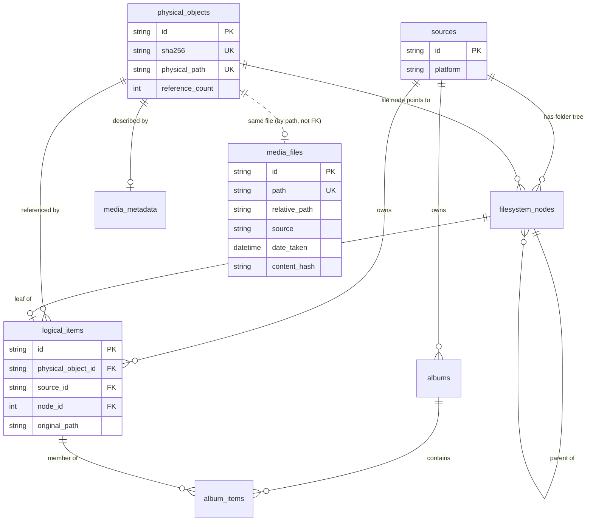
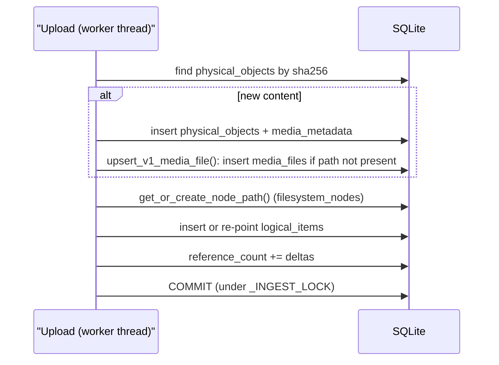

# Database

Synaps keeps its whole catalog in one SQLite file, accessed through SQLAlchemy from the backend process. It holds two models of the same files: the original v1 tables, which the web timeline reads, and the v2 content-addressed tables written by the Mac and iPhone apps. This page covers where the file lives, how SQLite is tuned, every table and index, how the schema evolves, how v1 and v2 stay in step, and how backups work.

## Location and engine

The URL comes from `SYNAPS_DB_URL` and defaults to `sqlite:///<repo>/backend/synaps.db` ([`backend/config.py`](../backend/config.py)). The file is git-ignored. In WAL mode SQLite also keeps `synaps.db-wal` and `synaps.db-shm` next to it; treat the three files as one unit.

[`backend/database.py`](../backend/database.py) creates the engine with `check_same_thread=False` (FastAPI handlers run in worker threads, and a session may be created in one and used in another) and a pysqlite `timeout` equal to the busy timeout. `SessionLocal` is the session factory; `get_db()` is the FastAPI dependency that opens a session per request and closes it afterwards. Code that runs outside a request (ingest under its lock, housekeeping, scans) opens `SessionLocal()` directly.

Why SQLite: the NAS has 2 GB of RAM and one user. A database server would cost memory and another service to keep running, while SQLite is a single file that is easy to back up and fast enough for a single-process backend.

## Pragmas

`_configure_sqlite()` runs on every new connection:

| Pragma | Value | Why |
|---|---|---|
| `journal_mode` | `WAL` | Write-ahead logging: readers (timeline, thumbnails) are not blocked by an upload's write transaction and vice versa. Stored in the file, so it is a no-op after the first time. |
| `busy_timeout` | `SYNAPS_SQLITE_BUSY_TIMEOUT_MS` (30000) | A second writer waits up to 30 s instead of failing with "database is locked". |
| `synchronous` | `NORMAL` | Fewer fsyncs. In WAL mode this is still safe against corruption; a power cut can lose only the last few commits, and clients re-check by SHA-256 and re-upload those. |
| `cache_size` | `-8000` | About 8 MB page cache per connection (default is about 2 MB). |

Foreign key enforcement stays off (the SQLite default). The code comment explains: existing NAS databases were written without it and may contain rows that would violate it. Relationships are therefore enforced only by application code.

## Schema overview



`media_files`, `trash_items`, `sync_records` and `settings` stand alone (no foreign keys). The dotted line is not a real relationship: a v1 row matches a v2 object only because `media_files.path` equals the storage root joined with `physical_objects.physical_path`.

## v1 tables ([`backend/models.py`](../backend/models.py))

### `media_files`

One row per photo or video file on disk. Read by the web timeline, search, favorites, trash and `/api/media/*`. Filled by the scanner, the web Sync upload, the Import Manager and v2 uploads (see below). Ids are UUID strings.

| Column | Notes |
|---|---|
| `id` | UUID primary key. |
| `filename`, `extension`, `mime_type` | Display name (v2 rows drop the `<sha16>_` prefix), lowercase extension. `filename` and `extension` are indexed. |
| `path` | Absolute path; unique and indexed. This is the identity of a row: the scanner skips paths it already has. |
| `relative_path`, `directory` | Relative to the storage root. `directory` is indexed. |
| `source` | Timeline source key such as `iphone`, `mac`, `windows`; indexed. Derived from the folder (`scanner.derive_source()`) or from the uploading device (`v1_source_key()`). |
| `file_size`, `width`, `height`, `duration` | Size in bytes; dimensions and video length when known. |
| `media_type` | `image` or `video` (indexed). |
| `is_screenshot`, `is_screen_recording`, `is_raw`, `is_favorite` | Classification flags; `is_screenshot` and `is_favorite` are indexed. |
| `date_taken` | Best capture date (EXIF, video metadata, file name, then file times); indexed, drives the timeline. |
| `date_created`, `date_modified`, `date_indexed` | Filesystem times and when the row was created. |
| `camera_make`, `camera_model`, `gps_lat`, `gps_lon` | Optional metadata. |
| `has_thumbnail`, `thumbnail_path` | Thumbnail bookkeeping. |
| `file_hash` | MD5 of the first 64 KB: a cheap partial fingerprint (indexed). |
| `content_hash`, `hash_algorithm` | Full SHA-256 (indexed, may be NULL for old rows) and `"sha256"`. |

### `trash_items`

One row per file in the trash. Moving to trash deletes the `media_files` row and creates this one; restoring moves the file back, re-indexes it with `index_single_file()` (a new `media_files` row with a new id) and deletes the trash row.

| Column | Notes |
|---|---|
| `id` | UUID primary key. |
| `original_path`, `trash_path` | Where the file was and where it is now. |
| `filename`, `file_size`, `media_type` | Copied from the media row. |
| `deleted_at`, `auto_delete_at` | Deletion time and deletion + 30 days (`TRASH_RETENTION_DAYS`). |

### `sync_records`

One row per file uploaded through the web dashboard's Sync page ([`backend/routers/sync.py`](../backend/routers/sync.py)): `filename`, `file_hash` (indexed, required), `content_hash` (SHA-256, indexed), `hash_algorithm`, `file_size`, `destination_path`, `synced_at`, `source_device` (default `iPhone`). Used for upload history and duplicate checks.

### `settings`

Key/value store: `key` (primary key), `value`, `updated_at`. Only `theme` is writable over the API.

## v2 tables ([`backend/models_v2.py`](../backend/models_v2.py))

The v2 model separates content from provenance. "Provenance" here means where a file came from: which device, which path, which timestamps.

### `sources`

A registered device. The client picks the `id` (for example an iPhone source id) and sends it with every check and upload.

| Column | Notes |
|---|---|
| `id` | String primary key chosen by the client. |
| `friendly_name` | Display name; also decides the mirror folder (see [03-storage-and-ingest.md](03-storage-and-ingest.md)). Updated on every `ingest/check`. |
| `platform` | For example `macOS`, `Windows`, `iOS` (the iPhone app sends `ios`). |
| `volume_identifier` | Optional volume UUID or serial. |
| `created_at`, `last_seen_at` | Registration time and last pre-check. |

### `physical_objects`

One row per unique content, stored once in the vault.

| Column | Notes |
|---|---|
| `id` | UUID primary key. |
| `sha256` | Unique, indexed. The dedup key. |
| `file_size` | Bytes. |
| `physical_path` | Relative to the storage root, unique: `Vault/YYYY/MM/<sha16>_<name>`. |
| `mime_type` | Guessed from the name when the client sends `application/octet-stream`. |
| `reference_count` | Number of `logical_items` pointing at this object. Updated with SQL-side increments (`_apply_ref_deltas()`) so concurrent updates cannot be lost. |
| `created_at` | When the content first arrived. |

### `logical_items`

One device's record of a file. Many logical items (the same photo on the Mac and the iPhone) can point at one physical object.

| Column | Notes |
|---|---|
| `id` | UUID primary key. |
| `physical_object_id` | FK to `physical_objects`, indexed. Re-pointed if the file at this path changes. |
| `source_id` | FK to `sources`, indexed. |
| `node_id` | FK to the leaf `filesystem_nodes` row, indexed. |
| `original_path` | Path on the device (indexed). Together with `source_id` it identifies the item; the ingest code looks items up by this pair. |
| `original_filename` | Name on the device. Indexed via `EXTRA_INDEXES` (used for mirror thumbnails and `ingest/match`). |
| `source_location` | Client-supplied area such as "Downloads" or "Camera Roll". |
| `source_created_at`, `source_modified_at` | Device timestamps, stored as naive UTC. |
| `imported_at` | When the NAS first recorded it. |
| `is_deleted_on_source` | Reset to false when the item is seen again; no current code sets it to true. |

### `filesystem_nodes`

Each source's folder tree as an adjacency list (each row points at its parent), maintained by `get_or_create_node_path()` in [`backend/node_manager.py`](../backend/node_manager.py). It lets `GET /api/v2/sources/{id}/tree` list a folder with a database query instead of a disk scan.

| Column | Notes |
|---|---|
| `id` | Integer primary key (autoincrement). |
| `source_id` | FK to `sources`, indexed. |
| `parent_id` | FK to `filesystem_nodes.id`, NULL for top-level entries, indexed. |
| `name` | One path component. Mac paths drop the leading `Users/<name>/`. |
| `is_directory` | False for the leaf file node. |
| `physical_object_id` | For file nodes, the content they point at; indexed. |

Unique index `idx_nodes_source_parent` on `(source_id, parent_id, name)`.

### `albums` and `album_items`

`albums` (`id`, `name` indexed, `source_id` FK, `created_at`) holds albums per source, created by `POST /api/v2/ingest/albums`. `album_items` (`id`, `album_id` FK, `logical_item_id` FK, `added_at`) links albums to logical items, with unique index `idx_album_item_unique` on `(album_id, logical_item_id)`. Album sync only adds links; it never removes them.

### `media_metadata`

One row per physical object (primary key and FK `physical_object_id`): `capture_date` (indexed), `media_type` (indexed), `camera_make`, `camera_model`, `width`, `height`, `duration`, `is_screenshot` (indexed), `is_screen_recording`, `is_favorite` (indexed), `gps_lat`, `gps_lon`, `has_thumbnail`, `thumbnail_path`. Written when an upload creates a new physical object. `capture_date` also decides the `Vault/YYYY/MM` folder.

## Indexes

Columns marked `index=True` or `unique=True` in the models get SQLAlchemy indexes (`ix_<table>_<column>`) when the table is created. Indexes added later go in `EXTRA_INDEXES` in `database.py`, because `create_all()` never touches an existing table:

| Index | Purpose |
|---|---|
| `ix_logical_items_original_filename` | Find the canonical file behind a `Mirrors/` hardlink by name (finder thumbnails) and `ingest/match` lookups. |
| `ix_media_files_file_size` | Duplicate checks by size (imports, web uploads). |
| `ix_media_files_date_taken_id` | Composite `(date_taken, id)` for ordering by date. |

All three use `CREATE INDEX IF NOT EXISTS` and run on every startup.

## Schema changes

There is no migration framework such as Alembic. Instead:

1. **`init_db()`** runs at startup. It imports both model modules, calls `Base.metadata.create_all()` (creates any missing table), then in one transaction:
   - `add_missing_columns()` compares each existing table with `PRAGMA table_info` and runs `ALTER TABLE ... ADD COLUMN` for every model column the database lacks, creating its index if the column is indexed. Only nullable, non-primary-key columns are added, and only on SQLite.
   - If `media_files.source` was just added, `_fill_media_sources()` fills it for existing rows using `scanner.derive_source()`.
   - Creates `EXTRA_INDEXES`.
   Added columns are logged by the `synaps.database` logger.
2. **Scripts in [`backend/migrations/`](../backend/migrations/)** handle changes that need data work:
   - [`backfill_v2_media_files.py`](../backend/migrations/backfill_v2_media_files.py) gives every v2 physical object under `Vault/` a `media_files` row, so files uploaded before uploads did this themselves appear in the timeline. It also fills a missing `content_hash` and replaces a meaningless `source` on existing canonical rows. It is idempotent (keyed by `media_files.path`). Options: `--dry-run`, `--fix-reference-counts` (recount `reference_count` from `logical_items`), `--fix-capture-dates` (set `media_metadata.capture_date` from the file's embedded date; the file stays where it is), `--batch-size N` (default 200). Run from `backend/` with the venv active: `python migrations/backfill_v2_media_files.py --dry-run`.
   - [`add_source_column.py`](../backend/migrations/add_source_column.py) is the older way to add and fill `media_files.source`. `init_db()` now does the column part automatically. The script always opens `backend/synaps.db` directly (it ignores `SYNAPS_DB_URL`) and recomputes `source` for every row with the folder-based rule, which gives a meaningless value for v2 `Vault/YYYY/MM` paths, so prefer the backfill script on a database with v2 data.

What `add_missing_columns()` cannot do: add a `NOT NULL` column, change a type, rename or drop a column, or add a constraint. Such changes need a script in `backend/migrations/`.

## How v1 and v2 relate

The web timeline only reads `media_files`, so v2 uploads must also land there. In [`backend/routers/ingest_v2.py`](../backend/routers/ingest_v2.py), `_commit_ingest()` calls `upsert_v1_media_file()` when an upload creates a new physical object:



`upsert_v1_media_file()`:

- Only handles photo and video extensions (`ALL_MEDIA_EXTENSIONS`); other files get no v1 row.
- Uses the canonical path (`<storage root>/Vault/YYYY/MM/<sha16>_<name>`) as `media_files.path`, never a `Mirrors/` path, so a later manual scan sees the path and skips it. The scanner always excludes `Mirrors/` for the same reason: mirrors share inodes with vault files and would appear twice.
- Copies type and flags from `media_metadata`, sets `content_hash` to the SHA-256 and `source` to `v1_source_key()` (maps the device platform to `iphone`, `mac` or `windows`).
- Returns the existing row if one is already there.

Favorites flow one way at upload time: `_mark_favorite()` sets `media_metadata.is_favorite` and, when that flag flips, the matching `media_files.is_favorite`, so a web un-favorite is not undone on every sync. Content that only exists in v1 (scanned or web-uploaded files) has no v2 rows, but `ingest/match` and the web Sync dedup look in both catalogs.

## Backups

`./synaps update` calls `backup_db()` before applying a new revision, but only when the update changes files under `backend/`. It uses Python's `sqlite3` online backup API, which produces a consistent copy even while the backend is writing. Copies go to `backend/.deploy/backups/synaps-YYYYmmdd-HHMMSS.db` (git-ignored), and only the 5 newest are kept. The database path is taken from `SYNAPS_DB_URL` or defaults to `backend/synaps.db`.

These backups protect against a bad deploy, not against disk failure: they sit on the same machine. To restore one, stop the backend, copy the backup over `synaps.db`, remove any stale `synaps.db-wal` and `synaps.db-shm`, and start it again. See [12-operations.md](12-operations.md).

## Inspecting the database

Open it read-only so you cannot lock out the running backend for long:

```bash
sqlite3 -readonly backend/synaps.db
```

Useful queries:

```sql
-- Tables, schema of one table, current journal mode
.tables
.schema logical_items
PRAGMA journal_mode;

-- Timeline size by source and type
SELECT source, media_type, COUNT(*) FROM media_files GROUP BY 1, 2 ORDER BY 3 DESC;

-- Newest timeline entries
SELECT date_taken, filename, relative_path FROM media_files ORDER BY date_taken DESC LIMIT 20;

-- Devices and how many files each has recorded
SELECT s.id, s.friendly_name, s.platform, s.last_seen_at, COUNT(li.id) AS items
FROM sources s LEFT JOIN logical_items li ON li.source_id = s.id GROUP BY s.id;

-- Vault size and dedup savings (logical items beyond one per object)
SELECT COUNT(*) AS objects, SUM(file_size) / 1e9 AS gb,
       SUM(reference_count) - COUNT(*) AS extra_references
FROM physical_objects;

-- reference_count that disagrees with the real number of logical items
SELECT po.id, po.physical_path, po.reference_count, COUNT(li.id) AS actual
FROM physical_objects po LEFT JOIN logical_items li ON li.physical_object_id = po.id
GROUP BY po.id HAVING po.reference_count != COUNT(li.id);

-- v2 photos/videos with no timeline row (the backfill script fixes these)
SELECT po.physical_path FROM physical_objects po
LEFT JOIN media_files mf ON mf.relative_path = po.physical_path
WHERE mf.id IS NULL
  AND (lower(po.physical_path) LIKE '%.jpg' OR lower(po.physical_path) LIKE '%.jpeg'
    OR lower(po.physical_path) LIKE '%.png' OR lower(po.physical_path) LIKE '%.heic'
    OR lower(po.physical_path) LIKE '%.mp4' OR lower(po.physical_path) LIKE '%.mov');

-- Where did this file come from? (all devices that hold a given SHA-256)
SELECT s.friendly_name, li.original_path, li.imported_at
FROM physical_objects po JOIN logical_items li ON li.physical_object_id = po.id
JOIN sources s ON s.id = li.source_id WHERE po.sha256 = '<sha256>';

-- Trash that will be purged next
SELECT filename, auto_delete_at FROM trash_items ORDER BY auto_delete_at LIMIT 20;
```

The extension list in the "no timeline row" query mirrors `ALL_MEDIA_EXTENSIONS`; the backfill script's `--dry-run` gives the authoritative count.

## Gotchas and limits

- **No foreign key enforcement.** Deleting rows by hand can leave orphans (for example `logical_items` pointing at a missing physical object). There is no API that deletes v2 rows; trash refuses v2 vault files.
- **`logical_items` has no unique constraint on `(source_id, original_path)`.** Uniqueness relies on `_INGEST_LOCK` serializing ingests in one process.
- **Root nodes can duplicate.** In the `filesystem_nodes` unique index, NULL `parent_id` values never compare equal, so the index cannot stop two identical top-level nodes; again the ingest lock does.
- **`reference_count` is bookkeeping, not a guarantee.** Older data can drift; check with the query above and fix with `backfill_v2_media_files.py --fix-reference-counts`.
- **Timestamps are naive.** Device timestamps in `logical_items` are stored as UTC wall clock; capture dates (`media_metadata.capture_date`, `media_files.date_taken`) are local wall clock, like EXIF.
- **Copying the DB file while the backend runs** can miss data still in the WAL file. Use the online backup (as `./synaps update` does) or stop the backend first.
