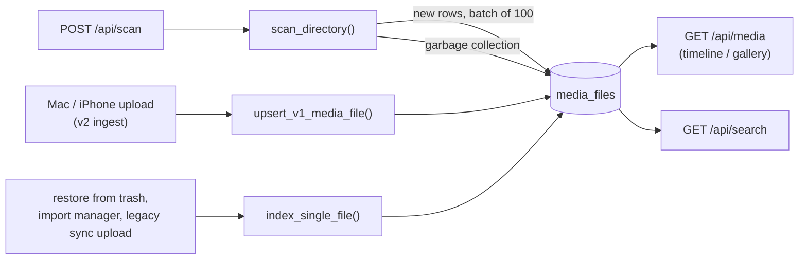
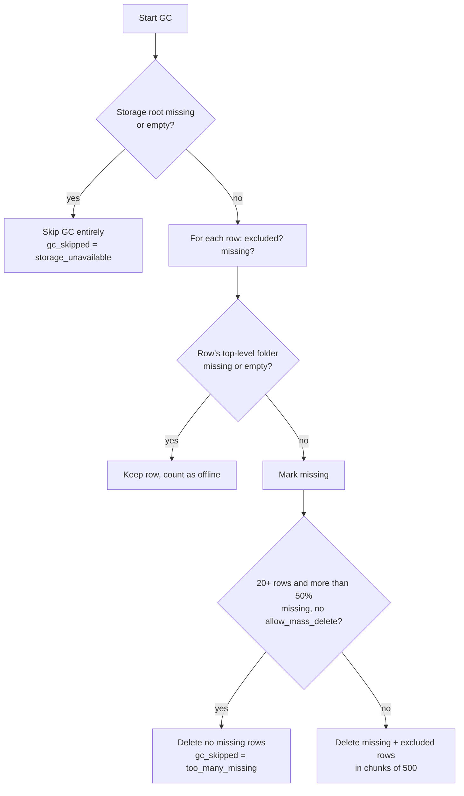

# Scanner and Timeline

The web timeline reads from one table, `media_files` (the "v1" catalog). Rows get there in two ways: the filesystem scanner in [`backend/scanner.py`](../backend/scanner.py) walks the storage root and indexes every photo and video it finds, and the v2 ingest path (`upsert_v1_media_file` in [`backend/routers/ingest_v2.py`](../backend/routers/ingest_v2.py)) adds a row for each file the Mac and iPhone apps upload. This page covers how the scanner turns files into rows, how it cleans up rows whose files are gone, and how the timeline and search endpoints query the result.

The web timeline is a secondary feature: the owner mainly uses the Mac and iPhone apps, which read the v2 tables and browse files through the Finder API instead. See [04-database.md](04-database.md) for the full schema and [03-storage-and-ingest.md](03-storage-and-ingest.md) for the v2 model.

## Where rows come from

| Writer | When | Code |
|---|---|---|
| `scan_directory` | Only when someone calls `POST /api/scan` | [`backend/scanner.py`](../backend/scanner.py), [`backend/main.py`](../backend/main.py) |
| `upsert_v1_media_file` | After every v2 upload (and by the backfill migration) | [`backend/routers/ingest_v2.py`](../backend/routers/ingest_v2.py), [`backend/migrations/backfill_v2_media_files.py`](../backend/migrations/backfill_v2_media_files.py) |
| `index_single_file` | Restore from trash, import manager, legacy `/api/sync/upload` | [`backend/scanner.py`](../backend/scanner.py) |
| Thumbnail worker | Sets `has_thumbnail` / `thumbnail_path` after generating a thumbnail | [`backend/thumbnails.py`](../backend/thumbnails.py) |

All writers key rows by the unique `path` column (the absolute path on disk). That is why a manual scan after an app upload does not create a duplicate: the scanner sees the path already in the table and skips it.

## What triggers a scan

There is no automatic scan. The `lifespan` hook in [`backend/main.py`](../backend/main.py) creates the database and folders and starts the housekeeping thread, but the startup scan is deliberately disabled. The comment there explains why: a scan ends with garbage collection, and running that on every boot against the v2 vault was considered too risky.

A scan runs only when a client calls `POST /api/scan`. The web dashboard's Settings page has a "Rescan Now" button for this (`triggerScan` in [`frontend/src/lib/api.ts`](../frontend/src/lib/api.ts)).

The endpoint is single-flight. `trigger_scan` tries to take a module-level `threading.Lock` without blocking:

- If the lock is free, it starts a daemon thread running `run_initial_scan` and answers `{"status": "scan_started"}`. The thread releases the lock when it finishes, even on error.
- If a scan is already running, it answers `{"status": "scan_already_running"}` and does nothing.

The scan opens its own database session and calls `scan_directory(db)` with the defaults (`force_rescan=False`, `allow_mass_delete=False`). The HTTP response does not wait for the result; the stats are only written to the log.

## Which paths are scanned

| Setting | Value | Defined in |
|---|---|---|
| `ALLOWED_SCAN_PATHS` | `[STORAGE_PATH]`, the whole storage root (`/storage` on the NAS) | [`backend/config.py`](../backend/config.py) |
| `EXCLUDED_PATHS` | `Vault/Windows_laptop-HP`, `Vault/<Owner>/Mac/Private`, `Mirrors`, `.synaps_tmp`, `.synaps_trash`, plus anything in `SYNAPS_EXCLUDED_PATHS` | [`backend/config.py`](../backend/config.py) |
| `_BUILTIN_EXCLUDED_PATHS` | `Mirrors`, `.synaps_tmp`, `.synaps_trash` (always excluded, even if the config list changes) | [`backend/scanner.py`](../backend/scanner.py) |
| `_SKIP_DIR_NAMES` | `thumbnails`, `trash`, `venv`, `__pycache__`, `node_modules`, `.git` (by folder name, anywhere) | [`backend/scanner.py`](../backend/scanner.py) |

`SYNAPS_EXCLUDED_PATHS` is a comma-separated list of paths relative to the storage root, for example `Vault/Old_Backups,Scratch`. `<Owner>` comes from `SYNAPS_OWNER_NAME` (default `Harsh`).

### Why these exclusions exist

- **`Mirrors/`** holds hardlinks to the canonical v2 files (same inode, different path). Indexing them would show every app upload twice.
- **`.synaps_tmp/`** is the upload staging area: partial uploads that may never finish.
- **`.synaps_trash/`** is the trash fallback on the storage disk.
- **The thumbnail and trash directories** are also skipped by absolute path, in case a dev setup puts them inside the storage root.

### How exclusion matching works

`is_excluded_path(rel_path)` compares whole path components, not string prefixes. The excluded list is normalized once at import (`_normalize_excluded`), which also drops empty entries and `.`, since either would exclude the entire storage root.

So excluding `Vault/Harsh/Mac/Private` skips `Vault/Harsh/Mac/Private/x.jpg` but not `Vault/Harsh/Mac/PrivateTrip/x.jpg`.

During the walk, the scanner prunes excluded and hidden directories before `os.walk` descends into them. It also skips hidden files, `.aae` sidecar files and `.tmp` files.

## How a file becomes a row

Only files whose extension is in `ALL_MEDIA_EXTENSIONS` are indexed. Today that is `.jpg`, `.jpeg`, `.png`, `.heic`, `.mp4` and `.mov`. `DOCUMENT_EXTENSIONS` and `RAW_EXTENSIONS` are empty sets, so documents and RAW files never reach the timeline.

Before walking, `scan_directory` loads every existing `(id, path)` pair into a dictionary. Each file is then a memory lookup instead of a database query, which matters on the Core 2 Duo. Files already in the table are skipped unless `force_rescan` is set.

For a new file, `_build_media_file` fills in the row:

| Column | How it is computed |
|---|---|
| `filename` | The file name. For v2 canonical objects (`Vault/YYYY/MM/<sha16>_<name>`) the 17-character `<sha16>_` prefix is stripped, matching what the ingest upsert stores. |
| `path`, `relative_path`, `directory` | Absolute path, path relative to the storage root, and the parent folder relative to the root |
| `source` | `derive_source(relative_path, db)`, see below |
| `extension`, `mime_type` | Lowercased extension; `mimetypes.guess_type`, falling back to `application/octet-stream` |
| `file_size`, `date_created`, `date_modified` | From `os.stat` (`date_created` uses `st_birthtime` where it exists, otherwise `st_ctime`) |
| `media_type`, `is_screenshot`, `is_screen_recording`, `is_raw` | `classify_media(ext, filename)` |
| `date_taken` | `get_best_date(filepath, filename)` |
| `file_hash` | `compute_file_hash`: MD5 of the first 64 KB only |

### Classification

`classify_media` sets `media_type` to `image` or `video` from the extension (anything else would be `document`). A file counts as a screenshot if its name contains "screenshot" or "screen shot", or if it is a PNG whose name looks like an iPhone camera-roll name (`IMG_1234` or four capitals plus four digits). The reasoning in the code: iPhones never save camera photos as PNG, so a PNG from the camera roll is almost always a screenshot. Screen recordings are detected by "screen" and "recording" in the name.

### Picking the capture date

`get_best_date` tries sources in this order and returns the first hit:

1. **EXIF** (`extract_exif_date`). HEIC/HEIF files are read with Pillow and pillow-heif (`DateTimeOriginal`, then `DateTime`). JPEG, TIFF and a few RAW extensions are read with `exifread`. Other extensions (including PNG) skip this step.
2. **Video container metadata** (`extract_video_date`). For `.mp4`, `.mov` and `.m4v`, it runs `ffprobe` (10 second timeout) and reads `creation_time`.
3. **File name** (`extract_date_from_filename`). Patterns `YYYY-MM-DD`, `YYYY_MM_DD` or `YYYYMMDD`, accepted only for years 1990 to 2030. The time of day is lost (midnight).
4. **Filesystem dates.** The oldest of birth time (where the OS provides it), `mtime` and `ctime` that is not in the future. The oldest is used because copying a file resets `mtime` to the copy date.

If all of that fails, the row gets the current time.

### Hashes: `file_hash` versus `content_hash`

There are two hash columns, and they mean different things.

| Column | Algorithm | Cost | Who fills it |
|---|---|---|---|
| `file_hash` | MD5 of the first 64 KB (`compute_file_hash`) | Cheap, fixed | Scanner, `upsert_v1_media_file` |
| `content_hash` | Full SHA-256 (`compute_content_hash`) | Reads the whole file | `upsert_v1_media_file` (copies the v2 SHA-256), the legacy `/api/sync/upload` path, import manager duplicate checks |

The scanner never computes `content_hash`: on the NAS, hashing every byte of the library during a scan would take far too long. `file_hash` is only a fast hint for duplicate checks. Two different videos with identical first 64 KB would share it.

### Dimensions and camera metadata

The model has `width`, `height`, `duration`, `camera_make`, `camera_model`, `gps_lat` and `gps_lon` columns, and the API returns them. The scanner does not fill any of them, so for scanned rows they stay `NULL`.

### Batching

New rows are committed in batches of `SCAN_BATCH_SIZE` (100), plus a final batch per directory. If a batch fails with an `IntegrityError` (a row with the same `path` appeared meanwhile, typically from the v2 ingest), `_commit_batch` retries row by row and keeps the existing row.

A forced rescan (`force_rescan=True`) updates existing rows in place, but only the file-derived columns in `_RESCAN_COLUMNS`. It leaves `source`, `is_favorite` and the thumbnail fields alone. The `/api/scan` endpoint never passes `force_rescan`; it exists for scripts.

## Deriving the source

`source` drives the iPhone / Mac / Windows filters in the sidebar. `derive_source` works it out from where the file lives:

| Path shape | Example | Result |
|---|---|---|
| `Vault/<Device>/...` where `<Device>` is in `SOURCE_MAPPING` | `Vault/Windows_laptop-HP/a.jpg` | `windows` |
| `Vault/<Owner>/<Device>/...` (at least four parts) | `Vault/Harsh/Iphone/2024/a.jpg` | `SOURCE_MAPPING` value, otherwise the folder name lowercased (`iphone`) |
| v2 canonical `Vault/YYYY/MM/<name>` | `Vault/2026/09/3fa2..._IMG_1.HEIC` | Platform of the device that uploaded it, looked up in the v2 tables |
| Anything outside `Vault/`, or too shallow | `Imports/a.jpg` | `unknown` |

`SOURCE_MAPPING` in [`backend/config.py`](../backend/config.py) maps `Iphone`, `Mac` and `Windows_laptop-HP` to `iphone`, `mac` and `windows`.

For v2 canonical paths, the scanner joins `physical_objects` to `logical_items` to `sources` and takes the earliest import. `_platform_source` then turns the platform and source id into a key using the same `v1_source_key` function the ingest upsert uses, so scanned and uploaded rows agree. If the file is not registered in the v2 tables, the result is `unknown`.

## Garbage collection and its safety guard

After indexing, `_garbage_collect` removes rows that should no longer be in the catalog:

- rows whose `relative_path` is now excluded (deleted even though the file exists, because the config says so)
- rows whose file no longer exists

Deleting rows because files are "missing" is dangerous on a NAS. An unmounted data disk looks exactly like a library where every file was deleted. The guard has three layers:

1. **Storage mounted?** `_storage_is_mounted` returns false if the storage root is missing or has no visible entries. GC is skipped completely.
2. **Top-level folder available?** `_top_folder_available` checks the row's first path component (for example `Vault`). If that folder is gone or empty, the row is kept and counted as offline. This covers a separately mounted disk that is down.
3. **Mass-delete ceiling.** If the table has at least `GC_MIN_ROWS_FOR_GUARD` (20) rows and more than `GC_MAX_DELETE_FRACTION` (50%) of them are missing, no missing rows are deleted. The log points at `clean_stale_records.py` (now [`backend/scripts/clean_stale_records.py`](../backend/scripts/clean_stale_records.py)) for the case where the deletions are real.

The 50% guard only blocks deletions for missing files. Rows removed because their path is excluded are still deleted. `allow_mass_delete=True` disables the ceiling, but nothing in the API passes it.

## How the timeline queries the catalog

`GET /api/media` in [`backend/routers/media.py`](../backend/routers/media.py) (also registered as `/api/media/` and `/api/media/timeline`) serves both web views.

| Parameter | Default | Effect |
|---|---|---|
| `view` | `timeline` | `timeline` returns month groups; `gallery` returns a flat list with a `date_string` per item for the sticky date header |
| `sources` | none | Comma-separated, lowercased, matched with `source IN (...)` |
| `media_type` | none | `screenshot`, `screen_recording`, `raw` and `favorite` filter on the boolean columns; any other value filters on `media_type` (`image`, `video`) |
| `year`, `month` | none | Date range on `date_taken` |
| `page`, `per_page` | 1, 50 | `per_page` is capped at 200 |

Results are always sorted by `date_taken` descending.

### Date filters as ranges

When `year` (and optionally `month`) are valid, the filter becomes `date_taken >= start AND date_taken < end`. Filtering with `strftime()` on the column would force SQLite to read every row; a range lets it use the `date_taken` index. The `strftime` form is kept only as a fallback for out-of-range values.

### Paging

Paging is offset based: the endpoint runs a `COUNT(*)` for `total`, then `ORDER BY date_taken DESC OFFSET (page-1)*per_page LIMIT per_page`. The web app asks for 200 items per page in timeline view and 100 in gallery view.

[`backend/database.py`](../backend/database.py) creates an index `ix_media_files_date_taken_id` on `(date_taken, id)`, and its comment calls it the index for "timeline keyset paging". Keyset paging (asking for "the next 200 after this date and id" instead of "skip N rows") is not implemented in the router yet. The index still helps the sort, but deep pages still pay for the skipped rows.

### Timeline grouping

In timeline view, the current page's items are grouped by `YYYY-MM` of `date_taken` (falling back to `date_created`, then now). Items taken before `ARCHIVE_CUTOFF_YEAR` (2024) all go into a single `Archive` group with `year: 0`, which sorts last. Grouping happens per page, so the web app merges the groups of each new page into what it already has (`mergeGroups` in [`frontend/src/app/page.tsx`](../frontend/src/app/page.tsx)).

### Other catalog endpoints

| Endpoint | Purpose |
|---|---|
| `GET /api/media/item/{id}` | One row, with extra fields (relative path, MIME type, dates, camera, GPS) |
| `POST /api/media/favorite/{id}` | Toggles `is_favorite` |
| `GET /api/media/stats` | Counts by type plus total size, via `library_counts` (separate `COUNT` queries, each served by an index) |

Thumbnail, file and stream endpoints are covered in [06-thumbnails-and-media.md](06-thumbnails-and-media.md). The full list is in [10-api-reference.md](10-api-reference.md).

## Search

`GET /api/search` in [`backend/routers/search.py`](../backend/routers/search.py) matches the query against `filename`, `directory` and `relative_path`, with an optional `media_type` filter. It pages the same way as the timeline (`page`, `per_page` up to 200, sorted by `date_taken` descending). The query must be 1 to 200 characters.

`like_pattern` escapes the LIKE wildcards `%` and `_` (and the escape character `\` itself) before wrapping the query in `%...%`. Without this, searching for `IMG_1234` would also match `IMGX1234`, because `_` means "any character" in LIKE. The search uses plain `LIKE` rather than `ilike()`, since SQLite's `LIKE` is already case-insensitive for ASCII.

`GET /api/search/suggestions` returns up to five distinct matching file names and five matching directories. The web search page calls it 200 ms after the user stops typing.

Every search is a `%...%` match, so SQLite cannot use an index and scans the table. With tens of thousands of rows that is acceptable on the NAS, but it will not scale indefinitely.

## Gotchas and limits

- **Rows can point at moved files.** Maintenance scripts in [`backend/scripts/`](../backend/scripts/) can move files without updating `media_files`. On the real NAS, roughly 18,000 of about 19,500 timeline rows point at paths moved by an old restructure. Those rows still show in the timeline, but opening them returns 404, and so does their thumbnail unless one was cached before the move. A scan would not clean them up either: with more than half the rows missing, the 50% guard refuses. The fix is [`backend/scripts/clean_stale_records.py`](../backend/scripts/clean_stale_records.py) (dry run first), followed by a scan. The web timeline is not a priority for the owner, so this has been left as is.
- **No scan on startup.** Files copied onto the NAS by hand (not through an app) only appear in the timeline after someone triggers `POST /api/scan`.
- **The scan result is only in the log.** `POST /api/scan` returns immediately; check the backend log for the stats.
- **The scan runs in the web server process.** It is a background thread, so it competes with requests for the CPU. Each new file costs EXIF parsing, possibly an `ffprobe` run, and a 64 KB read.
- **Filename dates lose the time of day**, so photos dated from their name sort as midnight.
- **No dimensions, duration or GPS for scanned files.** The columns exist but the scanner does not fill them; the video duration badge in the web grid is blank for these rows.
- **`file_hash` is a partial hash.** Treat it as a hint, not proof that two files are identical.
- **Offset paging** gets slower on very deep pages; see the keyset note above.
