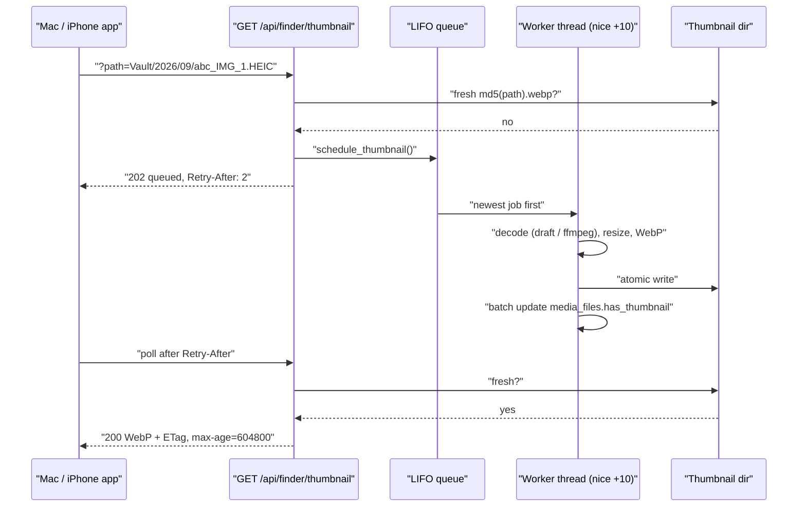

# Thumbnails and Media Delivery

Every photo grid in Synaps, on the web and in the Mac and iPhone apps, is built from small WebP thumbnails that the NAS generates once and caches on disk. Generation happens on a single low-priority background thread, so an HTTP request never waits for a decoder: it either gets a cached thumbnail straight away or is told to come back later. This page covers [`backend/thumbnails.py`](../backend/thumbnails.py), the thumbnail endpoints, the HEIC preview cache, and how full files are downloaded with caching and Range support.

All of it is shaped by the hardware: a Core 2 Duo with 2 GB of RAM. A 48-megapixel HEIC or a 4K HEVC video takes seconds to decode there, so the design is about never decoding more than necessary and never doing it on the request path.

## Where thumbnails live

| Item | Value |
|---|---|
| Directory | `SYNAPS_THUMBNAIL_DIR`, default `backend/thumbnails/` |
| File name | `md5(<source path>).webp`, from `get_thumbnail_path` |
| Size | Fits inside 320 x 320 (`THUMBNAIL_SIZE`), aspect ratio kept, never upscaled |
| Format | WebP, quality 75 (`THUMBNAIL_QUALITY`), `method=0` (fastest encoder setting) |
| HEIC previews | `<thumbnail dir>/previews/<sha1>.jpg`, see [HEIC previews](#heic-previews-for-browsers) |

The cache key is the MD5 of the full path string, not of the file contents. That keeps the lookup free (no file read), but it means a moved file gets a new key. Maintenance scripts call `move_thumbnail` to carry the cached file over when they move a source.

### When a cached thumbnail counts as fresh

`thumbnail_is_fresh` treats a cached file as usable unless:

- it is empty (0 bytes), or
- it is older than the source file (thumbnail `mtime` + 1 second < source `mtime`), meaning the source was replaced.

If the source's `mtime` is more than 60 seconds in the future (a camera with a wrong clock), the thumbnail is accepted anyway. Otherwise that file would be regenerated on every request.

## How a thumbnail is generated

`generate_thumbnail_file` picks a generator by extension:

| Kind | Generator | How |
|---|---|---|
| JPEG, PNG, WebP, HEIC | `generate_image_thumbnail` | Pillow with decode-time downscaling, BILINEAR resize |
| Video (`.mp4`, `.mov`, `.m4v`) | `generate_video_thumbnail` | One frame from `ffmpeg`, piped back as PPM |
| PDF | `generate_pdf_thumbnail` | First page with `pdftoppm` (poppler-utils), 15 second timeout |

### Images: decode less

`_render` calls Pillow's `img.draft()` before decoding. For JPEG this decodes directly at 1/2, 1/4 or 1/8 scale inside the JPEG decoder (DCT scaling), which is 4 to 8 times less work than decoding the full image and shrinking it. For HEIC, pillow-heif registers itself as a Pillow opener at import time; newer pillow-heif releases can use the same `draft()` hook to decode the small thumbnail embedded in the HEIC file instead of the full HEVC image. If `draft()` is not supported, the image is decoded at full size.

After resizing, `_render` checks the EXIF Orientation tag. Phones often store portrait JPEGs sideways with a tag saying "rotate 90 degrees", so the thumbnail is rotated with `ImageOps.exif_transpose`. pillow-heif already applies HEIC rotation and resets the tag to 1, so HEICs are not rotated twice.

Palette, CMYK and other unusual modes are converted to RGB before saving.

### Videos: one keyframe, low priority

`_grab_video_frame` runs `ffmpeg` with:

- `nice -n 10` and, on Linux, `ionice -c 2 -n 7`, so the decoder yields CPU and disk to web requests
- `-threads 1`
- `-skip_frame nokey -ss 1 -noaccurate_seek`: jump to the keyframe nearest 1 second and decode keyframes only, so no frames are decoded just to be thrown away
- scaling done inside ffmpeg, output written to a pipe as a PPM image (`-f image2pipe -c:v ppm`), which Pillow then encodes to WebP

If no frame comes back (for example a clip shorter than 1 second), it retries without the seek to grab the first frame. Each ffmpeg run has a 25 second timeout (`FFMPEG_TIMEOUT`), so a stuck decode cannot block the queue forever.

### Atomic writes

`_atomic_write` writes to a hidden temp file next to the destination (`.<name>.<pid>.<thread>.tmp`), then renames it into place with `os.replace`. A crash mid-write can therefore never leave a truncated `.webp` that would be served forever. The first worker thread deletes temp files older than 10 minutes on start-up (`_cleanup_stale_temp_files`).

## The background worker and its queue

Thumbnails are generated by background threads, started lazily the first time something is queued (`_ensure_workers`).

| Setting | Default | Meaning |
|---|---|---|
| `SYNAPS_THUMBNAIL_WORKERS` | 1 | Worker threads. One leaves the second core for the web server and SQLite. |
| `SYNAPS_THUMBNAIL_QUEUE_MAX` | 2000 | Maximum queued jobs. When full, the oldest is dropped. |

`_ThumbnailQueue` is a bounded LIFO (last in, first out) queue with de-duplication:

- **LIFO** because the newest request is what the user is looking at right now. If someone scrolls fast through a grid, the tiles on screen are served before the ones they scrolled past.
- **Bounded**: when full, the oldest entry is dropped. A client that still wants it will ask again and re-queue it.
- **De-duplicated**: a source path that is already queued or being generated is not added twice (`is_thumbnail_pending` exposes this).

Each worker thread raises its own nice value by 10 on Linux (`lower_thread_priority`), so request threads can preempt it. Before generating, `_process` re-checks that the source still exists and that no fresh thumbnail appeared meanwhile (for example from the preheat script).

After a successful generation, the worker records `has_thumbnail = True` and `thumbnail_path` in `media_files`. These updates are batched: flushed every 25 items, whenever the queue empties, or after 5 seconds. Every 50 items it also calls `gc.collect()` to keep memory flat.

### Failure memory

If generation fails, the path is remembered in `_failed` for `FAILED_RETRY_SECONDS` (6 hours), along with the file's `mtime` and size. During that time, thumbnail requests for it answer 404 instead of queueing it again. The entry is dropped early if the file changes. At most 10,000 failures are remembered.

Without this, a corrupt video would be re-queued on every poll, and each attempt could burn up to 25 seconds of ffmpeg time.

## The thumbnail endpoints

There are three thumbnail endpoints. They share the cache but differ in what they answer while a thumbnail is still being made.

| Endpoint | Used by | Lookup | Not ready yet |
|---|---|---|---|
| `GET/HEAD /api/media/thumbnail/{media_id}` | Web timeline, gallery, search, viewer | `media_files` row by id | 200 SVG placeholder |
| `GET/HEAD /api/finder/thumbnail?path=...` | Mac and iPhone apps | Path relative to the storage root | 202 `{"status":"queued"}` |
| `GET/HEAD /api/trash/thumbnail/{trash_id}` | Web trash page | Trash row (thumbnail cached under the original path) | Never generates; returns the SVG placeholder if nothing was cached |

### Finder thumbnail contract (native apps)

`get_file_thumbnail` in [`backend/routers/finder.py`](../backend/routers/finder.py):

| Response | When |
|---|---|
| **200** WebP, `ETag`, `Last-Modified`, `Cache-Control: private, max-age=604800` | A fresh thumbnail exists |
| **304** | The client sent a matching `If-None-Match` (or `If-Modified-Since`) |
| **202** `{"status":"queued"}`, `Retry-After: 2`, `Cache-Control: no-store` | Queued or already being generated |
| **404** | File missing, hidden path, extension without thumbnail support, or generation failed recently |
| **400** | Path contains `..` or a NUL byte, or is not a regular file |
| **403** | The resolved path (after symlinks) is outside the storage root |

The `max-age` of 604800 seconds is 7 days. The optional `size` query parameter the iPhone app sends is accepted and ignored.

The lookup order is built so that the common case costs nothing:

1. The deterministic key for the full path, then a legacy key computed from the relative path.
2. If the path is already pending, answer 202 at once, with no database lookups on repeated polls.
3. The `thumbnail_path` recorded in `media_files` for this path.
4. An alias: the target of a symlink inside the storage root, or, for a `Mirrors/` hardlink, the canonical `Vault/` file with the same inode (found through `logical_items.original_filename`, confirmed by comparing inodes). If the alias already has a thumbnail, it is hardlinked under this path's key (`link_thumbnail`) so the next request takes step 1. If not, the alias is queued, so every mirror of one file shares a single decode.
5. Otherwise queue this path and answer 202.

### Web thumbnail contract

`get_thumbnail` in [`backend/routers/media.py`](../backend/routers/media.py) answers the same 200 and 304 as above. When the thumbnail is not ready, it queues it and returns **200** with a small SVG "Generating..." image, `Cache-Control: no-store` and `Retry-After: 2`. A plain `` tag can display that placeholder, which a 202 JSON body could not. It answers 404 if the row does not exist, the file is missing on disk, or generation failed recently.

### A thumbnail that is not generated yet

## How clients consume thumbnails

| Client | Endpoint | Behaviour while not ready | Caching |
|---|---|---|---|
| Web (`MediaGrid`) | `/api/media/thumbnail/{id}` | `HEAD` polls at about 2, 3, 5, 8, 13 and 21 seconds (each with +/-20% jitter), then gives up; stops on any 4xx | Browser HTTP cache |
| Mac (`NASThumbnailLoader`) | `/api/finder/thumbnail` | Up to 12 polls; delay is the larger of `Retry-After` and a backoff of 2 s x 1.5^attempt, capped at 10 s | 50 MB memory cache, disk cache trimmed from 512 MB to 384 MB; 400/403/404 remembered for 30 minutes |
| iPhone (`NASThumbnailLoader`) | `/api/finder/thumbnail` | Up to 5 polls, sleeping `Retry-After` (clamped to 0.5 to 10 s) | Memory cache plus `Caches/nas_thumbnails`; only 200 bodies are stored; after 7 days revalidated with `If-None-Match` (304 keeps the cached copy) |

The web grid only polls tiles that are mounted (the grid is windowed, so roughly the visible area plus one screen) and only when the list said `has_thumbnail` was false. The jitter stops a screenful of tiles from polling in lockstep. Code: [`frontend/src/components/MediaGrid.tsx`](../frontend/src/components/MediaGrid.tsx), [`clients/mac/SynapsMac/Sources/Services/NASThumbnailLoader.swift`](../clients/mac/SynapsMac/Sources/Services/NASThumbnailLoader.swift), [`clients/ios/SynapsiOS/Sources/Services/NASThumbnailLoader.swift`](../clients/ios/SynapsiOS/Sources/Services/NASThumbnailLoader.swift).

All polling is bounded on purpose. Before the limits, a file that could not be thumbnailed was re-queued every few seconds for as long as the page was open.

## HEIC previews for browsers

Browsers other than Safari cannot display HEIC. `GET /api/media/file/{media_id}` therefore serves HEIC and HEIF files as a JPEG preview by default, produced by `ensure_preview`:

| Item | Value |
|---|---|
| Size | Fits inside 2560 x 2560, LANCZOS resize |
| Format | JPEG quality 85; the ICC colour profile is kept (iPhone HEICs are Display P3) |
| Cache key | SHA-1 of path, `mtime_ns`, size, max size and quality, so a changed file gets a new preview |
| Cache size | `SYNAPS_PREVIEW_CACHE_MB`, default 1024 MB (minimum 16) |
| Concurrency | One conversion at a time (a 48 MP HEIC needs about 300 MB while decoding) |

A request waits up to 30 seconds (`PREVIEW_WAIT_SECONDS`) for the converter. If it is still busy, the endpoint answers **503** with `Retry-After: 5`. The web viewer retries twice, 2.5 seconds apart, then falls back to showing the thumbnail.

The cache is evicted least-recently-used first. A cache hit bumps the file's `mtime` at most once a day, and after every 20th new preview the cache is trimmed to 90% of its cap.

Add `?original=1` to get the original HEIC bytes instead. If the conversion fails for another reason, the endpoint logs the error and serves the original file.

## File downloads and streaming

Full files go through `cached_file_response` in [`backend/routers/media.py`](../backend/routers/media.py), which the finder and trash routers reuse.

| Header or feature | Behaviour |
|---|---|
| `ETag` | MD5 of inode, `mtime_ns` and size: changes whenever the file is rewritten |
| `Last-Modified` | File `mtime` |
| `Cache-Control` | `private, max-age=86400` for files, `private, max-age=604800` for thumbnails |
| Conditional GET | `If-None-Match` is checked first (a `W/` weak prefix is tolerated, `*` matches anything); `If-Modified-Since` only when there is no `If-None-Match`. A match returns 304. |
| Range | Handled by Starlette's `FileResponse`: 206 with `Content-Range`, so videos can seek and downloads can resume |
| HEAD | Registered on every file and thumbnail route |

| Endpoint | Serves |
|---|---|
| `GET/HEAD /api/media/file/{media_id}` | Original file, or the HEIC preview described above |
| `GET/HEAD /api/media/stream/{media_id}` | Same file without HEIC conversion; used as the web `<video>` source |
| `GET/HEAD /api/finder/download?path=...` | Any regular file under the storage root, with the same path checks as the finder thumbnail |

MIME types come from the row's `mime_type`, then `mimetypes`, then a small built-in map (`_resolve_mime`). The web viewer's Download button uses `/api/finder/download` with the item's relative path, so HEIC downloads get the original bytes rather than the JPEG preview.

Because these URLs are keyed by id or path rather than by content, they use `max-age` plus validators instead of `immutable`. After the max-age runs out, the client revalidates and usually gets a cheap 304.

## Preheating thumbnails

[`backend/scripts/preheat_thumbnails.py`](../backend/scripts/preheat_thumbnails.py) generates missing thumbnails ahead of time, so grids are instant the first time they are opened. It walks a folder newest first (folders sorted descending, so `2026` before `2025`), skips files with a fresh thumbnail, and generates the rest with the same `generate_thumbnail_file` the server uses.

| Option | Default | Meaning |
|---|---|---|
| `--path` | `Vault` | Folder relative to the storage root; must stay inside it |
| `--limit` | 0 (no limit) | Maximum number of files to process |
| `--delay` | 0.0 | Seconds to sleep between items |
| `--workers` | 1 | Parallel threads; use 2 only when the NAS is idle |

The script runs itself at `nice 10` and keeps only `workers x 2` jobs submitted at a time, so a 100,000-file run does not hold 100,000 futures in memory. Every 100 generated thumbnails it marks the `media_files` rows and runs `gc.collect()`. It only writes to the thumbnail directory and `media_files`; media files are never modified. The server's worker skips anything the script already produced.

Operational use is in [12-operations.md](12-operations.md).

## Gotchas and limits

- **The two thumbnail endpoints behave differently while generating.** The web endpoint returns 200 with an SVG; the finder endpoint returns 202. A client that treats any 200 as "done" will cache the placeholder if it uses the web endpoint.
- **Thumbnail keys are path-based.** Moving or renaming a file outside the maintenance scripts orphans its thumbnail and triggers a new decode. Nothing deletes orphaned thumbnails.
- **A thumbnail can outlive its source.** When the source file is gone, the web endpoint still serves a cached thumbnail if one exists (freshness cannot be checked without the source).
- **Only one decoder by default.** A burst of new uploads queues behind each other. Expect the first view of a large new folder to fill in over seconds to minutes; preheating helps.
- **Queue overflow drops the oldest jobs.** They are not lost for good, but they only come back when a client asks again.
- **Failure memory is in RAM.** Restarting the backend forgets it, so broken files are retried once after a restart.
- **The preview converter is single-threaded.** Stepping quickly through HEIC photos in the web viewer can produce 503s; the viewer handles them, other clients should too.
- **Missing tools are logged once.** Without `ffmpeg` or `pdftoppm` installed, video or PDF thumbnails fail and are remembered as failures.

See also [05-scanner-and-timeline.md](05-scanner-and-timeline.md) for where `media_files` rows come from, and [10-api-reference.md](10-api-reference.md) for every endpoint.
