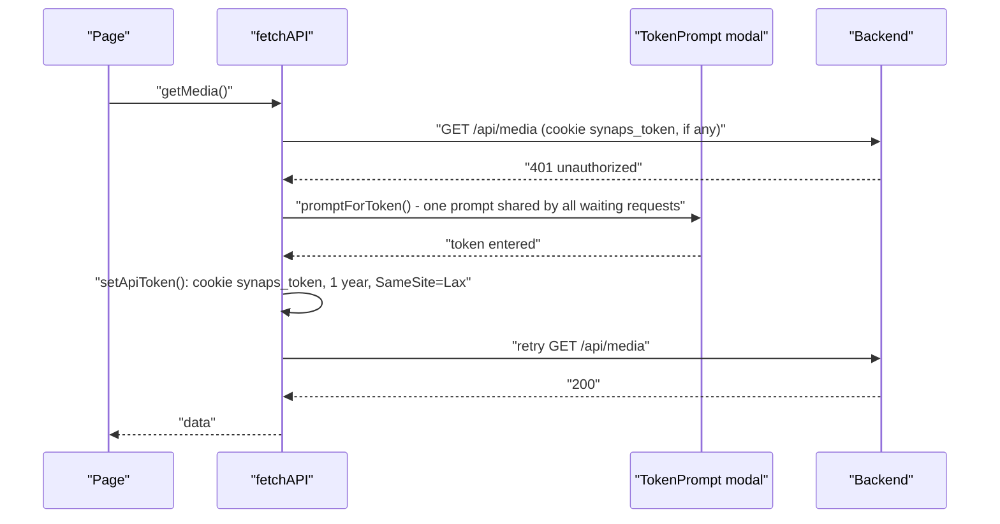
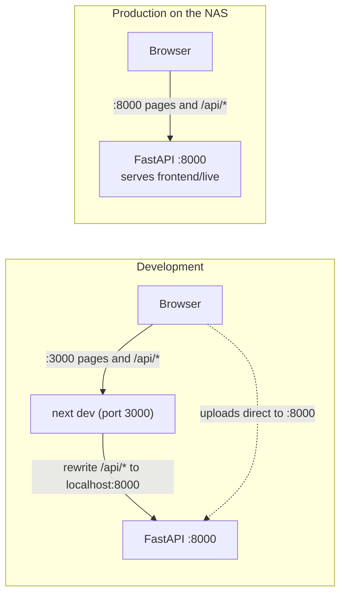

# Web Dashboard

The web dashboard in [`frontend/`](../frontend/) is a Next.js app for browsing the library from any browser: a photo timeline and gallery, a file browser, search, uploads, trash and settings. In production it is built as a plain static site and served by the FastAPI backend on port 8000, so the NAS does not need to run a Node.js server. The owner mainly uses the Mac and iPhone apps ([08-mac-app.md](08-mac-app.md), [09-iphone-app.md](09-iphone-app.md)); the website is a secondary client and reads mostly from the v1 `media_files` catalog.

## Tech stack

From [`frontend/package.json`](../frontend/package.json):

| Piece | Version | Used for |
|---|---|---|
| Next.js (App Router) | 14.2.15 | Routing, build, static export |
| React / React DOM | ^18.3.1 | UI |
| TypeScript | ^5 | All source files |
| Tailwind CSS | ^3.4.14 | Styling (`darkMode: "class"`), plus CSS variables in [`globals.css`](../frontend/src/app/globals.css) for the "glass" look |
| zustand | ^4.5.5 | Global state ([`store.ts`](../frontend/src/lib/store.ts), [`uploads.ts`](../frontend/src/lib/uploads.ts)) |
| framer-motion | ^11.11.0 | Panel and viewer animations |
| next-themes | ^0.4.6 | Light / dark / system theme, stored in `localStorage` |
| lucide-react | ^0.454.0 | Icons |

Every page is a client component (`'use client'`). There is no server-side data fetching: pages load data from the API in the browser. That is what makes the static export possible.

## Folder structure

```
frontend/
├── next.config.js            static export vs. dev proxy (see below)
├── tailwind.config.ts
└── src/
    ├── app/
    │   ├── layout.tsx        <html>, ThemeProvider, AppShell
    │   ├── page.tsx          Library: timeline and gallery  (/)
    │   ├── finder/page.tsx   file browser                   (/finder)
    │   ├── search/page.tsx   search with suggestions        (/search)
    │   ├── sync/page.tsx     browser uploads and Import Manager (/sync)
    │   ├── trash/page.tsx    trash, restore, delete forever (/trash)
    │   └── settings/page.tsx storage, theme, API token, rescan (/settings)
    ├── components/
    │   ├── AppShell.tsx      Sidebar + MediaViewer + TokenPrompt around every page
    │   ├── Sidebar.tsx       navigation, type filters, source filters
    │   ├── TopBar.tsx        page title, timeline/gallery switch
    │   ├── MediaGrid.tsx     windowed thumbnail grid
    │   ├── MediaViewer.tsx   full-screen photo/video viewer
    │   ├── TokenPrompt.tsx   modal asking for the API token on 401
    │   ├── ThemeProvider.tsx wrapper around next-themes
    │   └── glass/            GlassPanel, GlassButton, GlassToolbar, GlassSegmentedControl
    └── lib/
        ├── api.ts            every HTTP call, token handling, uploads
        ├── store.ts          app-wide zustand store
        └── uploads.ts        upload queue (zustand)
```

### Pages and what they call

| Route | Page | Main API calls |
|---|---|---|
| `/` | Library (timeline or gallery) | `GET /api/media`, `GET /api/media/stats` |
| `/finder` | Browse the storage folders | `GET /api/finder/browse`, `GET /api/finder/download` |
| `/search` | Search with live suggestions | `GET /api/search`, `GET /api/search/suggestions` |
| `/sync` | Upload from the browser; Import Manager | `POST /api/sync/upload`, `/api/import/*` |
| `/trash` | List, restore, delete permanently | `GET /api/trash`, `POST /api/trash/restore/{id}`, `DELETE /api/trash/permanent/{id}` |
| `/settings` | Storage overview, appearance, API token, media scanner | `GET/PUT /api/settings`, `GET /api/settings/storage-usage`, `POST /api/scan` |

The sidebar has no separate Favorites or Screenshots pages. Those entries set `activeFilter` in the store, which the Library page sends as `media_type`. The iPhone, Mac and Windows entries toggle `activeSources`, sent as `sources`. See [05-scanner-and-timeline.md](05-scanner-and-timeline.md) for how the backend applies them.

## The API layer: `src/lib/api.ts`

All HTTP calls go through [`frontend/src/lib/api.ts`](../frontend/src/lib/api.ts). It uses a relative base, `/api`, so the same build works whether the page was loaded from port 3000 (dev) or 8000 (production).

### No trailing slashes

Endpoints are called without a trailing slash, for example `/api/media?...` rather than `/api/media/?...`. The comment in the file explains why: in dev, Next.js 308-redirects `/api/x/` to `/api/x` before proxying, and FastAPI's own slash redirect then points at `http://localhost:8000/...`, which other devices on the LAN cannot reach. The backend registers the slash-less routes for this reason.

### Errors and the small GET cache

`fetchAPI` throws an `ApiError` with the HTTP status and the FastAPI `detail` message (validation error lists are joined into one string).

`cachedGet` keeps identical GETs for a short time so that several components do not refetch the same thing. Only `getMediaStats` uses it, with a 60 second lifetime (the sidebar and the Library page both want stats). Mutations such as trash, restore, uploads and scans call `clearCache()`.

### API token handling

Token auth is optional on the backend (`SYNAPS_API_TOKEN`). The web app does nothing about it until a request gets a 401:



The token is stored in a cookie, not in `localStorage`, because `` and `<video>` tags cannot add an `Authorization` header but do send cookies. That way thumbnails and videos work with auth turned on. The backend accepts the token as a bearer header, the `synaps_token` cookie or a `?token=` query parameter.

Details worth knowing:

- If many requests hit 401 at once, only one prompt is shown (`promptForToken` reuses the pending promise).
- If another request already stored a new token, a 401 is simply retried without prompting (`recoverFromUnauthorized`).
- Tokens must be cookie-safe characters (`isValidApiToken`); the backend's `.env.example` suggests `secrets.token_urlsafe(32)`.
- If `TokenPrompt` is not mounted, it falls back to `window.prompt`.
- The Settings page can save, clear and check the token (`verifyApiToken` calls `/api/sync/history?per_page=1` and reports ok, rejected or error).

## Uploads

Browser uploads go to the legacy `POST /api/sync/upload` endpoint, which stores files under the iPhone sync folder in year/month subfolders and skips duplicates. Two files work together on this.

### Transport: `uploadFile` in `api.ts`

Uploads use `XMLHttpRequest` instead of `fetch`, because XHR reports upload progress (`xhr.upload.onprogress`). `fetch` does not.

Where the bytes go depends on how the page was loaded:

| Page loaded from | Upload goes to | Why |
|---|---|---|
| Port 3000 (`next dev` / `next start`) | `http://<same host>:8000/api/sync/upload` directly, with `withCredentials` | Next's rewrite proxy buffers the whole request body in Node memory. The code notes a 600 MB upload grew the Next server by about 520 MB, which could take down a 2 GB NAS. |
| Port 8000 (static export served by FastAPI) | Same origin, `/api/sync/upload` | Already direct |

`NEXT_PUBLIC_SYNAPS_DIRECT_API` overrides the direct origin (an empty value turns direct uploads off).

If a direct upload fails with a network error and `GET <origin>/api/health` is also unreachable (port 8000 blocked, or CORS refused), the app marks direct uploads unavailable and falls back to the same-origin proxy. Through the proxy, files over 64 MB (`PROXY_UPLOAD_LIMIT`) are refused with an error rather than risk the Node process. The backend's default CORS rule allows credentialed requests from port 3000 on LAN and Tailscale addresses for exactly this case (see [02-backend.md](02-backend.md)).

### Queue: `src/lib/uploads.ts`

[`frontend/src/lib/uploads.ts`](../frontend/src/lib/uploads.ts) is a separate zustand store, `useUploads`, that drives the Sync page:

- **Two slots.** At most two uploads run at once (`MAX_SLOTS`). A file of 256 MB or more (`BIG_FILE_BYTES`) takes both slots.
- **Statuses:** `pending`, `uploading`, `processing` (all bytes sent, server hashing and storing), `success`, `duplicate`, `error`, `cancelled`.
- **Progress** is only written to the store when the whole-number percentage changes, so fast progress events do not re-render the page hundreds of times a second.
- **Auth first.** `start()` calls `checkAuth()` before sending any bytes, so the token prompt appears once instead of after the first file fails.
- **Cancel, retry, clear.** `cancelAll` aborts in-flight XHRs and cancels pending items; `retryFailed` re-queues errors and cancellations.
- **Leave warning.** While anything is uploading, a `beforeunload` handler asks before the tab is closed or reloaded.

The Sync page also hosts the Import Manager (scan, preview and run imports from the import folder via `/api/import/*`); see [03-storage-and-ingest.md](03-storage-and-ingest.md).

## State management: `src/lib/store.ts`

[`frontend/src/lib/store.ts`](../frontend/src/lib/store.ts) is a single zustand store, `useAppStore`. It holds cross-page UI state only; fetched data stays in each page's own React state.

| State | Used for |
|---|---|
| `sidebarOpen` | Mobile drawer (the sidebar is always visible on large screens) |
| `viewerOpen`, `viewerEntries`, `viewerIndex` | Which items the viewer shows, so left/right arrows step through the list it was opened from |
| `activeFilter` | Media type filter from the sidebar (favorite, screenshot, ...) |
| `activeView` | `timeline` or `gallery`, switched in the TopBar |
| `activeSources` | Source filters (`iphone`, `mac`, `windows`) |
| `searchQuery` | Search text |
| `deletedMediaIds` | Items trashed in the viewer, hidden from grids until the next refetch |
| `favoriteOverrides` | Favorite toggles made in the viewer, so grid stars update without a refetch |
| `theme` | Present in the store but not what drives the UI; the real theme comes from next-themes |

A `ViewerEntry` is either `{kind: 'media', id}` (a catalog row) or `{kind: 'file', path, name, fileType}` (a raw file opened from the Finder).

Components subscribe to single fields, for example `useAppStore((s) => s.activeView)`, so a change to one field only re-renders the components that read it. The store is not persisted: filters and view mode reset on reload.

## The Library page and MediaGrid

The Library page ([`frontend/src/app/page.tsx`](../frontend/src/app/page.tsx)) loads `GET /api/media` page by page: 200 items per page in timeline view, 100 in gallery view.

- **Infinite scroll.** An `IntersectionObserver` with a 600 px margin watches a sentinel below the content and loads the next page when it comes into view.
- **Stale responses are dropped.** Each filter or view change bumps a generation counter, and responses from an older generation are ignored, so a slow page from the previous filter cannot be appended to the new results.
- **Timeline merge.** Each API page returns its own month groups; `mergeGroups` folds them into the existing groups and only creates new objects for months that changed, so the other months' memoized grids do not re-render.
- **Collapsed by default.** Only the newest year and its newest month start expanded. Because new pages often land in collapsed months, automatic "fill the screen" loading in timeline view stops after three pages in a row unless the user scrolls.

### Windowing

[`MediaGrid`](../frontend/src/components/MediaGrid.tsx) renders only the rows within about one screen above and below the viewport. Each tile is absolutely positioned from its index, and the container gets the full height of all rows, so the scrollbar is correct. Column count comes from the container width and a minimum tile size (140 to 180 px depending on viewport width). A library scrolled through thousands of items keeps a few hundred DOM nodes instead of tens of thousands.

### Thumbnail polling

Tiles use ``. If the thumbnail is not generated yet, the backend returns an SVG placeholder. A tile polls with `HEAD` only if the list said `has_thumbnail` was false and the placeholder has loaded. It checks after about 2, 3, 5, 8, 13 and 21 seconds (each with +/-20% jitter), stops early on any 4xx, and once the response is no longer SVG it reloads the image with a cache-busting `?t=` parameter. Full contract: [06-thumbnails-and-media.md](06-thumbnails-and-media.md).

## MediaViewer

[`MediaViewer`](../frontend/src/components/MediaViewer.tsx) is mounted once in `AppShell` and opens on top of any page.

- **Catalog items** (`kind: 'media'`) load details from `/api/media/item/{id}`. Images use `/api/media/file/{id}`, which serves a JPEG preview for HEIC. Videos use `/api/media/stream/{id}` with the thumbnail as the poster.
- **Finder files** (`kind: 'file'`) use `/api/finder/download?path=...` for both display and download.
- **Progressive loading.** The grid thumbnail is shown immediately while the full image loads.
- **HEIC 503 handling.** If the image fails (for example a 503 while the NAS's single HEIC converter is busy), it retries twice, 2.5 seconds apart, then keeps showing the thumbnail.
- **Download** always uses `/api/finder/download` with the item's relative path when known, so HEIC downloads get the original bytes, not the preview.
- **Keyboard:** Escape closes, left/right step (except inside a focused video), `+`/`-`/`0` zoom.
- **Trash and favorite** update the store (`markAsDeleted`, `setFavoriteOverride`), so the grid reflects the change at once. After trashing, the viewer moves to the next item.

## Finder

The Finder page ([`frontend/src/app/finder/page.tsx`](../frontend/src/app/finder/page.tsx)) calls `GET /api/finder/browse` with 200 files per page; folders always come back in full, and "load more" fetches the next page of files.

Each file entry carries a `media_id` when the same path exists in `media_files`. Opening an image or video from the Finder builds a viewer list of the folder's previewable files: entries with a `media_id` open as catalog items (favorite, trash, HEIC preview available), the rest open as raw files through `/api/finder/download`. Non-media files are plain download links.

## Dev versus production



| | Development | Production (default) |
|---|---|---|
| Command | `npm run dev` (`next dev -H 0.0.0.0 -p 3000`) | `npm run build:static` (`SYNAPS_STATIC_EXPORT=1 next build`) |
| Output | Live dev server | Static files in `frontend/out/` |
| How `/api` is reached | `next.config.js` rewrites `/api/:path*` to `http://localhost:8000/api/:path*` | Same origin: FastAPI serves both |
| Node.js on the NAS | Yes | Only to build |

[`frontend/next.config.js`](../frontend/next.config.js) switches on `SYNAPS_STATIC_EXPORT`:

- **Static export:** `output: 'export'` and `trailingSlash: true`, so the build emits `out/sync/index.html` instead of `out/sync.html`. Starlette's static file server serves directory index files, not `<path>.html`.
- **Otherwise:** the `/api` rewrite for `next dev` and `next start`.
- **Always:** `images: { unoptimized: true }`, so Next's image optimizer never resizes images on the Core 2 Duo.

The `./synaps` script at the repo root builds the static site with `nice -n 10` and `NODE_OPTIONS=--max-old-space-size=1024` (the NAS has 2 GB of RAM), checks that `out/index.html` exists, copies `out/` to `frontend/live` with a swap so the live site is replaced only after a good build, and sets `SYNAPS_FRONTEND_DIST` to that folder. The backend then mounts it at `/` (`mount_frontend` in [`backend/main.py`](../backend/main.py)). The mount never answers `/api/*`, so unknown API paths keep their JSON 404 and wrong-method requests still get 405. `SYNAPS_WEB_MODE=node` instead runs `next build` and a Next.js server as the `synaps-frontend` service on port 3000. Details are in [11-deployment.md](11-deployment.md).

## Gotchas and limits

- **The website shows the v1 catalog.** Files only appear in the Library after they have a `media_files` row (app uploads get one automatically; hand-copied files need a rescan). Rows pointing at moved files show up but fail to open. See [05-scanner-and-timeline.md](05-scanner-and-timeline.md).
- **Uploads use the legacy endpoint**, not the v2 ingest that the native apps use, so browser uploads land in the iPhone sync folder rather than the content-addressed `Vault/YYYY/MM/` layout.
- **Through the Next proxy, uploads are capped at 64 MB.** This only matters when the page is served from port 3000 and port 8000 is unreachable.
- **No offline support or service worker.** Every view needs the NAS.
- **Filters are not in the URL.** Reloading the page resets view mode, filters and sources.
- **Stale comment.** [`uploads.ts`](../frontend/src/lib/uploads.ts) says `/api/sync/upload` reads the whole file into the backend's RAM. The backend now streams the upload into a staging file (`StagedUpload` in [`backend/routers/sync.py`](../backend/routers/sync.py)), so the "big files take both slots" rule is more conservative than it needs to be.
