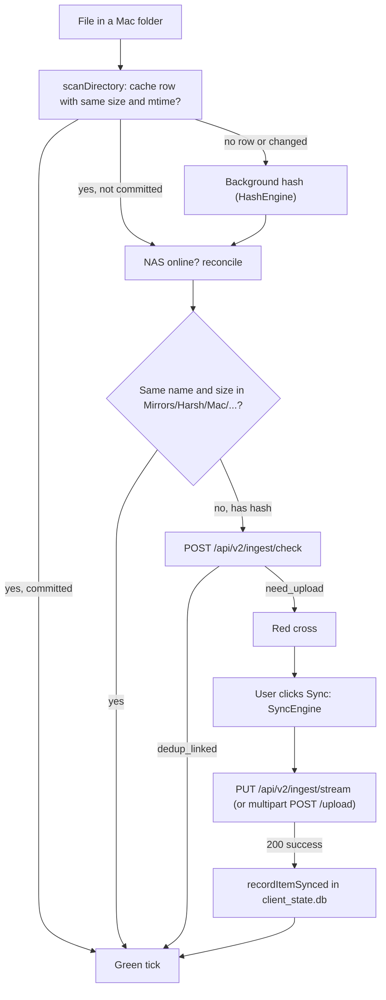

# Mac App (SynapsMac)

SynapsMac is a native SwiftUI app that shows your Mac folders Finder-style, with a green tick on every file the NAS already holds and a red cross on the ones it doesn't. It uploads what is missing, lets you browse the NAS ("Home Cloud") and download from it, and imports photos from an iPhone plugged in over USB. Everything below is read from `clients/mac/SynapsMac/Sources/` on the current branch.

For the server side of the same endpoints see [03-storage-and-ingest.md](03-storage-and-ingest.md) and [10-api-reference.md](10-api-reference.md). The iPhone app is covered in [09-iphone-app.md](09-iphone-app.md).

## Big picture

The app is one window with three kinds of content: local Mac folders, the NAS, and a USB-connected iPhone. A single view model, `AppViewModel`, owns what is on screen and delegates the real work to a handful of singleton services.

| Layer | Types | Job |
|---|---|---|
| App and scenes | `SynapsMacApp`, `main.swift` | Window group plus a Settings scene |
| Views | `MainView`, `SidebarView`, `FileListView`, `PhotosGridView`, `SyncStatusBar`, `ActivityLogSheet`, `SettingsView`, `FileBadgeView` | Layout, toolbar, badges |
| View model | `AppViewModel` | Navigation, selection, filters, NAS status, starting syncs, merging results |
| Local files | `LocalFileScanner`, `HashEngine`, `LocalCacheStore`, `SecurityBookmarkManager` | List folders, hash files, remember state |
| NAS | `NASClient`, `SyncEngine`, `NASReconciliationEngine`, `NASThumbnailLoader` | HTTP calls, uploads, "is it on the NAS?" checks, thumbnails |
| iPhone | `iPhoneManager` | ImageCaptureCore device listing and import |
| Helpers | `ThumbnailLoader`, `ItemInfoLoader`, `QuickLookCoordinator`, `UserNotifier`, `FileManager+UniqueMove` | Local thumbnails, Quick Look, notifications |

## App and scene setup

[`main.swift`](../clients/mac/SynapsMac/Sources/main.swift) just calls `SynapsMacApp.main()`. The package is a SwiftPM executable target, so there is no `@main` attribute; the entry point is this file.

[`SynapsMacApp.swift`](../clients/mac/SynapsMac/Sources/SynapsMacApp.swift) declares two scenes:

- A `WindowGroup` showing `MainView`, with a title-bar window style, a unified toolbar and `SidebarCommands()` (the standard "Toggle Sidebar" menu item).
- A `Settings` scene showing `SettingsView`, opened with Synaps > Settings... or Cmd+, (and from the gear button in the sidebar via `SettingsLink`).

## UI structure

[`MainView`](../clients/mac/SynapsMac/Sources/Views/MainView.swift) creates the `AppViewModel` (`@StateObject`) and lays out a `NavigationSplitView`:

- **Sidebar**: `SidebarView`.
- **Detail**: one of three things, then `SyncStatusBar` underneath:
  - a "Home Cloud is Offline" panel when the NAS section is selected and the NAS doesn't answer (with Reconnect, a "Use <address>" button if discovery found another server, and a link to Settings);
  - `PhotosGridView` when the iPhone section is selected or the grid display mode is on;
  - `FileListView` otherwise.

The toolbar has a Back button (`navigationHistory`), a filter picker (All / Uncommitted / Committed, hidden in the NAS section), a sort menu (name, date modified, date created, size, kind), Quick Look, a list/grid toggle and Refresh. Search is a `.searchable` field that filters by file name.

[`SidebarView`](../clients/mac/SynapsMac/Sources/Views/SidebarView.swift) has these sections:

| Section | Rows | Selecting it |
|---|---|---|
| Devices | The connected iPhone (name, item count, transport) or a "Connect iPhone via USB-C" hint | iPhone grid |
| Mac Folders | Downloads, Documents, Desktop, Pictures | Downloads/Documents/Desktop load that folder. **Pictures opens the iPhone grid**, not `~/Pictures` |
| iPhone Albums | Album names found in the cache for phone items (only shown when there are any) | Display only |
| NAS Network | "Home Cloud (homecloud1)" with a green/red dot, the NAS URL (or the auth error), a refresh button and a Settings gear | NAS browser |

[`SyncStatusBar`](../clients/mac/SynapsMac/Sources/Views/SyncStatusBar.swift) is context-sensitive. In a Mac folder it shows the breadcrumb, the uncommitted count and size (or "All committed"), the last sync summary, a progress bar with MB/s and a cancel button during a sync, and the **Sync (n)** / **Sync All** buttons. In the iPhone grid it shows import progress and **Import (n)** / **Import All**. In the NAS view it shows the path, item count and download status. Every mode has an **Activity** button that opens `ActivityLogSheet`, a searchable list of the last 100 rows of the local activity log.

[`FileBadgeView`](../clients/mac/SynapsMac/Sources/Views/FileBadgeView.swift) draws the status badge from [`SyncStatus`](../clients/mac/SynapsMac/Sources/Models/SyncStatus.swift):

| Status | Icon | Colour |
|---|---|---|
| `committed` | checkmark.circle.fill | green |
| `uncommitted` | xmark.circle.fill | red |
| `syncing` | arrow.triangle.2.circlepath | blue |
| `failed` | exclamationmark.circle.fill | orange |

## AppViewModel

[`AppViewModel`](../clients/mac/SynapsMac/Sources/ViewModels/AppViewModel.swift) is a `@MainActor` `ObservableObject`. Its main responsibilities:

- **Navigation.** `selectSidebarItem`, `navigateIntoFolder`, `navigateBack`, `loadFolder`, `loadNASFolder`, `selectPicturesSection`. Every navigation calls `beginNavigation()`, which cancels the previous load and bumps `loadGeneration`. Async results carry the generation they started with and are dropped if the user has moved on, so a slow scan of a folder you already left can't overwrite the screen.
- **List state.** `fileItems`, plus a cached `filteredItems` (filter, search, sort) that is recomputed only when an input changes; `groupedItemsByKind` for the kind headers.
- **NAS status.** `checkNASStatus()` shares one in-flight health check between callers. It runs at launch, when the app becomes active, and every 45 s while the NAS is offline (`nasRecoveryTimer`). If a token is configured (or a 401 was seen) it also calls `NASClient.verifyAuth()`. When the NAS comes back online it re-reconciles the folder on screen.
- **Settings changes.** `SettingsView` posts `SynapsConfig.didChangeNotification`; `applySettings` pushes the new URL and token into `NASClient` and re-checks.
- **Syncs.** `syncAllUncommitted`, `syncSelectedItems`, `syncItem` expand folders recursively (`scanDirectoryRecursivelyAsync`), skip committed files, and hand the rest to `SyncEngine.run`. Engine events update badges and progress; `finishSync` writes the summary, logs it and posts a notification.
- **Merging.** `mergeReconciled` applies reconciliation results by path, but never touches files in the running sync (`activeSyncPaths`) and never flips a file back to uncommitted if a sync committed it after the reconciliation started (`committedAt`).

## Local scanning

[`LocalFileScanner.scanDirectory`](../clients/mac/SynapsMac/Sources/Services/LocalFileScanner.swift) is a shallow listing, like Finder. It skips hidden files, a fixed ignore list (`.DS_Store`, `.git`, `node_modules`, `__pycache__`, `.venv`, `venv`, `.next`, `.cache`, ...) and partial-download extensions (`tmp`, `download`, `part`, `crdownload`).

For each entry it decides a status without reading file contents:

- **Files**: look up the path in `LocalCacheStore`. If the stored size matches and the stored mtime is within 1 second, reuse the stored SHA-256, and show committed if the record has `last_synced_at` or `sync_status = 'committed'`. Otherwise the file is uncommitted and has no hash yet.
- **Folders**: `evaluateFolderSyncStatus` walks the folder recursively and returns committed only if it contains at least one file and every file has a record proving that exact size+mtime was committed. It stops at the first unproven file. After 64 files it switches from per-file lookups to one range query (`records(under:)`).

The list is returned to the UI immediately. Files without a cached hash are then hashed in the background (`scheduleHashing`); starting a new scan, opening the NAS or iPhone view, or starting a sync cancels that work. Results reach the UI in batches of up to 32 items or every 0.75 s (`HashResultBatcher`), via the `onItemsHashed` callback.

`persistHash` saves the new hash. A previous committed status carries over only if the record describes the same content (same hash, or same size+mtime when no hash was stored); an edited file becomes uncommitted again.

### Security-scoped bookmarks

[`SecurityBookmarkManager`](../clients/mac/SynapsMac/Sources/Services/SecurityBookmarkManager.swift) wraps `startAccessingSecurityScopedResource` with reference counting and stores bookmarks in `UserDefaults` (`com.synaps.security_bookmarks`). It only does anything inside the App Sandbox, detected through the `APP_SANDBOX_CONTAINER_ID` environment variable. The current build is not sandboxed ([`Entitlements.plist`](../clients/mac/SynapsMac/Entitlements.plist) has the user-selected-files and app-scope-bookmark keys but not `com.apple.security.app-sandbox`), so every call returns the plain URL.

## The local state database

[`LocalCacheStore`](../clients/mac/SynapsMac/Sources/Services/LocalCacheStore.swift) is a SQLite file at `~/.config/synaps/client_state.db` (the directory comes from `SynapsConfig.configDir`, overridable with `SYNAPS_CONFIG_DIR`; tests use a temp directory). It opens in WAL mode with `synchronous=NORMAL` and a 3 s busy timeout, and all access is serialized on one dispatch queue.

**`local_files`**, one row per path:

| Column | Meaning |
|---|---|
| `path` (PK) | Normalized path (symlinks resolved), or a virtual key like `iPhone://100APPLE/IMG_0001.JPG` |
| `inode` | File number at the time of writing (stored, not used for matching) |
| `size`, `mtime` | What the hash and status describe |
| `sha256` | Hex digest, if computed |
| `last_synced_at` | When the NAS confirmed it; set means committed |
| `sync_status` | `uncommitted` / `committed` |
| `album`, `is_favorite` | Extra metadata (album is set to "iPhone Import" for imported photos) |

**`sync_activity_log`** holds the activity entries (`existing_discovered`, `file_synced`, `sync_started`, `sync_completed`, `sync_failed`, ...). It is pruned to the newest 5,000 rows at launch.

`saveRecord` uses an upsert that makes "committed" sticky: a write that says `uncommitted` cannot downgrade a committed row unless size, mtime (by 1 s or more) or hash changed. `updateSyncStatuses(..., notSyncedSince:)` lets reconciliation revert rows without overwriting a commit that happened after it started.

## Hashing

[`HashEngine`](../clients/mac/SynapsMac/Sources/Services/HashEngine.swift) streams files through CryptoKit's SHA-256 in 4 MB reads, so memory stays flat for any file size. `computeSHA256s` hashes many files with bounded parallelism (`min(cores - 1, 4)`, at least 1) on its own concurrent GCD queue, keeping blocking reads off Swift's cooperative thread pool. Cancellation is checked between chunks, so stopping a 50 GB hash is quick.

## Sync flow (committing files)

[`SyncEngine.run`](../clients/mac/SynapsMac/Sources/Services/SyncEngine.swift) processes the selected files in chunks of 200 (`NASClient.maxCheckBatchSize`), entirely off the main thread:

1. **Hash** files in the chunk that have no SHA-256 yet. Unreadable files fail immediately.
2. **Pre-check** with `POST /api/v2/ingest/check`. Files the NAS answers `dedup_linked` for are recorded as committed (`recordItemsSynced`) with zero transfer. If the check itself fails (other than 401), the chunk is uploaded anyway, since the server dedups by hash too.
3. **Upload** the rest, two at a time (`uploadConcurrency = 2`; the NAS is a dual-core box with one disk). Identical content inside a chunk is uploaded once; the copies are linked afterwards by a second pre-check.
4. **Albums**: committed files with an album name get one `POST /api/v2/ingest/albums` call per source and album.

Each upload goes through `NASClient.uploadFile`:

- It probes once per server with a `GET` on `/api/v2/ingest/stream`; 404 means an old backend. Otherwise it sends `PUT /api/v2/ingest/stream` with the raw file as the body and the metadata in the query string.
- If that answers 404 or 405, it remembers the fact for the session and uses multipart `POST /api/v2/ingest/upload`, building the body in a temp file in 4 MB chunks (never in RAM).

| Situation | What the engine does |
|---|---|
| Transient error (timeouts, connection lost, 408/429/502/503/504) | Retry up to 3 attempts, backoff ~2 s then ~4 s with ±20% jitter (capped at 30 s) |
| HTTP 400 | Re-hash the file once; if the content changed, retry with the new hash |
| HTTP 401 | Stop the whole run; sidebar shows "API token missing or wrong" |
| HTTP 507 | Stop the whole run ("Home Cloud's disk is full") |
| Other errors | Mark the file failed and log it |
| Cancel | In-flight uploads stop; files already uploaded stay committed |

On success the file is recorded as committed in `local_files` and logged as `file_synced`. Progress is byte-weighted and sampled every 300 ms; the speed shown is an exponentially smoothed rate of bytes actually sent.

## NAS reconciliation

Reconciliation answers "which files in this folder are already on the NAS?" for files Synaps didn't upload itself, or after the cache was lost. [`NASReconciliationEngine`](../clients/mac/SynapsMac/Sources/Services/NASReconciliationEngine.swift) runs after every folder load while the NAS is online.

`resolveMirrorPath` maps the local folder to its mirror folder on the NAS by stripping `/Users/<name>/`:

```text
/Users/harshrathod/Downloads            -> Mirrors/Harsh/Mac/Downloads
/Users/harshrathod/Downloads/Invoices   -> Mirrors/Harsh/Mac/Downloads/Invoices
```

The owner (`Harsh`) and device (`Mac`) segments are hard-coded. `reconcileDirectory` then works in two tiers:

1. **Fast tier**: list the mirror folder (`browseAllDirectoryFiles` on `/api/finder/browse`) and mark any local file with the same name and size committed. No hashing needed.
2. **Deep tier**: files not found in the mirror that already have a hash go through `/api/v2/ingest/check` in batches of 200. `dedup_linked` means committed; `need_upload` means uncommitted. Files with no hash that the cache claimed were committed are reverted to uncommitted.

`reconcileHashedItems` runs the deep tier on files as background hashing finishes them. Note that `/ingest/check` is not read-only: a `dedup_linked` answer means the server has linked this Mac path to the existing content (see [03-storage-and-ingest.md](03-storage-and-ingest.md)).



## Browsing the NAS

`loadNASFolder` calls `NASClient.browseDirectory` (`GET /api/finder/browse`, 1,000 per page). If the folder has more files it fetches the remaining pages (`browseAllDirectoryFiles`, at most 500 pages) so sorting covers the whole folder. Items use `nas://<path>` ids and are always shown as committed. **Download to Mac** (context menu) saves into `~/Downloads` via `/api/finder/download` and never overwrites: a taken name becomes `name (1).ext`.

[`NASThumbnailLoader`](../clients/mac/SynapsMac/Sources/Services/NASThumbnailLoader.swift) fetches `GET /api/finder/thumbnail` with three cache tiers: memory (`NSCache`, 300 items / 50 MB), disk (`~/Library/Caches/com.synaps.mac/nas_thumbnails`, trimmed least-recently-used from above 512 MB down to 384 MB once per launch), then the network (at most 3 connections). Concurrent requests for one path share a download, and a cell that scrolls away cancels its request.

| Response | Handling |
|---|---|
| 200 | Decode, write to disk cache, put in memory cache |
| 202 (queued on the NAS) | Poll again after `max(Retry-After, min(10, 2 x 1.5^attempt))` seconds, up to 12 times |
| 400 / 403 / 404 | Remember as unavailable for 30 minutes |
| 401 | Report through `NASClient.reportUnauthorized()` |

Local-file thumbnails come from [`ThumbnailLoader`](../clients/mac/SynapsMac/Sources/Services/ThumbnailLoader.swift) (QuickLook `QLThumbnailGenerator`, 4 concurrent, 60 MB memory cache).

## The iPhone (USB) view

[`iPhoneManager`](../clients/mac/SynapsMac/Sources/Services/iPhoneManager.swift) uses ImageCaptureCore: an `ICDeviceBrowser` finds the phone, opens a session and reads `mediaFiles`. A locked or untrusted phone (`isLocked` / `isAccessRestrictedAppleDevice`) shows an "unlock and trust" panel instead.

- **Ids.** Each photo gets `iPhone://<DCIM folder>/<file name>`, for example `iPhone://100APPLE/IMG_0001.JPG`. The folder is included because file names repeat across folders. Older name-only keys are still looked up.
- **Status.** Built off the main thread from `local_files` rows under that id: committed if the stored size matches and the row says committed.
- **Already on the NAS.** `markItemsAlreadyOnNAS` sends file name and size of every not-yet-committed phone item to `POST /api/v2/ingest/match` (batches of up to 2,000). Matches are saved as committed rows with the NAS's hash, and the badges flip to green. Each item is asked once per session; on an error (offline, older server) they are asked again on the next refresh.
- **Import.** **Import** / **Import All** download each file over USB into a hidden staging folder, then move it into `~/Pictures/Synaps Imports` under a unique name (a byte-identical earlier import is reused). The download timeout scales with size (at least 60 s, allowing about 5 MB/s). After import the local copy is hashed and stored as **uncommitted** with album "iPhone Import", and the phone item is stored as **committed**.

So in the iPhone grid, a green tick means "imported to this Mac, or already on the NAS", not necessarily "uploaded". The imported files reach the NAS only when that folder is synced. The sidebar's Pictures row opens the iPhone grid, so the import folder can't currently be opened from the sidebar.

## Configuration

[`SynapsConfig`](../clients/mac/SynapsMac/Sources/Models/Config.swift) is stored as JSON in `~/.config/synaps/mac_app_config.json`. It is written atomically with mode 0600 (directory 0700), because it can contain the API token. A file that fails to decode is copied to `mac_app_config.json.corrupt` and replaced with defaults; missing fields fall back to defaults individually.

| Field | Default | Used for |
|---|---|---|
| `nasUrl` | `http://192.168.0.105:8000` | Base URL of every request |
| `apiToken` | empty | Sent as `Authorization: Bearer <token>` when set |
| `autoDiscoverNas` | true | Suggest another address when the NAS is offline |
| `notificationsEnabled` | true | `UserNotifier` |
| `macSourceId`, `iphoneSourceId`, `watchFolders` | `mac_harsh`, `iphone_harsh`, Downloads/Documents/Desktop/Pictures | Stored but not read by the app; source ids are hard-coded in the code |

The token lives in this file, not in the Keychain. `SettingsView` edits address, token, discovery and notifications; **Test Connection** uses a throwaway `NASClient` so a wrong token there doesn't flag the main app.

**Discovery never switches hosts on its own.** `discoverNAS()` probes `/api/health` (then `/health`) on three fixed candidates: `http://192.168.0.105:8000`, `http://192.168.0.101:8000` and `http://homecloud1.local:8000`. Localhost is deliberately excluded. Health probes never carry the token. A responder is only offered as "Use <address>"; the saved URL changes only when you click it.

## Notifications

[`UserNotifier`](../clients/mac/SynapsMac/Sources/Services/UserNotifier.swift) posts "sync finished" and "import finished" messages when `notificationsEnabled` is on. Inside the `.app` bundle it uses `UNUserNotificationCenter` (and shows banners even while Synaps is frontmost). Without a bundle, such as a bare `swift run`, or if the center errors, it falls back to `osascript`, passing the text as arguments so it can never be run as AppleScript.

## Building and running

The quickest path is `./synaps mac` from the repo root. It runs [`bundle_app.sh`](../clients/mac/SynapsMac/bundle_app.sh) and opens the result. The script:

1. runs `swift build -c release`;
2. creates `SynapsMac.app` next to the package, copies the binary into `Contents/MacOS/` and writes an `Info.plist` (bundle id `com.synaps.mac`, minimum macOS 14.0, Photos/camera/folder usage strings);
3. ad-hoc signs it with `Entitlements.plist` (`codesign --sign -`).

**Build with the Mac's default toolchain** (Command Line Tools with the macOS 26 SDK). Building with Xcode 27's Swift 6.4, whose default build system is `swiftbuild`, stamps the binary with SDK 14.0. macOS 26 then draws the app in the old, pre-Liquid-Glass compatibility look. Check which SDK a build used:

```bash
vtool -show-build clients/mac/SynapsMac/SynapsMac.app/Contents/MacOS/SynapsMac
# look for "sdk 26.x"; "sdk 14.0" means the wrong toolchain
```

`xcode-select -p` shows which toolchain `swift` resolves to.

### Tests

`Package.swift` defines a `SynapsMacTests` test target (`clients/mac/SynapsMac/Tests/`): sync engine, NAS client, config, hash/cache and reconciliation tests. Run them with `swift test` in the package folder, or via `./synaps test`. `swift test` needs XCTest, which ships with full Xcode, not the Command Line Tools. `LiveNASIntegrationTests` are skipped unless `SYNAPS_LIVE_NAS_URL` is set (optionally `SYNAPS_LIVE_NAS_TOKEN`). Under XCTest, `SynapsConfig.configDir` points at a temp folder so the real `~/.config/synaps` is never touched.

## Gotchas and limits

- **Cache keys are paths.** Moving or renaming a file makes it look new until it is re-hashed and found by `/ingest/check`. The `inode` column is stored but not used for matching.
- **Mirror paths are hard-coded** to `Mirrors/Harsh/Mac/...`, and only folders under `/Users/<name>/` map cleanly. The fast tier only helps for files the NAS mirrored at the same relative path.
- **Reconciliation writes to the NAS.** A `dedup_linked` answer from `/ingest/check` links the local path on the server.
- **Sidebar folders are fixed**: Downloads, Documents, Desktop, plus subfolders you open. Pictures opens the iPhone grid.
- **iPhone ticks mean "imported or on the NAS"**, and imports land in `~/Pictures/Synaps Imports`, which still has to be synced.
- **The API token is a plain-text file** (0600) in `~/.config/synaps/`.
- **Folder badges are recursive walks.** Very large folders take a moment to show their status and are re-evaluated after every sync.
- **Uploads are 2 at a time** by design; raising `uploadConcurrency` just thrashes the NAS disk.
