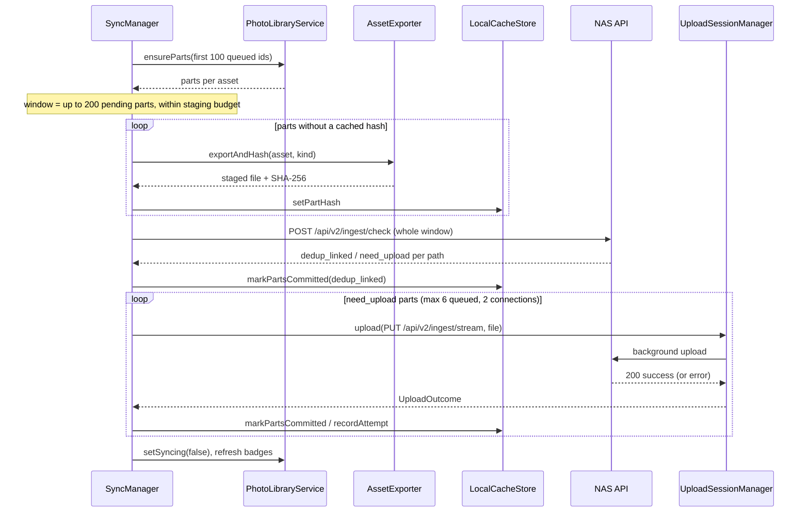

# iPhone App (SynapsiOS)

SynapsiOS is a SwiftUI app (iOS 16+) that backs up the iPhone photo library to the NAS. It shows every photo with a committed (green) or uncommitted (red) badge, uploads in the background through a background `URLSession`, can browse the NAS vault, and shows a Lock Screen Live Activity while a backup runs. Everything below is read from `clients/ios/SynapsiOS/Sources/`, `Widgets/` and `Resources/` on the current branch.

The Mac client is covered in [08-mac-app.md](08-mac-app.md); the server side of `/api/v2/ingest/*` is in [03-storage-and-ingest.md](03-storage-and-ingest.md) and [10-api-reference.md](10-api-reference.md).

## Big picture

| Area | Types | Job |
|---|---|---|
| Lifecycle | `SynapsiOSApp`, `AppDelegate` | Scene phases, BGTask registration, background-session relaunch |
| Library | `PhotoLibraryService`, `LibraryScanner`, `PartScanner`, `AssetIndex` | Enumerate PHAssets, index their resources, publish `SynapsMediaItem`s |
| State | `LocalCacheStore`, `PartPolicy`, `AssetPart` | SQLite cache of hashes, commit marks, failures, activity log |
| Sync | `SyncManager`, `AssetExporter`, `HashEngine`, `UploadSessionManager`, `NASClient` | Export, hash, `/check`, upload |
| Automation | `BackgroundSyncWorker`, `NetworkMonitor`, `NASReconciler` | When to sync; marking photos already on the NAS |
| Lock Screen | `SyncLiveActivityController`, `SyncActivityAttributes`, `Widgets/SyncLiveActivityWidget.swift` | Live Activity |
| Vault | `NASVaultViewModel`, `NASThumbnailLoader` | Browse the NAS |
| Secrets | `APITokenStore` | API token in the Keychain |

The UI is a `TabView` in [`MainTabView`](../clients/ios/SynapsiOS/Sources/Views/MainTabView.swift) with four tabs: **Photos** (grid with badges, selection, detail view), **Uncommitted** (badge = uncommitted count, "Commit All"), **NAS Vault** and **Settings**. One `PhotosViewModel` is shared by all tabs so the library is enumerated once.

## App lifecycle

[`SynapsiOSApp`](../clients/ios/SynapsiOS/Sources/SynapsiOSApp.swift) is the `@main` entry. It attaches an [`AppDelegate`](../clients/ios/SynapsiOS/Sources/AppDelegate.swift) with `@UIApplicationDelegateAdaptor` and watches `scenePhase`:

- `.background` calls `BackgroundSyncWorker.shared.scheduleNextBackgroundSync()`.
- `.active` calls `SyncManager.shared.appDidBecomeActive()`.

`AppDelegate.didFinishLaunching` does three things that must happen before launch completes:

1. `BackgroundSyncWorker.registerBackgroundTasks()`: `BGTaskScheduler` requires launch handlers to be registered before launch finishes.
2. `UploadSessionManager.activate()`: reconnects to the background upload session, so uploads that kept running while the app was suspended or killed deliver their results, and deletes orphaned staging files.
3. On iOS 16.2+, `SyncLiveActivityController.shared.start()`.

When iOS relaunches the app because background uploads finished, `application(_:handleEventsForBackgroundURLSession:completionHandler:)` hands the completion handler to `UploadSessionManager`, which calls it on the main thread after `urlSessionDidFinishEvents`.

## Photo library indexing

[`PhotoLibraryService`](../clients/ios/SynapsiOS/Sources/Services/PhotoLibraryService.swift) is a `@MainActor` singleton that publishes `mediaItems`. Loading happens in two passes so the grid appears fast.

**Pass 1, snapshot.** `LibraryScanner.buildSnapshot` runs off the main thread. It fetches all `PHAsset`s (newest first; user library, iCloud shared and iTunes-synced sources), reads all cached rows from SQLite, and builds items from cheap `PHAsset` properties only. An asset needs a resource scan when it has no row, its `parts_version` is out of date, or its modification date changed. The snapshot also fills `AssetIndex`, a thread-safe id-to-`PHAsset` map, so later lookups don't query Photos again.

**Pass 2, resource scan.** Assets needing a scan are processed in chunks of 400 at utility priority. `PartScanner.scan` lists the asset's `PHAssetResource`s and turns them into **parts**, the files Synaps uploads for that asset:

| Part kind | What it is |
|---|---|
| `photo`, `video`, `audio` | The original. One is the primary part |
| `alternatePhoto` | e.g. the RAW companion of a RAW+JPEG pair |
| `pairedVideo` | Motion half of a Live Photo (`.MOV`) |
| `fullSizePhoto`, `fullSizeVideo`, `fullSizePairedVideo` | Rendered output of an edit made in Photos |

The primary part is the original photo (or video for video assets). Edited renders get Apple's naming, `IMG_1234.HEIC` becomes `IMG_E1234.<ext>`. Sizes come from the undocumented `fileSize` key of `PHAssetResource`, guarded so a missing key gives 0. Each part's NAS identity is `originalPath = "ph://<localIdentifier>/<filename>"`.

The service also observes `PHPhotoLibraryChangeObserver`. Changes that touch the fetch are debounced for 1.5 s, then the library reloads and `SyncManager.libraryDidChange()` asks for an automatic sync.

## What "committed" means

[`PartPolicy`](../clients/ios/SynapsiOS/Sources/Models/AssetPart.swift) decides which parts an asset needs on the NAS:

- The primary part is always required.
- Live Photo videos are required only if **Settings > Backup Contents > Live Photo Videos** is on (`uploadLivePhotoVideos`, default on).
- Edited renders are required only if **Edited Versions** is on (`uploadEditedVersions`, default on).

An asset is **committed** when every expected part has both `committedAt` and `sha256` set. If not, it is `failed` when the last attempt failed, otherwise `uncommitted`. `syncing` exists only in memory while a window is in flight, never in the database. Changing a policy toggle calls `policyDidChange()`, which re-derives every stored status (`recomputeStatuses`) and reloads.

A cached hash stays valid while the part's size is unchanged; for edited renders the asset's modification date must also match (`AssetPart.hashIsValid`), since re-editing changes the render but not the original.

## The local database

[`LocalCacheStore`](../clients/ios/SynapsiOS/Sources/Services/LocalCacheStore.swift) is SQLite at `Application Support/Synaps/synaps_ios_state.db` (`getDatabaseURL`), in WAL mode with `synchronous=NORMAL`. All access goes through one serial queue.

| Table | Key | Holds |
|---|---|---|
| `local_assets` | `id` (localIdentifier) | filename, size, mtime, primary sha256, `last_synced_at`, `sync_status`, `is_favorite`, `fail_count`, `last_attempt_at`, `last_error`, `parts_version` |
| `asset_parts` | (`asset_id`, `kind`) | filename, size, `is_primary`, sha256, `hash_mtime`, `committed_at` |
| `sync_activity_log` | `id` | Activity entries (`UPLOADED`, `DEDUP_LINKED`, `FAILED`, ...), pruned to 2,000 rows every 200 inserts |

Important writes:

- `applyResourceScans` replaces an asset's parts, carrying over hashes and commit marks that are still valid. Rows written by the old single-part version (v1) carry their hash and committed state into the primary part.
- `setPartHash` stores a new hash; a different hash clears `committed_at`.
- `markPartsCommitted` (after upload or `/check` dedup) and `markPartsFoundOnNAS` (after `/ingest/match`).
- `recordAttempt` re-derives the status and records failures. Failed assets are skipped by automatic syncs for 15 min, doubling per failure, capped at 24 h (`assetIdsInFailureBackoff`). Manual syncs ignore the backoff.

At open, any leftover `syncing` status is reset to `uncommitted`.

## The sync pipeline

[`SyncManager`](../clients/ios/SynapsiOS/Sources/Services/SyncManager.swift) owns a queue of asset ids. `syncItems` (manual) and `requestAutomaticSync` (automatic) both call `enqueue`; work added while a run is active joins that run. A run begins with a health check, calls `beginBackgroundTask("SynapsSync")` for extra time if the app is backgrounded, then repeatedly takes a **window** off the queue and processes it.

`nextWindow` looks at the first 100 queued ids, makes sure their parts are indexed (`ensureParts`), and takes assets until the window would exceed **200 pending parts** or the **staging budget** (at least 64 MB, at most 1 GB, and at most a quarter of free space). One asset bigger than the budget gets a window of its own. Assets already fully committed are just re-recorded.

Each window then runs three phases:

**A. Export and hash.** Parts without a cached hash are written to disk with `PHAssetResourceManager.writeData` (downloading from iCloud if needed; progress shows as "Downloading ... from iCloud (n%)") by [`AssetExporter`](../clients/ios/SynapsiOS/Sources/Services/AssetExporter.swift), then hashed by [`HashEngine`](../clients/ios/SynapsiOS/Sources/Services/HashEngine.swift) in 4 MB reads. Exported files stay staged in `Application Support/SynapsUploads` (excluded from backup; tmp/ could be purged while a background upload still reads the file). An export is refused if free space is below twice the file size plus 200 MB, because the multipart fallback needs a second copy.

**B. Pre-check.** One `POST /api/v2/ingest/check` for all hashed parts of the window. Parts the NAS answers `dedup_linked` for are marked committed and their staged files deleted. A 401 or any other pre-check failure stops the run.

**C. Upload.** Remaining parts are handed to [`UploadSessionManager`](../clients/ios/SynapsiOS/Sources/Services/UploadSessionManager.swift), a background `URLSession` (`com.synaps.ios.background-upload`, at most 2 connections). `SyncManager` keeps at most 6 uploads queued in the session and exports the next part while earlier ones upload. Each task stores an `UploadTaskInfo` JSON in `taskDescription`, so if the app dies, `SyncResultRecorder` can still apply the result on the next launch.

Per-part upload rules (`uploadWithFallback`):

| Response | Action |
|---|---|
| 2xx with `"status": "success"` | Mark part committed |
| 404 / 405 / 411 on `PUT /api/v2/ingest/stream` | Switch to multipart `POST /api/v2/ingest/upload` for the rest of the session and retry |
| 401 | Stop the run and cancel queued uploads |
| 507 | Stop the run ("The NAS disk is full") and cancel queued uploads |
| 400 containing "mismatch" | Re-export and re-hash once, upload again; fail if it mismatches twice |
| Transient (timeouts, lost connection, 408/429/500/502/503/504, 400 "incomplete"/"disconnect") | Retry, up to 3 attempts, backoff 2 s then 4 s plus up to 0.5 s jitter (capped at 30 s) |

The `/check` call uses the same retry helper. Manual runs may use expensive or constrained networks (`allowsExpensiveNetworkAccess`); automatic runs may not.

A **connection watchdog** runs during phase C: every 30 s, if the app is in the foreground and no upload has made progress for over a minute, it probes the NAS. Two failed probes in a row cancel the uploads with "Lost connection to the NAS", instead of waiting out the session's long timeouts (300 s per request).

When all of an asset's parts finish, `finalize` records the outcome once, logs `UPLOADED` or `DEDUP_LINKED` (or `FAILED`), and bumps the progress counter.

### Why a run stops

`statusMessage` holds the reason, shown in the banner above the grid and on the Lock Screen.

| Reason | Message |
|---|---|
| NAS health check fails at start | "Cannot reach the NAS at ..." |
| Automatic run and conditions no longer hold | "Paused: waiting for Wi-Fi" / "waiting for charger" / "Auto-Upload is off" |
| 401 | "API token missing or wrong ..." |
| 507 | "The NAS disk is full (507) ..." |
| `/check` failed | "NAS pre-check failed: ..." |
| Watchdog | "Lost connection to the NAS" |

User **Cancel** (`cancelSync`) stops the run and cancels every task in the background session. Background-time expiry calls `stopAfterCurrentStep()`: already-exported files are still handed to the background session (they upload while suspended), but nothing new is exported.

## Automatic sync

`requestAutomaticSync` only queues work when all of these hold (`automaticSyncBlocker`):

- **Auto-Upload on Wi-Fi** is on (`autoSyncOnWifi`, default on).
- The network is unmetered LAN ([`NetworkMonitor`](../clients/ios/SynapsiOS/Sources/Services/NetworkMonitor.swift)): Wi-Fi or Ethernet, not "expensive" (personal hotspot), not constrained (Low Data Mode).
- If **Require Charging / Power** is on, the battery is charging or full.
- The NAS answers its health check (so being on someone else's Wi-Fi stays quiet).

Candidates are uncommitted or failed items not in failure backoff, newest first, limited to favorites if **Sync Favorites Only** is on (this applies to automatic runs only).

It is triggered from:

| Trigger | Where |
|---|---|
| App becomes active | `SyncManager.appDidBecomeActive` (after `NASReconciler.reconcileIfDue`) |
| Photo library changed | `PhotoLibraryService.scheduleReloadAfterChange` |
| Device joins unmetered Wi-Fi/Ethernet while running | `NetworkMonitor.onWifiConnected` -> `BackgroundSyncWorker.triggerWifiAutoSync` |
| Background tasks | [`BackgroundSyncWorker`](../clients/ios/SynapsiOS/Sources/Services/BackgroundSyncWorker.swift) |

`BackgroundSyncWorker` schedules two BGTasks each time the app goes to the background, and cancels both if **Enable Background Worker** or Auto-Upload is off:

| Identifier | Type | Earliest start | Work |
|---|---|---|---|
| `com.synaps.ios.backgroundsync` | `BGAppRefreshTask` | 15 min | Up to 20 items, waits at most 25 s, then winds down |
| `com.synaps.ios.photoprocessing` | `BGProcessingTask` | 30 min | Whole backlog; requires network, and external power if Require Charging is on |

Both reload the library, call `runBackgroundSync`, and complete the task exactly once (on finish or expiry). Uploads already in the background session keep going after the task ends. When iOS actually runs these tasks is up to iOS.

## Finding photos already on the NAS

The sync engine only learns that a photo is on the NAS after exporting and hashing it. Photos that got there another way (AirDropped to the Mac and synced by the Mac app, an older install, the web uploader) would stay red until then. [`NASReconciler`](../clients/ios/SynapsiOS/Sources/Services/NASReconciler.swift) fixes that cheaply:

1. Take every not-committed item, make sure its parts are indexed (chunks of 400), and collect the expected, uncommitted parts with a known size.
2. Send their (file name, size) pairs to `POST /api/v2/ingest/match`, at most 2,000 per request. This endpoint is read-only on the server.
3. Mark every match committed with the NAS's SHA-256 (`markPartsFoundOnNAS`) and log one `DEDUP_LINKED` entry.

No photo data is read. It runs automatically when the app becomes active, at most every 6 hours (`nasReconcileLastRun` in `UserDefaults`), before the automatic sync decides what to upload. **Settings > Find Photos Already on NAS** runs it any time. A 404 means the server is too old for `/ingest/match`.

Matching by name and size can produce a false positive if two different files share both. The Mac app uses the same endpoint for USB-connected iPhones (see [08-mac-app.md](08-mac-app.md)).

## Lock Screen Live Activity

While a backup runs, a Live Activity shows it on the Lock Screen and in the Dynamic Island.

[`SyncActivityAttributes`](../clients/ios/SynapsiOS/Sources/Models/SyncActivityAttributes.swift) is compiled into both the app and the widget extension. The static attribute is `nasName`; the content state is `done`, `total`, `detail` and `phase` (`syncing`, `finished`, `stopped`). `done` counts items handled in the run, committed, linked or failed.

[`SyncLiveActivityController`](../clients/ios/SynapsiOS/Sources/Services/SyncLiveActivity.swift) (iOS 16.2+):

- At launch it ends any activity a killed previous run left behind.
- It subscribes to `SyncManager`'s `isSyncing`, `syncedCount`, `totalToSyncCount`, `currentItemName` and `statusMessage`, throttled to **one update per second**.
- It **starts** an activity only when the setting is on, `total > 0`, Live Activities are allowed, and the app is in the foreground. iOS doesn't let apps start one from the background, so a BGTask-started backup has no banner.
- Each update sets a stale date **5 minutes** ahead. While the app is suspended and only the background session uploads, the count can't move; once stale, the banner says "Uploading in the background".
- When the run ends it shows **finished** ("Your backup is complete", kept 5 min) or, if `statusMessage` is set, **stopped** ("Backup paused" with the reason, kept 30 min).
- **Settings > Show Progress on Lock Screen** (`showSyncOnLockScreen` in `UserDefaults`, default on) ends a running activity immediately when turned off.

The destination name is the NAS's host name. `NASClient.probeHealth` stores the `name` field of `/api/health` in `UserDefaults` under `nasServerName`; before that exists, the host from the NAS URL is used (with `.local` stripped).

The layouts are in [`Widgets/SyncLiveActivityWidget.swift`](../clients/ios/SynapsiOS/Widgets/SyncLiveActivityWidget.swift): `SynapsWidgetBundle` contains one `ActivityConfiguration`. The Lock Screen view is one compact row (icon, "Backing up to homecloud1...", a progress bar with `done/total`, a detail line). The Dynamic Island has expanded, compact (icon plus percent) and minimal layouts.

## NAS Vault browsing

[`NASVaultViewModel`](../clients/ios/SynapsiOS/Sources/ViewModels/NASVaultViewModel.swift) calls `GET /api/finder/browse` with 200 files per page and loads the next page when the last row appears. A new navigation cancels the previous load. Search filters only what is loaded. Errors are turned into plain messages (bad token, "Check that you're on your home Wi-Fi").

[`NASThumbnailLoader`](../clients/ios/SynapsiOS/Sources/Services/NASThumbnailLoader.swift) loads `GET /api/finder/thumbnail` itself (`AsyncImage` can't send the auth header):

- Memory cache of 400 images / 48 MB; disk cache in `Caches/nas_thumbnails`, keyed by MD5 of base URL plus path.
- A disk entry is fresh for 7 days (the server's `max-age`); after that it is revalidated with `If-None-Match`, and a 304 restarts the clock.
- 202 (generation queued on the NAS) is polled up to 5 times, waiting `Retry-After` (default 2 s, clamped to 0.5–10 s).
- 400/401/403/404 stop at once. On any failure a stale disk copy is shown if there is one.
- At most 3 connections, because the NAS has one thumbnail worker.

## Settings, configuration and the API token

[`SynapsConfig`](../clients/ios/SynapsiOS/Sources/Models/Config.swift) is JSON in `UserDefaults` (`synaps_ios_config`). Every field decodes with its own default, and `SynapsConfig.update` does an atomic read-modify-write so the Settings screen and the sync engine don't overwrite each other.

| Field | Default |
|---|---|
| `nasUrl` | `http://192.168.0.105:8000` |
| `sourceId`, `friendlyName` | `iphone_harsh`, "Harsh's iPhone" |
| `autoSyncOnWifi`, `backgroundTaskEnabled` | on |
| `requireCharging`, `syncFavoritesOnly` | off |
| `uploadEditedVersions`, `uploadLivePhotoVideos` | on |
| `notificationsEnabled` | on (stored, not used by any code path) |
| `lastSyncTimestamp` | set when a run commits something |

`NASClient.checkHealth` only ever probes the configured URL (older builds probed fixed LAN addresses and could redirect uploads, and the token, to another host). Concurrent callers share one probe and a result is reused for 3 s. **Test Connection** (`verifyAccess`) adds one authenticated `/api/finder/browse` call to tell a wrong token apart from an unreachable NAS.

[`APITokenStore`](../clients/ios/SynapsiOS/Sources/Services/APITokenStore.swift) keeps the optional token as a Keychain generic password (service `com.synaps.ios.api-token`, account `nas`) with `kSecAttrAccessibleAfterFirstUnlockThisDeviceOnly`, so BGTasks and background relaunches can authenticate while the phone is locked. The value is cached in memory. `NASClient.makeRequest` adds `Authorization: Bearer <token>` to every request when one is set.

## Info.plist and targets

Keys in [`Resources/Info.plist`](../clients/ios/SynapsiOS/Resources/Info.plist):

| Key | Value / why |
|---|---|
| `NSAppTransportSecurity > NSAllowsLocalNetworking` | Plain `http://` to LAN hosts |
| `NSBonjourServices` | `_http._tcp`, `_synaps._tcp` |
| `NSLocalNetworkUsageDescription` | Local network permission prompt |
| `NSPhotoLibraryUsageDescription`, `NSPhotoLibraryAddUsageDescription` | Photos access |
| `NSSupportsLiveActivities` | Lock Screen activity |
| `UIBackgroundModes` | `fetch`, `processing` |
| `BGTaskSchedulerPermittedIdentifiers` | `com.synaps.ios.backgroundsync`, `com.synaps.ios.photoprocessing` |

The Xcode project has two targets:

| Target | Bundle id | Deployment target |
|---|---|---|
| `SynapsiOS` (app) | `com.synaps.ios` | iOS 16.0 |
| `SynapsSyncActivity` (widget extension, `Widgets/`) | `com.synaps.ios.SyncActivity` | iOS 16.2 |

## Building and running

1. Run `./synaps ios` from the repo root, or open `clients/ios/SynapsiOS/SynapsiOS.xcodeproj` directly.
2. Pick your iPhone (or a simulator) as the run destination.
3. Under Signing & Capabilities, set your Team for both the `SynapsiOS` and `SynapsSyncActivity` targets.
4. Run (Cmd+R). In the app: Settings tab, enter the NAS URL and (if the server uses `SYNAPS_API_TOKEN`) the API token, then Test Connection.

Debug builds accept launch arguments for simulator testing (all compiled out of release builds):

| Argument | Effect |
|---|---|
| `-SynapsNASURLOverride http://127.0.0.1:8765` | Use this base URL instead of the saved one |
| `-SynapsSeedAPIToken <token>` | Store the token in the Keychain at launch |
| `-SynapsSyncAllOnLaunch YES` | Load the library, then commit every uncommitted item |
| `-SynapsInitialTab 2` | Open on a given tab (2 = NAS Vault) |
| `-SynapsVaultPath <path>` | Open the NAS Vault in this folder |

## Gotchas and limits

- **Background work is at iOS's discretion.** BGTasks may run late or not at all; a force-quit app gets no BGTasks until it is opened again. Uploads already in the background session survive suspension.
- **No Live Activity for background-started runs**, and the count freezes while suspended (it shows as stale after 5 minutes).
- **Automatic sync needs home Wi-Fi.** Hotspots and Low Data Mode count as metered; cellular is never used automatically.
- **Pre-check failures stop the run** on iOS (unlike the Mac, which uploads anyway).
- **Name+size matching** in `NASReconciler` can mark a photo committed if a different file with the same name and size is on the NAS.
- **iCloud "Optimize Storage"** means originals are downloaded during export; large libraries need time and free space (staging budget up to 1 GB, 25% of free space).
- **Part sizes come from an undocumented key.** If iOS drops it, sizes read as 0: the staging budget then underestimates windows, and `NASReconciler` skips those parts (it only matches parts with a size).
- `Resources/SynapsiOS.entitlements` (Wi-Fi info) is in the project, but no build setting points `CODE_SIGN_ENTITLEMENTS` at it, so it is not applied.
