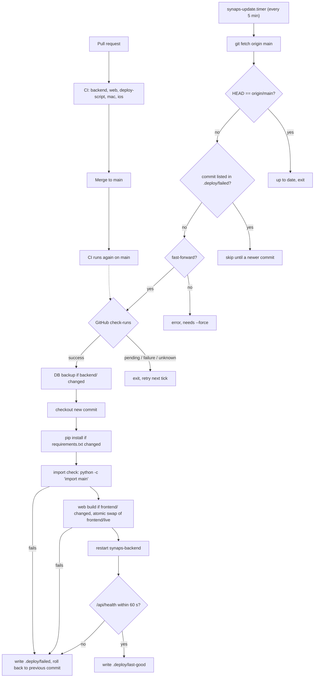

# Deployment

Synaps runs on the NAS as a handful of systemd units installed and driven by one bash script, [`synaps`](../synaps), at the repo root. You run `./synaps install` once on the NAS; after that, the NAS deploys itself: every 5 minutes a timer fetches `origin/main`, checks that GitHub CI passed for the new commit, rebuilds only what changed, restarts the backend and rolls back if the health check fails. This page covers what gets installed, the update loop, every `./synaps` command, the two kinds of settings, and the traps that have bitten before.

For day-to-day running (logs, backups, maintenance scripts, troubleshooting) see [12-operations.md](12-operations.md). The end-to-end trace of a merged PR is in [13-code-walkthroughs.md](13-code-walkthroughs.md#e-a-merged-pr-reaches-the-nas).

## What runs on the NAS

The NAS is `homecloud1` (Ubuntu Server 22.04, Core 2 Duo, 2 GB RAM, LAN IP 192.168.0.101, storage root `/storage`). The repo is a normal git checkout on it, e.g. `~/nas_dashboard`. Everything under `deploy/` is a template: `./synaps install` fills in placeholders such as `@USER@`, `@ROOT@` and `@STORAGE@` and copies the result into `/etc`. Edit the template in the repo, never the copy in `/etc`.

| Installed file | Template | What it does |
|---|---|---|
| `/etc/systemd/system/synaps-backend.service` | [`deploy/systemd/synaps-backend.service`](../deploy/systemd/synaps-backend.service) | Runs `backend/venv/bin/python main.py` as your user, working dir `backend/`, loading `backend/.env` as `EnvironmentFile`. `Restart=always` after 5 s, `Nice=-2`, `LimitNOFILE=16384`. `RequiresMountsFor=@STORAGE@` stops it from starting against an unmounted disk (an empty mount point would look like "everything was deleted"). |
| `/etc/systemd/system/synaps-update.service` | [`deploy/systemd/synaps-update.service`](../deploy/systemd/synaps-update.service) | `Type=oneshot` job that runs `./synaps update`. Runs at `Nice=10` with `IOSchedulingClass=idle` so builds don't starve file serving. `TimeoutStartSec=45min` because a web build on the Core 2 Duo is slow. |
| `/etc/systemd/system/synaps-update.timer` | [`deploy/systemd/synaps-update.timer`](../deploy/systemd/synaps-update.timer) | Starts the update job 3 min after boot (`OnBootSec`), then 5 min after the previous run finished (`OnUnitInactiveSec=5min`), plus up to 30 s random delay. |
| `/etc/systemd/system/synaps-frontend.service` | [`deploy/systemd/synaps-frontend.service`](../deploy/systemd/synaps-frontend.service) | Only installed in `node` web mode: runs `npm run start` (Next.js server on port 3000). In the default `static` mode it is not used and install disables it if present. |
| `/etc/sudoers.d/synaps` | [`deploy/sudoers.synaps`](../deploy/sudoers.synaps) | Lets your user run `systemctl restart synaps-backend.service` and `systemctl restart synaps-frontend.service` without a password, and nothing else. This is what lets the timer job restart the backend. |
| `/etc/avahi/services/synaps.service` | [`deploy/avahi/synaps.service`](../deploy/avahi/synaps.service) | Advertises "Synaps on %h" over Bonjour/mDNS as `_synaps._tcp` (TXT `path=/api/health`) and `_http._tcp` (TXT `path=/`), both on the backend port. |

Things the script creates in the checkout (all git-ignored, see [`.gitignore`](../.gitignore)):

| Path | Purpose |
|---|---|
| `backend/venv/` | Python virtualenv for the backend. |
| `backend/.env` | Backend settings (copied from [`backend/.env.example`](../backend/.env.example) on first install). |
| `.synaps.local` | Settings for the script itself (branch, web mode, CI gate). |
| `backend/.deploy/last-good` | Commit of the last successful deploy. |
| `backend/.deploy/failed` | Commit that failed to deploy (the timer skips it). |
| `backend/.deploy/backups/` | SQLite backups taken before backend updates (newest 5 kept). |
| `backend/.deploy/update.lock` | `flock` lock so two updates never overlap. |
| `frontend/live/` | The static web app the backend serves. Swapped in atomically via `frontend/live.new` and `frontend/live.old`. |

### Ports

| Port | Who listens | Notes |
|---|---|---|
| 8000 | Backend (uvicorn, one worker) | API, `/api/health`, and in `static` mode the web app at `/`. Change with `SYNAPS_PORT` in `backend/.env`; the script reads the same value for health checks, ufw and avahi. |
| 3000 | Next.js | Only in `node` web mode (`npm run start`) or during `./synaps dev` on the Mac (`npm run dev`). |
| 5353/udp | avahi-daemon | mDNS, so `homecloud1.local` resolves on the LAN. |

## Static vs node web mode

The web dashboard is a Next.js app (see [07-web-dashboard.md](07-web-dashboard.md)). It can be delivered two ways, set by `SYNAPS_WEB_MODE`:

- **`static` (default).** `npm run build:static` (which sets `SYNAPS_STATIC_EXPORT=1 next build`) exports plain HTML/JS to `frontend/out/`. The script copies it to `frontend/live/` and sets `SYNAPS_FRONTEND_DIST` in `backend/.env`, and the backend's `mount_frontend` in [`backend/main.py`](../backend/main.py) serves it at `/` without claiming `/api/*`. No Node process runs at all, which matters on a 2 GB box.
- **`node`.** `npm run build`, then `synaps-frontend.service` runs `next start` on port 3000. Costs a resident Node process.

Either way, Node.js is needed to *build* the web app. The avahi `_http._tcp` record always points at the backend port, so in `node` mode the advertised web URL is not where the dashboard lives.

## One-time install: `./synaps install`

Run as your normal user on the NAS (it refuses to run as root and uses `sudo` itself where needed):

```bash
./synaps install                       # storage defaults to /storage if it exists
./synaps install --storage /mnt/disk   # or name it
./synaps install --web node            # Next.js server instead of the static export
```

`cmd_install` performs these steps, in order:

1. **Packages.** With `apt-get`: installs `git curl python3 python3-venv python3-pip ffmpeg libheif1 avahi-daemon`. A package failure is only a warning. It does **not** install Node.js; it warns if `npm` is missing.
2. **Python check.** Dies unless `python3` is 3.10 or newer.
3. **`backend/.env`.** Copies `backend/.env.example` if no `.env` exists.
4. **Storage.** Uses `--storage`, else an existing `SYNAPS_STORAGE_PATH`, else `/storage` if it exists, else dies. The directory must exist (mount the disk first). Writes `SYNAPS_STORAGE_PATH` into `backend/.env`.
5. **`.synaps.local`.** Writes `SYNAPS_WEB_MODE` and `SYNAPS_BRANCH`, but only if the file doesn't exist yet.
6. **Backend.** `backend_deps` creates `backend/venv` and runs `pip install -r requirements.txt`; `backend_check` runs `python -c "import main"` in `backend/`. Either failing aborts.
7. **Web app.** `web_build` (details below). A failure aborts the install, so Node 18+ must already be installed.
8. **systemd units.** Fills placeholders into a temp dir. An existing unit in `/etc/systemd/system` that differs is backed up as `<unit>.bak-<timestamp>` before being replaced. The frontend unit is installed only in `node` mode.
9. **sudoers.** Fills `deploy/sudoers.synaps`, validates it with `visudo -cf`, installs it at `/etc/sudoers.d/synaps` with mode 0440.
10. **Bonjour.** If `/etc/avahi` exists, installs the avahi service file with the port filled in and enables `avahi-daemon`.
11. **Enable and start.** `daemon-reload`; in `static` mode disables `synaps-frontend` if it exists; `enable --now synaps-backend.service synaps-update.timer` (plus the frontend in `node` mode); restarts the backend.
12. **Firewall.** If `ufw` is active, allows the backend port from `10.0.0.0/8`, `172.16.0.0/12` and `192.168.0.0/16` only (comment `synaps`).
13. **Health.** Waits up to 90 s for `http://127.0.0.1:<port>/api/health`, then records `git rev-parse HEAD` in `backend/.deploy/last-good`.
14. Prints `http://<hostname>.local:<port>` and warns if `SYNAPS_API_TOKEN` is empty.

Every step is safe to re-run, so `./synaps install` is also how you apply changed unit templates, the sudoers file or the avahi file.

## The CI/CD loop

Deployment is pull-based: the NAS asks GitHub for news, nothing pushes into the NAS. The only gate is GitHub's check results for the commit.



### What `cmd_update` does, step by step

1. Takes `backend/.deploy/update.lock` with `flock -n`. If another update holds it, prints "another update is running" and exits 0.
2. Refuses to run if the checkout has local changes to tracked files (`git diff --quiet` and `git diff --cached --quiet`).
3. `git fetch origin <branch>`. If `HEAD` already equals `origin/<branch>`, prints "up to date" and exits.
4. If the new commit is the one recorded in `.deploy/failed`, exits without trying again (unless `--force`).
5. Requires `origin/<branch>` to be a fast-forward of `HEAD` (`git merge-base --is-ancestor`); otherwise dies and tells you to use `--force`.
6. **CI gate** (when `SYNAPS_REQUIRE_CI=1` and no `--force`): `ci_state` derives `owner/repo` from the `origin` URL and calls `GET https://api.github.com/repos/<repo>/commits/<sha>/check-runs?per_page=100` with no authentication. No runs, or any run not `completed`, means `pending`. Any conclusion other than `success`, `skipped` or `neutral` means `failure`. A network or parse error means `unknown`. Only `success` continues; the other three exit 0 and the next timer tick tries again.
7. If anything under `backend/` changed, `backup_db` copies the SQLite database with Python's online `sqlite3` backup API (consistent even while the backend writes) to `.deploy/backups/synaps-<timestamp>.db` and keeps the newest 5.
8. `apply_revision`: `git checkout -B <branch> <new>`; runs `backend_deps` only if `backend/requirements.txt` changed or the venv is missing; runs the import check; runs `web_build` only if `frontend/` changed (or, in `static` mode, `frontend/live/index.html` is missing). The import check goes first because it takes seconds while the web build takes minutes.
9. `restart_services`: `sudo -n systemctl restart synaps-backend.service` (and the frontend unit in `node` mode), then polls `/api/health` once a second for up to 60 s.
10. Success: writes the commit to `.deploy/last-good` and deletes `.deploy/failed`.
11. Failure anywhere in 8 or 9: writes the new commit to `.deploy/failed`, runs `apply_revision` back to the old commit, restarts the backend only if it had already been restarted onto the new code, and exits non-zero. The timer then skips that commit until a newer one lands on `main`.

Rolling back code does not roll back the database. Backend changes that alter data are expected to stay compatible with the previous commit; if not, restore a backup by hand ([12-operations.md](12-operations.md#restoring-a-database-backup)).

### The web build

`web_build` is shared by install and update:

- Exits with "install Node 18+" if `npm` is missing.
- Sets `NODE_OPTIONS=--max-old-space-size=1024` (unless you set `NODE_OPTIONS` yourself) and `NEXT_TELEMETRY_DISABLED=1`, and runs `npm ci` and the build under `nice -n 10`.
- In `static` mode: checks `frontend/out/index.html` exists, copies `out/` to `live.new/`, renames `live/` to `live.old/`, renames `live.new/` to `live/`, deletes `live.old/`, and sets `SYNAPS_FRONTEND_DIST` to `frontend/live` in `backend/.env`. A failed build never touches `live/`, so the dashboard keeps serving the previous version.

### What CI checks

[`.github/workflows/ci.yml`](../.github/workflows/ci.yml) runs on pushes to `main`, on every pull request, and on manual dispatch. `concurrency` cancels an older run on the same ref when a newer one starts. Permissions are `contents: read`.

| Job (check name) | Runner | Commands |
|---|---|---|
| `Backend tests (Python 3.10)` and `Backend tests (Python 3.12)` | ubuntu-latest | `pip install -r requirements-dev.txt`, then `python -m pytest -o addopts="" -q` in `backend/`. Matrix with `fail-fast: false`. |
| `Web app lint + static build` | ubuntu-latest, Node 20 | `npm ci --no-audit --no-fund`, `npm run lint`, `npm run build:static && test -f out/index.html` in `frontend/`. |
| `Deploy tooling checks` | ubuntu-latest | `shellcheck -S warning synaps clients/mac/SynapsMac/bundle_app.sh`; fills the systemd templates with dummy values and runs `systemd-analyze verify`, failing on "unknown", "invalid" or "failed to parse". |
| `Mac client build + tests` | macos-15 | `swift test` in `clients/mac/SynapsMac`. |
| `iPhone client build` | macos-15 | `xcodebuild` of the `SynapsiOS` scheme for the iOS Simulator, Debug, `CODE_SIGNING_ALLOWED=NO`. |

All of these must pass for the NAS to deploy, including the Mac and iPhone builds, even though neither runs on the NAS. A slow macOS runner therefore delays a backend-only deploy.

## Every `./synaps` command

`./synaps help` (or no argument) prints the header comment of the script. Commands marked NAS call `need_linux` and refuse to run on macOS.

| Command | Where | What it does |
|---|---|---|
| `install [--storage PATH] [--web static\|node]` | NAS | One-time setup, described above. |
| `update [--force]` | NAS | The deploy described above. The timer runs it every 5 min. `--force` skips the CI gate and the `failed` marker and allows a non-fast-forward. `--now` is accepted and ignored. |
| `rollback [REV]` | NAS | Checks out `REV` (default `HEAD~1`), rebuilds what differs, restarts and health-checks. Writes `last-good`, and writes the current `origin/<branch>` to `failed` so the timer doesn't immediately move forward again. It moves forward once a newer commit lands; `sudo systemctl stop synaps-update.timer` pins it for good. |
| `status` | Both | On Linux, the systemd state of the backend, update service and timer. Then the current revision, the last good deploy, and whether `/api/health` answers. |
| `logs [N]` | NAS | `journalctl -u synaps-backend -u synaps-update -u synaps-frontend -n N` (default 100). |
| `restart` | NAS | `restart_services`: restart plus health check (passwordless via sudoers). |
| `stop` | NAS | `sudo systemctl stop synaps-update.timer synaps-backend.service`. Asks for your password. |
| `start` | NAS | `sudo systemctl start synaps-backend.service synaps-update.timer`. Asks for your password. |
| `doctor` | Both | Environment checks, listed in [12-operations.md](12-operations.md#doctor). |
| `dev` | Mac | Creates `backend/venv` and `frontend/node_modules` if missing, runs `python main.py` (port 8000) and `npm run dev` (port 3000) together; Ctrl+C stops both. |
| `test` | Mac (or anywhere) | Backend `pytest` (installs `requirements-dev.txt`), web lint and static build if `npm` exists, `swift test` for the Mac app on macOS. Does not build the iPhone app. |
| `deploy [args]` | Mac | `ssh -t $SYNAPS_NAS "cd $SYNAPS_NAS_DIR && ./synaps update args"`. Warns if local `main` has unpushed commits, since the NAS only deploys what is on GitHub. `./synaps deploy --force` passes `--force` through. |
| `mac` | Mac | Runs `clients/mac/SynapsMac/bundle_app.sh` (a `swift build -c release` plus an `.app` wrapper) and opens `SynapsMac.app`. |
| `ios` | Mac | Opens `SynapsiOS.xcodeproj` in Xcode and prints how to run it on your phone. |

## Two kinds of settings

**Script settings** control deployment. They are environment variables, or `KEY=value` lines in the git-ignored `.synaps.local` at the repo root. The script sources that file with `set -a` at startup, so a value in the file overrides the same variable from your shell.

| Variable | Default | Meaning |
|---|---|---|
| `SYNAPS_BRANCH` | `main` | Branch the NAS follows. |
| `SYNAPS_REQUIRE_CI` | `1` | `1`: deploy only commits whose GitHub checks all passed. Any other value turns the gate off. |
| `SYNAPS_WEB_MODE` | `static` | `static` or `node`, see above. |
| `SYNAPS_NAS` | (none) | SSH target for `./synaps deploy`, e.g. `you@homecloud1.local`. Set on the Mac. |
| `SYNAPS_NAS_DIR` | `nas_dashboard` | Repo path on the NAS, relative to the SSH user's home. |

**Backend settings** control the running server. They live in `backend/.env`, are read by [`backend/config.py`](../backend/config.py) through `python-dotenv` and are also loaded by systemd's `EnvironmentFile`. All of them are documented in [`backend/.env.example`](../backend/.env.example) and in [02-backend.md](02-backend.md). The script itself reads three of them: `SYNAPS_PORT` (health URL, ufw, avahi), `SYNAPS_DB_URL` (which file to back up) and `SYNAPS_STORAGE_PATH` (install, doctor); it writes `SYNAPS_STORAGE_PATH` and `SYNAPS_FRONTEND_DIST`.

Backend settings are read once at import, so any change needs `./synaps restart`.

## Setting the API token

With `SYNAPS_API_TOKEN` empty, anyone on the Wi-Fi can use the API. To turn auth on:

1. Generate a cookie-safe value: `python3 -c "import secrets; print(secrets.token_urlsafe(32))"`.
2. Put `SYNAPS_API_TOKEN=<value>` in `backend/.env` on the NAS and run `./synaps restart`.
3. Enter the same value in the Mac app's Settings and the iPhone app's Settings (stored in the Keychain by `APITokenStore`). The web dashboard asks for it on the first 401 and keeps it in the `synaps_token` cookie.

`APITokenMiddleware` in [`backend/main.py`](../backend/main.py) then requires the token on every `/api/*` request, as `Authorization: Bearer`, the `synaps_token` cookie or `?token=`. `GET`/`HEAD /api/health`, CORS preflights and non-API paths (the web app, `/health`) stay open, so health checks and the deploy script keep working.

## Gotchas

- **Old database, new columns.** `Base.metadata.create_all()` never alters existing tables. A NAS database created by an older release used to break newer code with "no such column". `init_db` in [`backend/database.py`](../backend/database.py) now calls `add_missing_columns` on every startup, which `ALTER TABLE ... ADD COLUMN`s every nullable model column the database lacks (and its index), and backfills `media_files.source` if that column was just added. It logs `Added missing columns: ...`. Non-nullable new columns are not handled and still need a manual migration.
- **The NAS checkout must be clean.** `update` refuses to run if any tracked file has local edits, so every timer run fails and nothing deploys. Don't hot-fix files on the NAS. Make the change in a PR, or `git stash` the edit. Untracked and git-ignored files (`.env`, `venv/`, `live/`) are fine.
- **sudo is needed only for install, start and stop.** `update`, `rollback` and `restart` restart units through the passwordless sudoers rule, which covers `restart` of the two Synaps units only. If `./synaps doctor` reports "passwordless restart" as failing, re-run `./synaps install`.
- **Web builds are slow on the Core 2 Duo.** `npm ci` plus `next build` can take many minutes at `nice 10`, which is why the update job has a 45-minute timeout and why the web build is skipped unless `frontend/` changed. Node's heap is capped at 1 GB so the build doesn't push the backend into swap.
- **Node 18+ must be installed by hand.** `./synaps install` installs Python, ffmpeg and avahi but not Node. Without `npm`, install aborts at the web build step, and any update that touches `frontend/` fails and rolls back.
- **The CI gate uses the public GitHub API without a token.** That works for a public repository. For a private repository the request fails, `ci_state` returns `unknown`, and the update says "could not read CI status from GitHub - not deploying".
- **History rewrites.** A force-push to `main` makes `update` die with "not a fast-forward". Run `./synaps update --force` on the NAS (or `./synaps deploy --force` from the Mac) to follow it.
