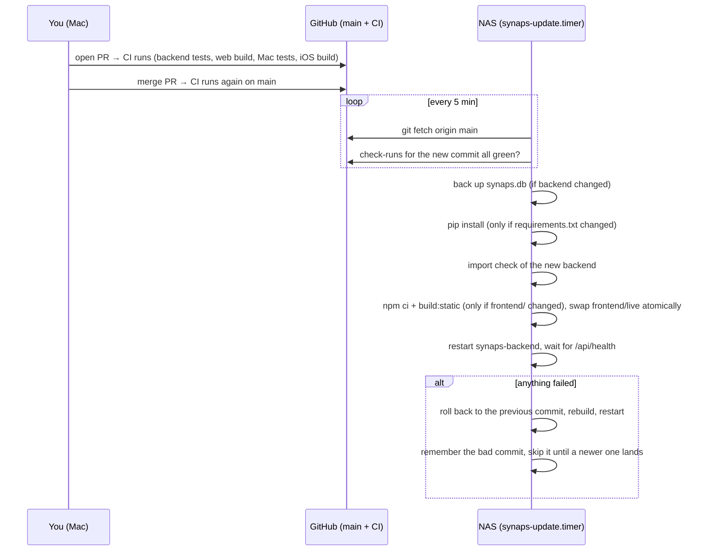

# 11 — Deployment and Services

Synaps deploys itself: merge to `main`, CI tests it on GitHub, and the NAS pulls the commit within
about 5 minutes once every check has passed. One script, [`./synaps`](../synaps), does everything —
install, development, update, rollback and diagnostics.

---

## What runs on the NAS

| Unit | What it does |
|------|--------------|
| `synaps-backend.service` | FastAPI on port 8000 (one worker). Serves the API **and** the static web app from `frontend/live/`. Waits for the storage disk to be mounted (`RequiresMountsFor`). Restarts on crash. |
| `synaps-update.timer` → `synaps-update.service` | Every 5 minutes runs `./synaps update` as your user, at low CPU/IO priority. |
| `avahi-daemon` + `/etc/avahi/services/synaps.service` | Bonjour/mDNS: `<hostname>.local` and `_synaps._tcp` so the Mac and iPhone apps find the NAS. |
| `/etc/sudoers.d/synaps` | Lets the update job run exactly `systemctl restart synaps-backend.service` (and `synaps-frontend.service`) without a password — nothing else. |
| `synaps-frontend.service` | Only with `SYNAPS_WEB_MODE=node` (Next.js server on :3000). The default static mode runs no Node.js process at all, which matters on a 2 GB machine. |

Templates live in [`deploy/`](../deploy); `./synaps install` fills in your user, repo path and storage path.

---

## One-time setup

```bash
git clone https://github.com/harshoutoftokens/synaps.git ~/nas_dashboard
cd ~/nas_dashboard
./synaps install --storage /storage        # --web node to keep the Next.js server instead
```

`install` is safe to re-run. It:

1. installs `git curl python3-venv ffmpeg libheif1 avahi-daemon` (apt), checks Python ≥ 3.10;
2. creates `backend/.env` from `.env.example` if missing and sets `SYNAPS_STORAGE_PATH`;
3. builds the backend venv and the static web app;
4. installs the systemd units (backing up any existing ones as `*.bak-<date>`), the sudoers rule and the
   Bonjour service; disables the old `synaps-frontend` Node service in static mode;
5. opens port 8000 to private networks only if `ufw` is active;
6. starts everything and waits for `/api/health`.

Then set an API token (recommended) in `backend/.env` — `SYNAPS_API_TOKEN=<long random string>` —
run `./synaps restart`, and enter the same token in the web app, the Mac app (Settings) and the iPhone app (Settings).

---

## How an update works



Guarantees:

- **CI gate** — a commit is deployed only when every GitHub check on it finished as success/skipped.
  Pending → try again next tick. Failed or unreadable → not deployed. `SYNAPS_REQUIRE_CI=0` turns the gate off.
- **Fast-forward only** — if `main` was rewritten, the NAS stops and asks for `./synaps update --force`.
- **Never clobbers local edits** — a dirty checkout on the NAS blocks updates with a clear message.
- **One at a time** — a lock file prevents two updates (timer + manual) from overlapping.
- **Database backups** — before any backend change, an online SQLite backup goes to
  `backend/.deploy/backups/` (last 5 kept). The DB is never restored automatically (that would lose new uploads).

---

## Commands

| Where | Command | Does |
|-------|---------|------|
| NAS | `./synaps status` | units, current revision, last good deploy, health |
| NAS | `./synaps logs [n]` | last *n* journal lines of backend + updater |
| NAS | `./synaps update [--force]` | deploy now (`--force` skips the CI gate and the bad-commit memory) |
| NAS | `./synaps rollback [rev]` | go back one commit (or to `rev`) and stay there until a newer commit lands |
| NAS | `./synaps doctor` | checks Python, venv, imports, ffmpeg, HEIC decoding on this CPU, storage mount, free space, health, timer, mDNS, sudo rule, token |
| NAS | `./synaps restart` / `stop` / `start` | service control |
| Mac | `./synaps dev` | backend :8000 + `next dev` :3000 |
| Mac | `./synaps test` | everything CI runs that works locally |
| Mac | `./synaps deploy` | SSH to the NAS and run `./synaps update` now (set `SYNAPS_NAS=user@host`, optionally `SYNAPS_NAS_DIR`) |
| Mac | `./synaps mac` / `./synaps ios` | build + open the Mac app / open the iPhone project in Xcode |

Settings for the script itself go in environment variables or a git-ignored `.synaps.local` file
(`SYNAPS_BRANCH`, `SYNAPS_REQUIRE_CI`, `SYNAPS_WEB_MODE`, `SYNAPS_NAS`, `SYNAPS_NAS_DIR`).
Backend settings stay in `backend/.env` (see [`.env.example`](../backend/.env.example)).

---

## Ports

| Service | Port | Change with |
|---------|------|-------------|
| Backend + web app | 8000 | `SYNAPS_PORT` in `backend/.env`, then `./synaps install` again (updates Bonjour + firewall) |
| Next.js (node mode / `./synaps dev`) | 3000 | `frontend/package.json` scripts |

---

## Diagnosing Startup Problems

### Problem: Backend Won't Start

```bash
# Test manually:
cd backend && source venv/bin/activate
python main.py

# Look for errors like:
# - ModuleNotFoundError: No module named 'fastapi'
#   → pip install -r requirements.txt
# - sqlite3.OperationalError: unable to open database file
#   → Check write permissions on backend/ directory
# - Address already in use
#   → Something is already running on port 8000: lsof -i :8000
```

### Problem: Frontend Won't Start

```bash
# Test manually:
cd frontend
npm run build    # Must succeed first
npm run start

# Common errors:
# - Module not found
#   → npm install
# - EACCES: permission denied
#   → chown -R $(whoami) frontend/
# - Port 3000 already in use
#   → lsof -i :3000 | grep LISTEN
```

### Problem: API Calls Failing (404 or network error)

```bash
# Check backend is running:
curl http://localhost:8000/api/health

# Check proxy config:
# frontend/next.config.js should point to http://localhost:8000

# Check from browser:
# Open Network tab → look at the failing /api/... request
# Check the response status and body
```
