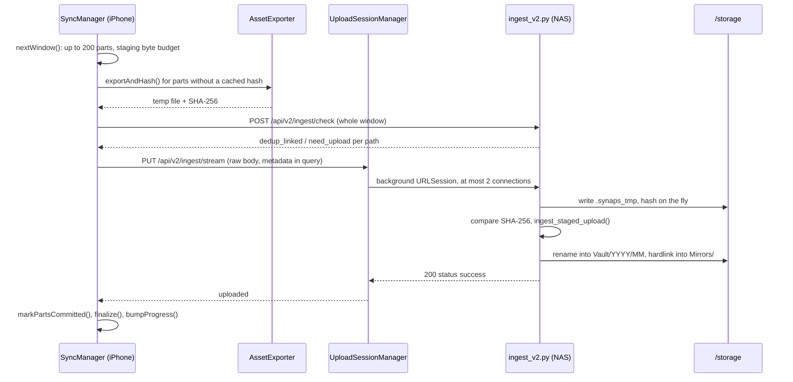
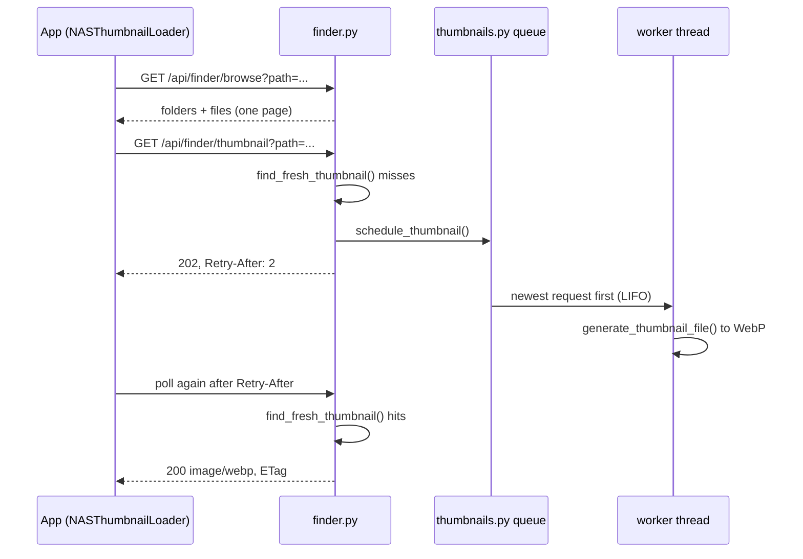

# Code Walkthroughs

Five real paths through the code, traced function by function: an iPhone photo being backed up, a Mac file getting its green tick, NAS thumbnails appearing in an app, an iPhone photo ticked because the Mac already uploaded it, and a merged PR reaching the NAS. Each step names the file and function, so you can open them side by side. The component docs explain the pieces; this page shows how they hand off to each other.

Background for these traces: [03-storage-and-ingest.md](03-storage-and-ingest.md) (Vault, Mirrors, staging), [06-thumbnails-and-media.md](06-thumbnails-and-media.md), [08-mac-app.md](08-mac-app.md), [09-iphone-app.md](09-iphone-app.md) and [11-deployment.md](11-deployment.md).

Two terms come up throughout. A **physical object** is one unique file content on the NAS, identified by its SHA-256 and stored once at `Vault/YYYY/MM/<sha256[:16]>_<name>`. A **logical item** is one place that content came from (a device and a path on it). Many logical items can point at one physical object; that is how deduplication works.

## (a) An iPhone photo is backed up

The iPhone app never sends a file the NAS already has. It hashes locally first, asks the NAS in bulk, and uploads only what is missing.

**1. Something starts a run.** `SyncManager.syncItems` (the user tapped Commit), `appDidBecomeActive` or `libraryDidChange` (both call `requestAutomaticSync`), or a background task via `runBackgroundSync`. Automatic runs first check `automaticSyncBlocker` (auto-upload on, unmetered network, charging if required) and the NAS health, then queue uncommitted or failed items not in failure backoff. `enqueue` appends to the queue and `start` launches `runLoop`, setting `isSyncing = true`. File: [`SyncManager.swift`](../clients/ios/SynapsiOS/Sources/Services/SyncManager.swift).

**2. `runLoop` checks the NAS once** with `NASClient.checkHealth` (GET `/api/health`, which also stores the NAS's host name for display). If unreachable, the run ends with "Cannot reach the NAS at ...".

**3. `nextWindow` cuts a window.** It asks `PhotoLibraryService.ensureParts` for the resources of up to 100 queued assets. A photo can have several **parts**: the original photo, the paired video of a Live Photo, full-size edited versions, and so on (`AssetPartKind` in [`AssetPart.swift`](../clients/ios/SynapsiOS/Sources/Models/AssetPart.swift)). `PartPolicy.expectedParts` decides which ones the settings require. A window holds at most 200 pending parts (`maxPartsPerWindow`, also the check batch size) and at most `stagingBudget()` bytes: 1 GB or a quarter of the phone's free space, whichever is smaller (minimum 64 MB).

**4. Phase A: export and hash.** In `process(window:)`, every part with no cached SHA-256 goes through `AssetExporter.exportAndHash` ([`AssetExporter.swift`](../clients/ios/SynapsiOS/Sources/Services/AssetExporter.swift)). It refuses if free space is below twice the file size plus 200 MB, streams the resource to a temp file with `PHAssetResourceManager.writeData` (downloading from iCloud if needed, with progress), then hashes the file with `HashEngine.computeSHA256`. The hash is saved by `LocalCacheStore.setPartHash`, keyed by asset, kind, size and modification time, so the next run skips this phase. The temp file is kept for phase C.

**5. Phase B: one pre-check for the window.** `NASClient.batchPreCheck` POSTs `/api/v2/ingest/check` with the source (`platform: "ios"`) and, per part, path, name, size, SHA-256 and favorite flag. On the NAS, `check_ingest_batch` in [`ingest_v2.py`](../backend/routers/ingest_v2.py) takes `_INGEST_LOCK` and runs `_check_batch`:

- registers or updates the source (`_upsert_source`);
- loads all matching `PhysicalObject`s with a few `IN` queries;
- for a hash it doesn't have: `need_upload`;
- for a hash it has: creates (or re-points) the `LogicalItem` for this device path, bumps the reference count, and answers `dedup_linked`. After the commit, it creates the hardlink mirror for each linked file.

Back on the phone, `dedup_linked` parts are marked committed at once (`LocalCacheStore.markPartsCommitted`) and their temp files deleted. Nothing is uploaded for them. A 401 stops the whole run with `stopRun`.

**6. Phase C: upload the rest.** For each `need_upload` part, `SyncManager.upload` calls `uploadWithFallback`. It builds the request with `NASClient.streamUploadRequest` (PUT `/api/v2/ingest/stream`, body = the file, metadata in the query string) and hands it to `UploadSessionManager.upload` ([`UploadSessionManager.swift`](../clients/ios/SynapsiOS/Sources/Services/UploadSessionManager.swift)). That is a background `URLSession` (`com.synaps.ios.background-upload`, 2 connections per host), so uploads continue while the app is suspended. At most 6 uploads are handed to the session at once.

Responses are mapped to outcomes: 401 stops the run; 404/405/411 switch to the multipart `POST /api/v2/ingest/upload` for the rest of the session; 507 stops the run ("The NAS disk is full"); a 400 mentioning "mismatch" re-exports, re-hashes and retries once; transient errors retry up to 3 attempts with exponential backoff.

**7. The NAS receives the stream.** `upload_stream_v2` requires `Content-Length` (411 otherwise) and calls `ensure_free_space`, which answers 507 if the upload would leave less than `SYNAPS_MIN_FREE_BYTES`. It creates a `StagedUpload` in `/storage/.synaps_tmp` (same disk as the Vault, so the final placement is a rename). It reads the body in batches and writes plus hashes each batch in a worker thread while the next one arrives. Then it compares the computed SHA-256 with `client_sha256` (400 "SHA-256 mismatch" if different).

**8. `ingest_staged_upload` commits it.** If the hash is new, it reads the capture date first (EXIF, video metadata or file name, via `_resolve_capture_date`), outside the lock because it is slow. Under `_INGEST_LOCK`, `_commit_ingest`:

- builds the canonical path with `get_canonical_relative_path` (`Vault/YYYY/MM/<sha256[:16]>_<name>`) and moves the staged file there with `place_in_vault` ([`storage_engine.py`](../backend/storage_engine.py));
- inserts `PhysicalObject` and `MediaMetadata` (media type, screenshot flags, favorite);
- creates the `FilesystemNode` path and the `LogicalItem` for this device;
- calls `upsert_v1_media_file`, which inserts the `media_files` row the web timeline reads, with `source` mapped to `iphone` by `v1_source_key`.

An `IntegrityError` (another request inserted the same hash at the same moment) rolls back and retries. After the commit, `_make_mirror` calls `create_hardlink_mirror`, which hardlinks the Vault file into `Mirrors/<Owner>/Iphone/<original path>`. Finally `enqueue_thumbnail` queues the thumbnail, so it is usually ready before anyone looks. The response carries `physical_object_id`, `logical_item_id`, `canonical_path`, `mirror_path` and `sha256`.

**9. The app marks it committed.** `upload` calls `LocalCacheStore.markPartsCommitted` and deletes the temp file. `handle` → `partFinished` → `finalize` runs once all of an asset's expected parts are done: it records the attempt, writes "Uploaded N files" (or "Already on NAS") to the activity log, clears the syncing flag in `PhotoLibraryService`, and `bumpProgress` increments `syncedCount`. If the app was suspended and relaunched for background-session events, `SyncResultRecorder.applyDetachedUploadResult` does the same bookkeeping without a running `SyncManager` loop.

**10. The Live Activity follows along.** `SyncLiveActivityController.start` ([`SyncLiveActivity.swift`](../clients/ios/SynapsiOS/Sources/Services/SyncLiveActivity.swift)), called at launch from `AppDelegate`, subscribes to `SyncManager`'s published `isSyncing`, `syncedCount`, `totalToSyncCount`, `currentItemName` and `statusMessage`, throttled to once a second. In `render`, the first syncing update starts an activity (only in the foreground, only if enabled in Settings and allowed by iOS); later ones update it with a 5-minute stale date. When `isSyncing` turns false, the activity ends with "N items handled." (kept 5 min) or the stop reason (kept 30 min). The destination name comes from the NAS's `/api/health` `name` field.

## (b) A file in a Mac folder gets a green tick

On the Mac, status starts from a local cache, is confirmed by hashing, and is checked against the NAS before anything is uploaded.

**1. Scan.** Opening a folder calls `AppViewModel.loadFolder` → `LocalFileScanner.scanDirectory` ([`LocalFileScanner.swift`](../clients/mac/SynapsMac/Sources/Services/LocalFileScanner.swift)). It lists the folder shallowly (like Finder) under the security-scoped bookmark. For each file it looks up `LocalCacheStore.getRecord(for: path)`. If size matches and mtime is within 1 second, it reuses the cached SHA-256 and shows **committed** if the record has `lastSyncedAt` or a committed status. The list returns to the UI immediately, sorted like Finder.

**2. Hash in the background.** Files without a cached hash go to `scheduleHashing` → `hashItems`, which uses `HashEngine.computeSHA256s` with bounded parallelism. `persistHash` saves the new hash and keeps a committed status only if the content is the same as before (same hash, or same size and mtime if no hash was stored). An edited file goes back to uncommitted. Results reach `AppViewModel` in batches through `onItemsHashed`.

**3. Check with the NAS.** In `setupScannerObserver`, freshly hashed items are passed to `NASReconciliationEngine.reconcileHashedItems` ([`NASReconciliationEngine.swift`](../clients/mac/SynapsMac/Sources/Services/NASReconciliationEngine.swift)). Its `performDedupCheck` POSTs `/api/v2/ingest/check` in batches of up to 200 (`NASClient.maxCheckBatchSize`). `dedup_linked` items turn committed (and are linked on the NAS as in (a) step 5); `need_upload` items are reset to uncommitted. Separately, `loadFolder` and `reconcileCurrentFolder` call `reconcileDirectory`, which first compares file names and sizes against the NAS mirror folder from `/api/finder/browse` (a cheap "metadata match") and only sends the rest to the hash check.

**4. Commit.** "Sync" calls `syncSelection` → `startSyncProcess`, which runs `SyncEngine.run` ([`SyncEngine.swift`](../clients/mac/SynapsMac/Sources/Services/SyncEngine.swift)) off the main thread in chunks of 200: hash anything still unhashed, `linkKnownContent` (another `/check`; matches are recorded with `recordItemsSynced` and reported as `alreadyOnNAS`), then upload the rest two at a time. Identical content within a chunk is uploaded once; the copies are linked by a second check afterwards.

**5. Upload.** `uploadOne` calls `NASClient.uploadFile`, which prefers PUT `/api/v2/ingest/stream` and falls back to multipart on 404/405. The server side is exactly (a) steps 7 and 8, with source `mac` and a mirror under `Mirrors/<Owner>/Mac/` (the `/Users/<name>/` prefix is stripped by `normalize_source_path_for_mirror`). On success the engine calls `LocalCacheStore.recordItemSynced` and logs "Uploaded ... to NAS Vault". 401 and 507 stop the batch; a 400 triggers one re-hash and retry if the file changed.

**6. The tick.** `SyncEngine` delivers results every ~300 ms. `AppViewModel.handleSyncEvent` → `applySyncResults` sets `.committed` for `uploaded` and `alreadyOnNAS` outcomes. `FileBadgeView` draws the status icon, and `SyncStatus.committed` is green. Next time the folder is opened, step 1 finds the cache record and the tick appears without any network call.

## (c) Opening a NAS folder and its thumbnails appearing

Thumbnails are never generated inside a request. The server answers immediately, either with the image or with "queued, ask again".

**1. Browse.** The iPhone's `NASVaultViewModel` and the Mac's `AppViewModel.loadNASFolder` call `NASClient.browseDirectory`, i.e. GET `/api/finder/browse?path=&page=&per_page=`. `browse_directory` in [`finder.py`](../backend/routers/finder.py) resolves the path inside the storage root, lists it (the listing is reused for about a minute while the directory's mtime is unchanged), returns all folders and one page of files, and only `stat()`s the files on that page. Files with a `media_files` row carry their `media_id`.

**2. Ask for a thumbnail.** Each visible cell asks its loader: `NASThumbnailLoader.image(for:)` on iPhone ([`NASThumbnailLoader.swift`](../clients/ios/SynapsiOS/Sources/Services/NASThumbnailLoader.swift)), `NASThumbnailLoader.loadThumbnail` on Mac. Both check memory, then a disk cache, then call GET `/api/finder/thumbnail?path=...`. The iPhone sends `If-None-Match` with a cached ETag and limits itself to 3 connections because the NAS has one thumbnail worker.

**3. Fast path.** `get_file_thumbnail` computes the cache path with `get_thumbnail_path` and calls `find_fresh_thumbnail`, which accepts a cached WebP only if it is newer than the source file. A hit returns the file with ETag, Last-Modified and Cache-Control (304 on revalidation).

**4. Miss.** In order: if the file is already queued (`is_thumbnail_pending`), answer 202 at once without a database lookup. Unsupported extension: 404. A thumbnail recorded in `media_files.thumbnail_path` under another key: serve it. A `Mirrors/` hardlink or a symlink: `_alias_source` finds the canonical Vault file and reuses or generates its thumbnail, so a mirror never causes a second decode. A file that failed recently (`thumbnail_failed`): 404. Otherwise `schedule_thumbnail` and `_queued_response()`: **202 Accepted** with `Retry-After: 2` and `Cache-Control: no-store`.

**5. The queue.** `schedule_thumbnail` starts the worker threads on first use and puts the job on `_ThumbnailQueue` ([`thumbnails.py`](../backend/thumbnails.py)), a bounded LIFO with de-duplication: the newest request is served first, and when 2000 jobs are waiting the oldest is dropped. `_thumbnail_worker` (one thread by default, at lowered priority) pops a job, `_process` re-checks freshness and calls `generate_thumbnail_file` (Pillow for images, pillow-heif for HEIC, ffmpeg for video, written atomically as WebP). Failures go to `_record_failure`. Every 25 results or 5 seconds, `_flush_db_updates` sets `has_thumbnail` on the matching `media_files` rows.

**6. Poll until 200.** On 202 the iPhone loader sleeps for `Retry-After` (clamped to 0.5 to 10 s) and retries, up to 5 times. The Mac backs off from 2 s by a factor of 1.5 up to 10 s, up to 12 times. Once the worker has written the file, step 3 hits, the app caches the image on disk (the iPhone keeps it for 7 days before revalidating) and shows it. On 404 the iPhone falls back to a stale cached copy if it has one; the Mac remembers the path as unavailable for 30 minutes.

## (d) A photo that reached the NAS via the Mac gets ticked on the iPhone

Say you AirDropped photos to the Mac and the Mac app uploaded them. The iPhone has the same photos but has never hashed them, so it would show them as uncommitted and eventually export, hash and pre-check every one. `/api/v2/ingest/match` avoids that by matching on file name and size, which the phone knows without reading any photo data.

**1. Trigger.** `SyncManager.appDidBecomeActive` checks the NAS and, if it is reachable, calls `NASReconciler.reconcileIfDue` before `requestAutomaticSync`. It runs at most every 6 hours; Settings has a button that calls `reconcile()` directly. File: [`NASReconciler.swift`](../clients/ios/SynapsiOS/Sources/Services/NASReconciler.swift).

**2. Collect candidates.** `reconcile()` takes every library item that is not committed, loads its parts in chunks of 400 via `PhotoLibraryService.ensureParts`, and builds a map from `(filename, size)` to the parts that have them. Only expected, uncommitted parts with a known size count.

**3. Ask the NAS.** `NASClient.matchExisting` POSTs `/api/v2/ingest/match` in batches of up to 2000 (`maxMatchBatchSize`). On the NAS, `match_existing_files` rejects more than 2000 files with 413 and calls `_match_files`, which is read-only. It joins `logical_items.original_filename` to `physical_objects` for size and SHA-256, from any source. It also looks in `media_files` (files indexed only by the scanner) where `content_hash` is set. It answers `{"matches": [{"filename", "size", "sha256"}, ...]}`.

**4. Mark them.** `LocalCacheStore.markPartsFoundOnNAS` records each matched part as committed with the NAS's hash, and `PhotoLibraryService.refreshItems` updates the grid. An asset is committed only when every expected part matched; a Live Photo whose video never reached the NAS stays partly uncommitted, and the result message says how many. A summary goes to the activity log as `dedupLinked`. A 404 means the NAS predates the endpoint.

**5. What it does not do.** Match creates no `LogicalItem` on the NAS and no `Mirrors/Harsh/Iphone/` hardlink; the phone's provenance is not recorded. It is a name-and-size match, not a hash check: the phone trusts the NAS's SHA-256 for the matched file without hashing its own copy. The Mac app's iPhone view uses the same endpoint (`iPhoneManager.markItemsAlreadyOnNAS`) for a phone plugged into the Mac.

## (e) A merged PR reaches the NAS

**1. CI on the PR.** [`.github/workflows/ci.yml`](../.github/workflows/ci.yml) runs five jobs: backend tests on Python 3.10 and 3.12, web lint and static build, deploy tooling checks (shellcheck and `systemd-analyze verify`), Mac `swift test`, and the iPhone simulator build. After the merge it runs again on `main`. Details are in [11-deployment.md](11-deployment.md#what-ci-checks).

**2. The timer fires.** `synaps-update.timer` starts `synaps-update.service` 5 minutes after the previous run finished (plus up to 30 s). The service runs `./synaps update` as your user at low CPU and I/O priority.

**3. Preconditions in `cmd_update`** ([`synaps`](../synaps)): lock, clean checkout, `git fetch`, new commit not in `.deploy/failed`, fast-forward only.

**4. The CI gate.** `ci_state` queries `https://api.github.com/repos/<owner>/<repo>/commits/<sha>/check-runs`. Until every run is `completed` the answer is `pending` and the job exits quietly; the next tick asks again. Any failed run means the commit is never deployed (the job logs which checks failed and waits for a newer commit).

**5. Apply.** If `backend/` changed, `backup_db` snapshots SQLite. `apply_revision` checks out the commit, runs pip only if `backend/requirements.txt` changed, runs the `import main` check, and runs `web_build` only if `frontend/` changed. The static web build lands in `frontend/live.new/` and is swapped in by two renames.

**6. Restart and health.** `restart_services` restarts `synaps-backend.service` through the passwordless sudoers rule. On startup, `lifespan` in [`main.py`](../backend/main.py) calls `init_db`, which adds any missing nullable columns, then starts the housekeeping thread. `wait_healthy` polls `/api/health` for up to 60 s. Success writes `.deploy/last-good`.

**7. The failure path.** If the import check, the web build, or the health check fails, `cmd_update` writes the commit to `.deploy/failed`, runs `apply_revision` back to the previous commit (re-running pip or the web build if they differ), restarts the backend if it had been restarted onto the bad code, and exits with "deploy of <sha> failed and was rolled back". The database backup from step 5 is not restored automatically. Each later tick sees the same `origin/main`, finds it in `.deploy/failed`, and does nothing until a newer commit is merged; that one goes through the whole loop again.
